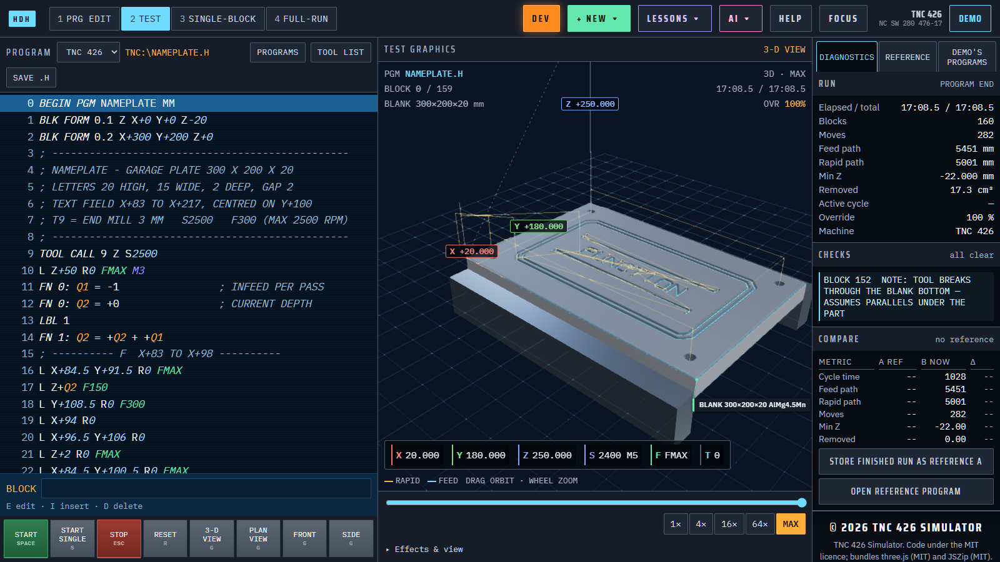
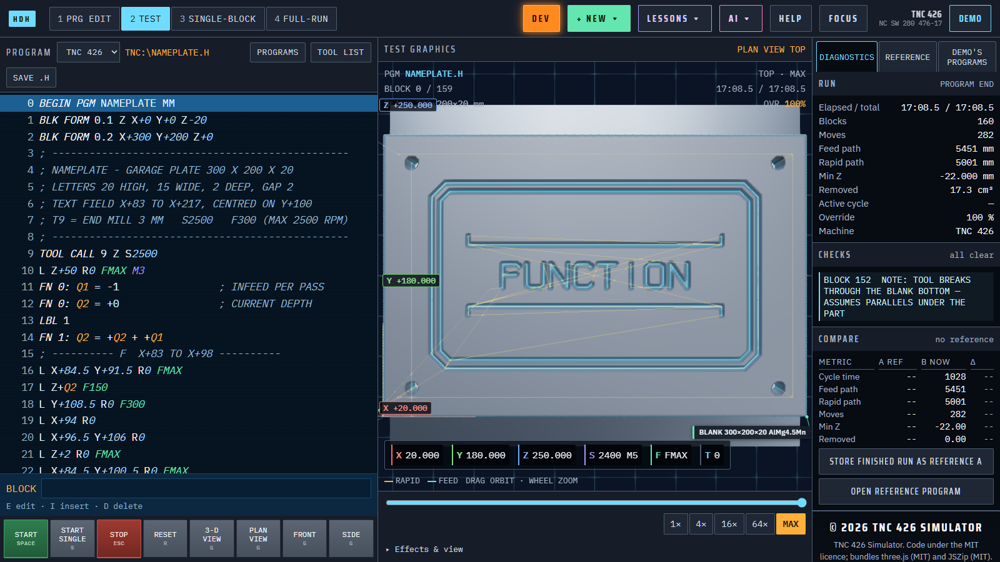
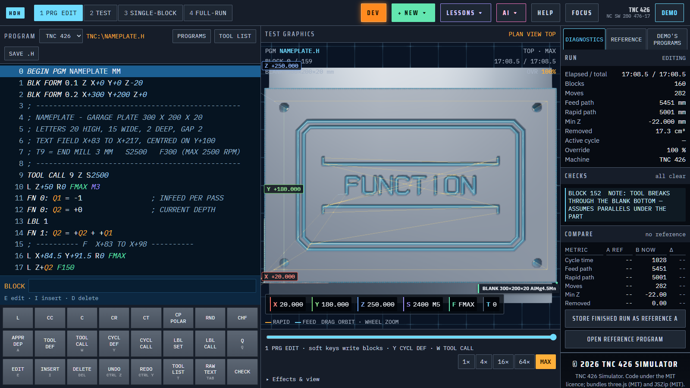
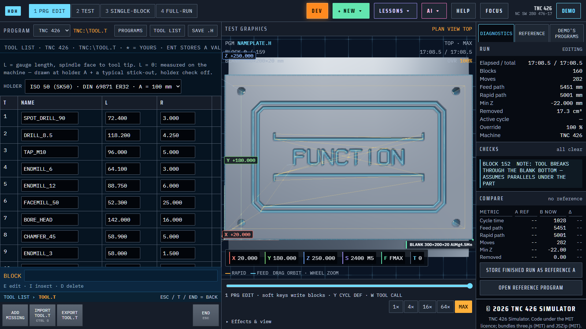

# TNC 426 / 430 Simulator

A browser simulator for HEIDENHAIN Klartext programs on the TNC 426 and 430 controls, for CNC programmers and students who want to run a program and see the errors the control would raise.

[Open the simulator](https://gigacook.github.io/tnc-sim/)



## Why

- Runs a program in 3D and shows the cut part, cycle time, path lengths and removed volume as the tool removes material from the blank.
- Simulates lines, arcs, helixes, radius compensation, Q parameters, subprograms, a tool table, both machines (426 with X Y Z; 430 with a swivel head) and a vice the tool can crash into.
- Covers the common fixed cycles, the SL contour cycles and the thread-milling and probing cycles; unsupported ones report `CYCLE n NOT IMPLEMENTED IN SIMULATOR` instead of failing silently.
- PRG EDIT builds each block through soft keys one question at a time, and stores a finished run as a reference so you can compare cycle time, paths and lowest Z after a change.
- One offline HTML file with no install; an optional AI button writes programs from a description and checks them against the simulator.

## Quick start

```sh
npm ci
python3 build.py
node tests/manual.js
node tests/parity.js
cd desktop && npx tauri dev
```

Or skip all of that: open `index.html` in a browser, or use the live link above.

## Screenshots


Plan view (key `G`) shows the engraved text and the tool path from above.


PRG EDIT (key `1`) builds each block with soft keys instead of raw Klartext.


The tool table (key `T`) holds each tool's length and radius, as `TOOL.T` does on the control.

## Manual

[docs/MANUAL.md](docs/MANUAL.md) covers using the simulator, all keys, AI programs, what is and is not simulated, the desktop app, troubleshooting and the developer setup.

## Status

Working on Windows, macOS and Linux (browser, desktop app and optional server); an educational simulator, not affiliated with HEIDENHAIN and not for verifying programs for real machines. MIT licence.

made by gigacook — per libertatem claritas vincit
