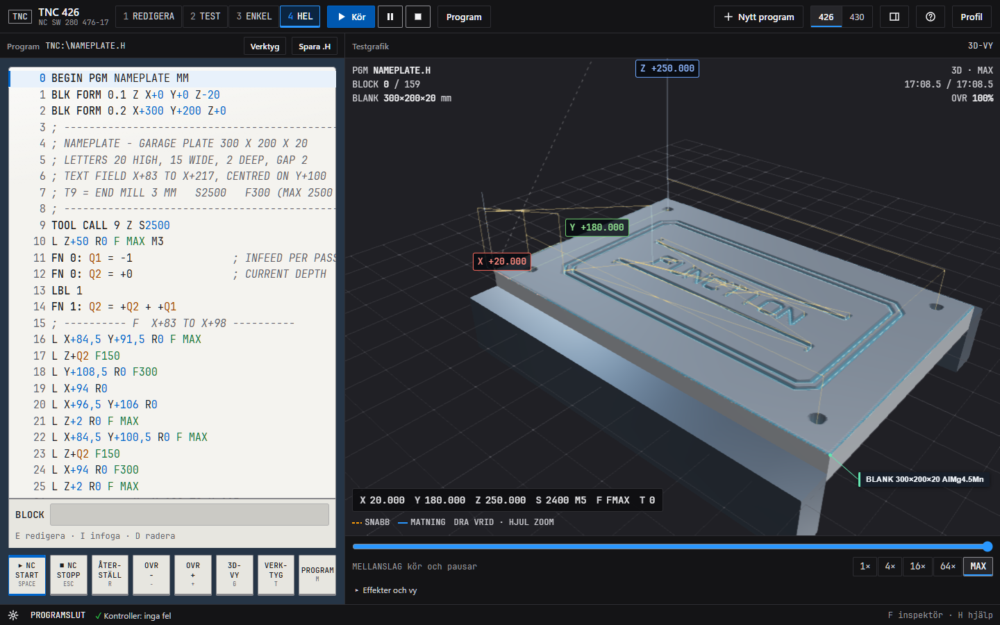
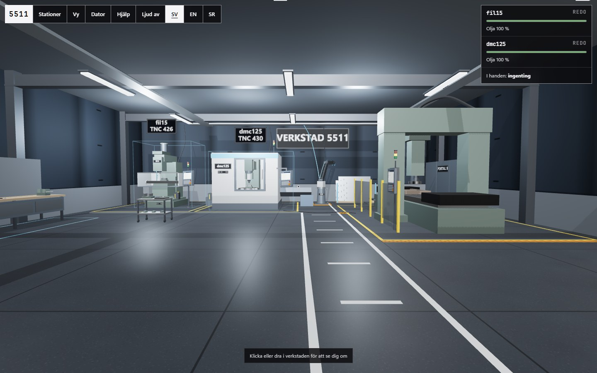
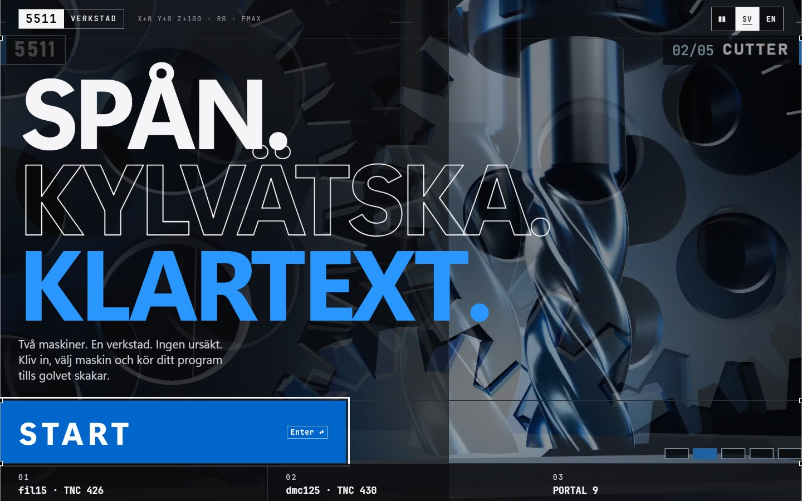
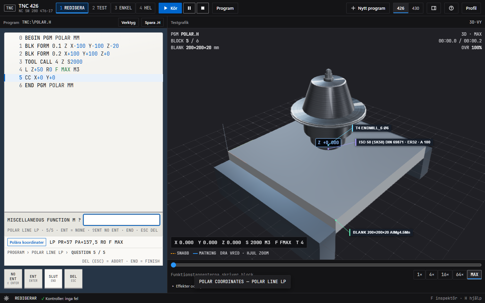
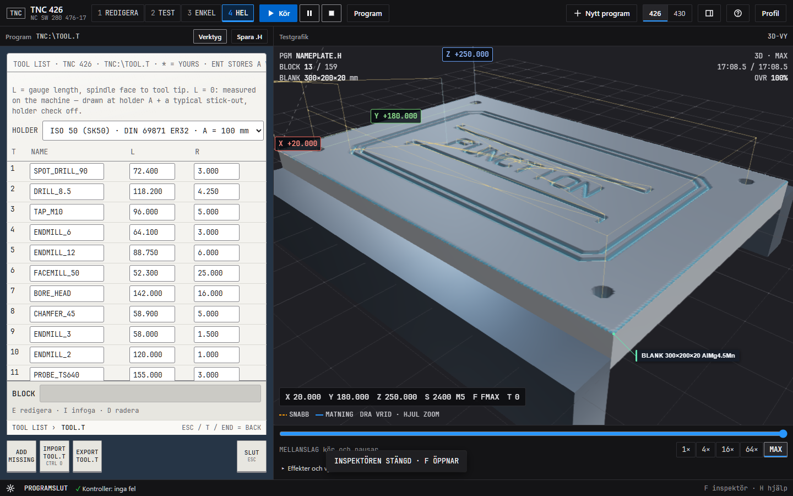
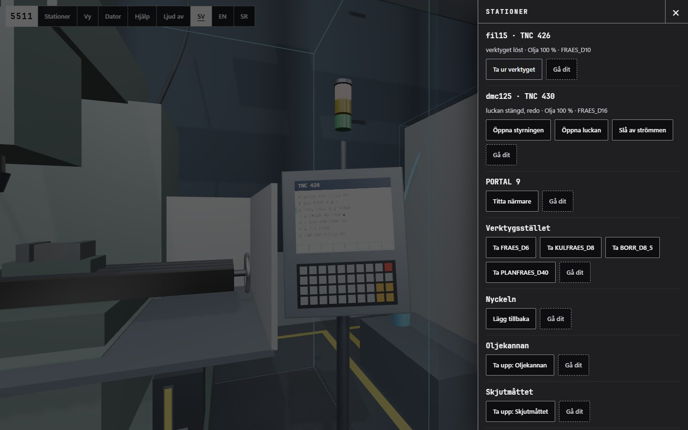

# TNC 426 / 430 Simulator

**Svenska** · [English](#english) · Srpski: priručnik je u [docs/MANUAL.sr.md](docs/MANUAL.sr.md)

En simulator i webbläsaren för HEIDENHAIN Klartext-program på styrsystemen TNC 426 och TNC 430. Du skriver eller laddar ett program, kör det och ser verktyget ta bort material ur ämnet, tillsammans med de fel simulatorn hittar. Den är gjord för CNC-programmerare och elever som vill öva utan maskin.



## Två utgåvor, samma simulator

| Utgåva | Vad du får |
|---|---|
| **Business** | Maskinvyn direkt: program till vänster, 3D-grafik till höger, inga omvägar. Ingen startsida, inget konto och ingen server behövs. |
| **Play** | En startsida, sedan en verkstad du går runt i själv. Där står två maskiner, en med TNC 426 och en med TNC 430. När du öppnar styrningen på en av dem får du samma simulator som i Business. Runt omkring finns underhåll (verktygsbyte, ström, olja), två figurer som tittar förbi och några påskägg. |

Båda utgåvorna kör samma program på samma sätt. Play lägger bara till verkstaden runt simulatorn.





## Kom igång

Utan installation: öppna filen `index.html` i en webbläsare. Den fungerar utan internet och utan server.

Med utgåvorna (kräver Node.js):

```sh
npm ci
npm --prefix web ci
npm run dev:business
```

Kommandot skriver ut en adress, normalt `http://127.0.0.1:5426/`. Öppna den i webbläsaren. Byt sista raden mot `npm run dev:play` för Play.

## Mer att se



Blocket `LP PR+57 PA+157,5 R0 F MAX` byggs med en fråga i taget.



Verktygstabellen håller längd och radie för varje verktyg, som `TOOL.T` på styrsystemet.



I Play byter du verktyg steg för steg, i 3D eller i stationslistan.

## Handbok

- [docs/MANUAL.md](docs/MANUAL.md): handboken på svenska.
- [docs/MANUAL.en.md](docs/MANUAL.en.md): samma handbok på engelska.
- [docs/MANUAL.sr.md](docs/MANUAL.sr.md): samma handbok på serbiska (latinska bokstäver).

Gränssnittet finns på svenska, engelska och serbiska; svenska är förvalt. Handboken tar upp installation, val av utgåva, styrsystemet och redigering, AI-nyckeln, verktyg, allt du gör i Play, utseende, inställningar, kortkommandon, vad som fungerar utan server, felsökning och vad som simuleras och inte.

## Status

En simulator för utbildning. Den är inte knuten till HEIDENHAIN och ska inte användas för att kontrollera program till riktiga maskiner. Fungerar i webbläsare på Windows, macOS och Linux; skrivbordsappen och servern är valfria. MIT-licens, se [LICENSE](LICENSE).

---

<a id="english"></a>

## English

A browser simulator for HEIDENHAIN Klartext programs on the TNC 426 and TNC 430 controls. You write or load a program, run it and watch the tool remove material from the blank, together with the errors the simulator finds. It is made for CNC programmers and students who want to practise without a machine.

### Two editions, one simulator

| Edition | What you get |
|---|---|
| **Business** | The machine workspace at once: program on the left, 3D graphics on the right, nothing in between. No landing page, no account and no server needed. |
| **Play** | A landing page, then a workshop you walk around in yourself. Two machines stand there, one with a TNC 426 and one with a TNC 430. Opening the control on either gives you the same simulator as Business. Around it there is maintenance (tool change, power, oil), two characters who drop by, and a few Easter eggs. |

Both editions run the same programs the same way. Play only adds the workshop around the simulator. The screenshots above show the Swedish interface; the language is changed in the settings of both editions.

### Get started

No install: open the file `index.html` in a browser. It works without internet and without a server.

With the editions (needs Node.js):

```sh
npm ci
npm --prefix web ci
npm run dev:business
```

The command prints an address, normally `http://127.0.0.1:5426/`. Open it in the browser. Replace the last line with `npm run dev:play` for Play.

### Manual

- [docs/MANUAL.en.md](docs/MANUAL.en.md): the manual in English.
- [docs/MANUAL.md](docs/MANUAL.md): the same manual in Swedish.
- [docs/MANUAL.sr.md](docs/MANUAL.sr.md): the same manual in Serbian (Latin script).

The interface comes in Swedish, English and Serbian; Swedish is the default. The manual covers installation, choosing an edition, the controller and editing, the AI key, tools, everything you do in Play, appearance, settings, keyboard shortcuts, what works without a server, troubleshooting, and what is and is not simulated.

### Status

An educational simulator. It is not affiliated with HEIDENHAIN and is not for verifying programs for real machines. Works in a browser on Windows, macOS and Linux; the desktop app and the server are optional. MIT licence, see [LICENSE](LICENSE).

made by gigacook — per libertatem claritas vincit
