# TNC 426 / 430 Simulator: manual

[Svenska](MANUAL.md) · English · [Srpski](MANUAL.sr.md) · Short overview: [README](../README.md)

The screenshots show the Swedish interface, which is the default. The text names every control in English, as it appears when the language is set to English.

## What it is

Klartext is the conversational programming language of the TNC 426 and TNC 430 controls. In the simulator you write or load a Klartext program, run it and watch the tool remove material from the blank. The simulator shows the errors it finds on the block where they occur, so you can practise without a machine.

The simulator comes in two editions that share the same engine and the same program window:

- **Business** opens the machine workspace at once. It is for writing and running programs with nothing around them.
- **Play** starts with a landing page and continues in a workshop you walk around in. Two machines stand there, one with a TNC 426 and one with a TNC 430. Opening the control on a machine gives you the same simulator as Business. The workshop adds maintenance, two characters and a few Easter eggs.

The parts are:

- **The simulator file** `index.html` is the whole simulator in one file. It opens directly in a browser and needs neither internet nor a server.
- **The editions** Business and Play are web pages that show the simulator file in a frame and add their own surroundings.
- **The desktop app** is an edition in its own window, with a program library on your computer.
- **The server** is optional. It provides accounts, a program library with versions, tool tables and share links, and it holds the AI key.

The simulator is not affiliated with HEIDENHAIN. It is for education and is not for verifying programs for real machines.

## Contents

1. [Key terms](#key-terms)
2. [Installing](#installing)
3. [Choosing an edition](#choosing-an-edition)
4. [The controller and editing](#the-controller-and-editing)
5. [Programs: saving, loading and the library](#programs-saving-loading-and-the-library)
6. [AI programs and the AI key](#ai-programs-and-the-ai-key)
7. [Tools and the tool table](#tools-and-the-tool-table)
8. [Play: the workshop](#play-the-workshop)
9. [Appearance](#appearance)
10. [Settings](#settings)
11. [Keyboard shortcuts](#keyboard-shortcuts)
12. [Without a server and without a key](#without-a-server-and-without-a-key)
13. [Troubleshooting](#troubleshooting)
14. [What is and is not simulated](#what-is-and-is-not-simulated)
15. [Reference](#reference)

## Key terms

- **Block**: one line of a program, for example `L X+10 Y+20 R0 FMAX` (a straight move at rapid speed).
- **Cycle**: a built-in machining routine, for example drilling or pocket milling. It is set up with `CYCL DEF` and run with `CYCL CALL`.
- **Blank**: the raw stock, which the program states with `BLK FORM`.
- **Operating mode**: what the control is doing right now. There are four: PRG EDIT (write), TEST (check), SINGLE-BLOCK (run one block at a time) and FULL-RUN (run everything).
- **Soft keys**: the row of buttons under the program. Their content changes with the operating mode, as on the control.
- **Polar coordinates**: a point given by a distance (`PR`) and an angle (`PA`) from a pole, instead of by X and Y. The pole is set with a `CC` block.
- **Inspector**: the panel on the right with the figures from the run, the checks, reference material and your programs. It stays closed until you open it.
- **Profile**: your programs and your tool table, stored in this browser.
- **Edition**: Business or Play.
- **Station**: a thing in the Play workshop where you can do something, for example a machine, the tool rack or the computer.

## Installing

You do not need to install anything to use the simulator file: open `index.html` in a browser. The rest of this chapter is about the editions.

### What you need

| Requirement | What for | How to check |
|---|---|---|
| Node.js 22 or newer, with npm | the editions and the tooling around them | `node --version` |
| Python 3 | only to rebuild the simulator file | `python --version` (on macOS and Linux `python3 --version`) |
| Rust | only for the server and the desktop app | `cargo --version` |

### Steps

1. Fetch the dependencies in the project root. This installs the build and test tooling.

   ```sh
   npm ci
   ```

2. Fetch the dependencies of the web part, which lives in the folder `web`.

   ```sh
   npm --prefix web ci
   ```

3. Start an edition. The command starts a local web server that listens on your own computer only.

   ```sh
   npm run dev:business
   ```

4. Check that it works. The command prints an address:

   ```
   ➜  Local:   http://127.0.0.1:5426/
   ```

   Open the address. You should see the machine workspace with the program `NAMEPLATE.H` and a card asking for the language. If port 5426 is taken, the command picks the next free port and prints that one instead.

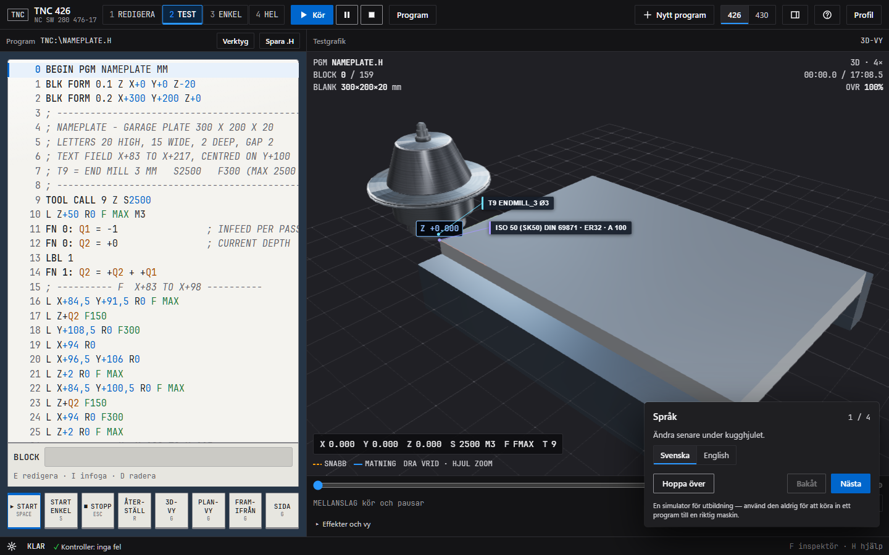

The simulator file `index.html` comes with the project, so you do not need to build it. If you have changed something in the folder `sim`, rebuild it with `python build.py` (on macOS and Linux `python3 build.py`).

## Choosing an edition

| You want to | Run | Result |
|---|---|---|
| try Business while working | `npm run dev:business` | a local address that opens the machine workspace at `/work` |
| try Play while working | `npm run dev:play` | a local address that opens the landing page at `/play` |
| build Business for a website | `npm run build:business` | the folder `dist/business` |
| build Play for a website | `npm run build:play` | the folder `dist/play` |
| only the simulator, nothing around it | open `index.html` | the simulator in one file |
| an app in its own window | see [The desktop app](#the-desktop-app) | an installer |

### The built folders

`dist/business` and `dist/play` hold everything an edition needs, including a copy of the simulator file. Put the folder on any web server that can hand out files; no server software of its own is needed. The folder has to sit at the root of the website and be opened over `http://` or `https://`. Double-clicking `dist/business/index.html` does not work, because the page fetches the simulator from the address `/sim/`.

The build copies the simulator file from the project root. If the file is missing, the build stops with the message `index.html missing in the repo root: run python build.py first`.

Business contains nothing of Play: the workshop, the landing film and the characters are in `dist/play` only. Play also contains the machine workspace at `/work`.

### The simulator file

`index.html` is the same simulator the editions show, with nothing around it. It has the same machine workspace, the same settings and the same programs. Use it when you want a single file to carry with you or when you have no internet.

### The desktop app

The desktop app is an edition in its own window. It starts its own server inside the app, on `127.0.0.1` and for your computer only, keeps its database in the system's app-data folder and signs you in automatically. Starting the app a second time brings the open window to the front.

| You want to | Run | Name of the app |
|---|---|---|
| build Business as an app | `npm run desktop:business` | TNC 426-430 Business |
| build Play as an app | `npm run desktop:play` | TNC 5511 Play |

The installers are not code-signed, so Windows and macOS warn the first time you open them.

The build needs Rust and also: on Windows, MSVC build tools and WebView2 (built into Windows 10 and 11); on macOS, Xcode command-line tools; on Linux, WebKitGTK 4.1 (`libwebkit2gtk-4.1-dev libsoup-3.0-dev libjavascriptcoregtk-4.1-dev librsvg2-dev libxdo-dev libssl-dev`).

### With the server

The server is only needed for what is listed under [Without a server and without a key](#without-a-server-and-without-a-key). It listens on `127.0.0.1:8426` unless you say otherwise. To make an edition you run with `npm run dev:business` or `npm run dev:play` use a server that is already running, put the server's address in the environment variable `TNC_SERVER` before you start:

```powershell
$env:TNC_SERVER = 'http://127.0.0.1:8426'
npm run dev:business
```

When the server answers, Business gets a small menu button (☰) at the edge with Programs, Tool tables, Account and, for administrators, Users. The first time you open the library on a new server, the page asks you to create the first account, which becomes the administrator.

## The controller and editing

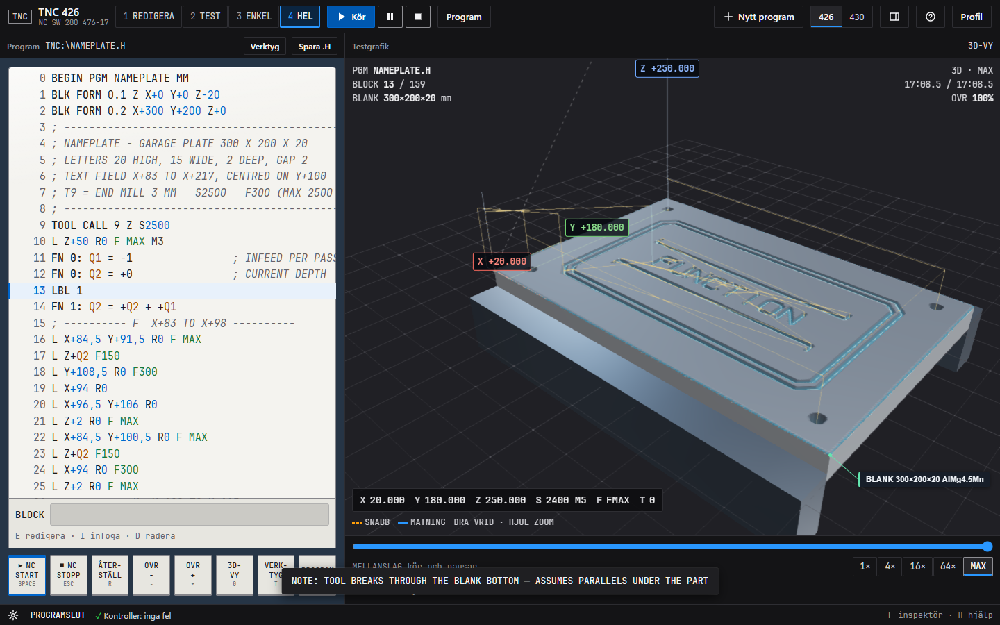

### The screen

- **The top bar** has the four operating modes, the buttons Run, Pause and Stop, the button New program, the 426 | 430 switch, and the buttons for the Inspector, Help and Profile.
- **The program** is on the left (on the right with the 430 Steel controller). The highlighted block is the one being run or edited. Above the listing are the buttons Tools and Save .H.
- **The block line** under the program is where you type a block or answer a question.
- **The soft keys** are at the bottom. Each key also shows its keyboard key in small print.
- **The test graphics** show the blank, the tool and the tool path. Drag to orbit and use the wheel to zoom. A dashed line is rapid traverse, a solid line is feed. The position (X, Y, Z, spindle speed, feed and tool) is in a box on top of the picture.
- **The bottom bar** has the gear for settings, the run state and the number of errors from the checks.

### Operating modes

| Key | Mode | What SPACE does |
|---|---|---|
| `1` | PRG EDIT | nothing; the soft keys write blocks |
| `2` | TEST | runs and holds |
| `3` | SINGLE-BLOCK | runs the next block |
| `4` | FULL-RUN | runs and holds |

If you press Run in PRG EDIT, the simulator answers `PROGRAM MODE — NC START WORKS IN 2 TEST, 3 SINGLE-BLOCK, 4 FULL-RUN`. Change the mode first.

### Running a program

1. Press `2` for TEST or `4` for FULL-RUN.
2. Press SPACE or Run. Press again to hold.
3. Choose the speed with `5` to `9`: 1×, 4×, 16×, 64× and MAX.
4. Drag the slider under the graphics, or press `←` and `→`, to move back and forth in the run. Going back rebuilds the blank.
5. Press `R` or Stop to start again from the beginning.

Errors are shown with their block. Open the Inspector with `F` to see run time, feed path, rapid path, lowest Z and removed volume, and the list of checks.

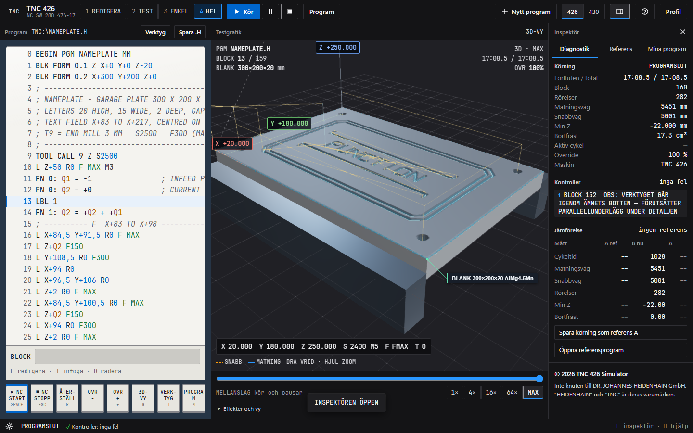

To compare two versions of a program: finish a run, choose **Store run as reference A** in the Inspector, change the program and run again. The Compare table shows the difference in cycle time, feed path, rapid path, number of moves, lowest Z and removed volume.

### Guided block entry

In PRG EDIT you build a block by answering one question at a time, the way the control works. You do not need to know how the block is spelled.

1. Press `1` for PRG EDIT.
2. Put the cursor on the block the new one should follow.
3. Press the soft key for the block type, for example `L` for a straight line. The line above the soft keys shows which question you are on.
4. Type the answer and press ENTER. ENTER without a value skips a question that can be skipped.
5. After the last question the block is stored and the simulator checks the program again.

| Key | What it does in a question |
|---|---|
| ENTER | takes the answer and goes to the next question (ENT) |
| SHIFT+ENTER | leaves the question without a value (NO ENT) |
| END | ends the dialog and stores the block with what you have answered |
| ESC | cancels the dialog without storing (DEL) |
| DELETE | clears what you typed (CE) |
| `X` `Y` `Z` | selects the axis in the coordinate question; on the TNC 430 also `B` and `A` |
| `I` | makes the value incremental |
| `P` | switches to polar coordinates |
| `Q` | answers with a Q parameter |
| `+` `-` | changes the sign |
| `#` | takes the actual position |

The soft keys in PRG EDIT come in three rows. The first row has the path functions `L`, `CC`, `C`, `CR`, `CT`, `CP`, `RND` and `CHF`. The second row has `APPR/DEP`, `TOOL DEF`, `TOOL CALL`, `CYCL DEF`, `CYCL CALL`, `LBL SET`, `LBL CALL` and `Q`. The third row has edit, insert, delete, undo, redo, tools, raw text and check.

### Polar blocks: LP with PR and PA

A polar block gives the target by the radius `PR` and the angle `PA` from the pole. The pole has to exist first, in a `CC` block.

1. Write the pole, for example `CC X+0 Y+0`.
2. Press the soft key `L`. The question is about ordinary coordinates at first.
3. Press `P`. The dialog switches to a polar line and is labelled **Polar coordinates**.
4. Answer the radius, for example `57`, and press ENTER.
5. Answer the angle, for example `157,5`, and press ENTER.
6. Choose the radius compensation with the soft key `R0`, `RL` or `RR`.
7. Answer the feed rate, for example `MAX`, and then the M function, or press ENTER for none.

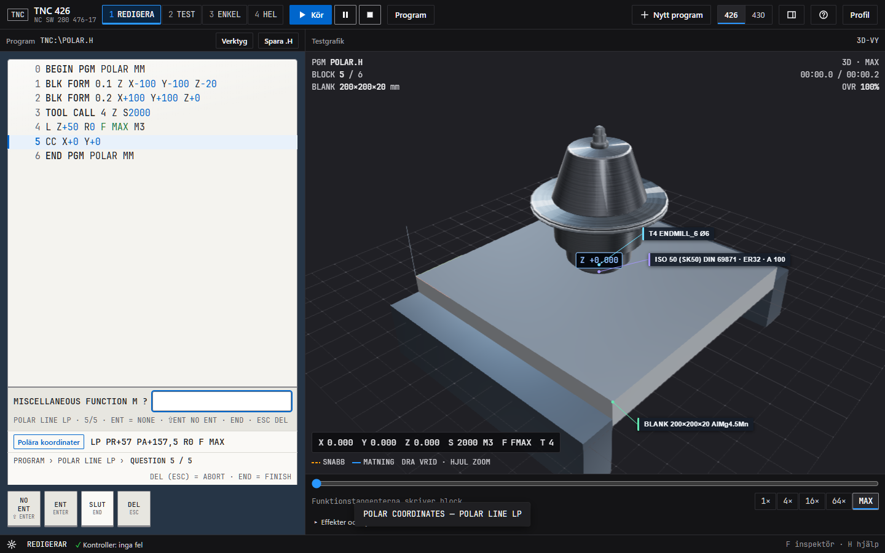

Under the question the block is shown as far as you have answered. When you are done, the Swedish screen shows:

```
LP PR+57 PA+157,5 R0 F MAX
```

How to read it:

- **Decimal comma on the screen.** With the language set to Swedish, the screen shows decimal numbers with a comma. With English it shows a point: `LP PR+57 PA+157.5 R0 F MAX`. You may type a comma or a point in a question; both mean the same.
- **Point in the file.** In the saved file the block has a point and no space in the feed rate, the way the control writes it: `LP PR+57 PA+157.5 R0 FMAX`. Program text and comments are never rewritten.
- **Some words always keep their point**, on the Swedish screen too: `BLK FORM 0.1`, `CYCL DEF 7.1`, `TCH PROBE 0.0` and `FN 0:`.
- **A malformed number is not accepted.** If you type `1,2,3` as the angle, for example, the question stays.

`P` works the same way for `C` (becomes `CP`), `CT` (becomes `CTP`) and for approach and departure with `APPR` and `DEP`. `CC` is always Cartesian.

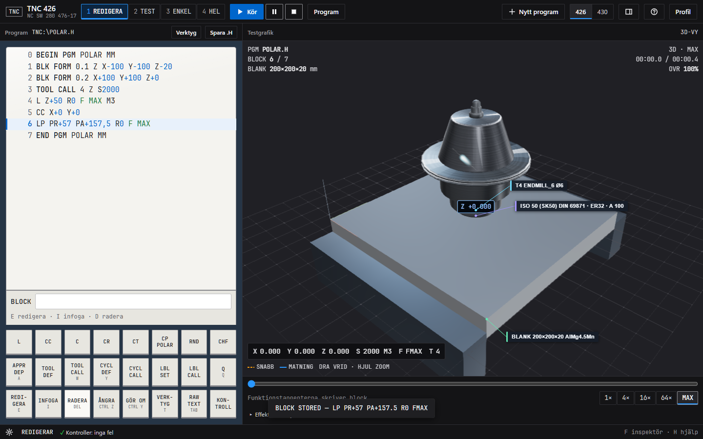

### Changing a block

Put the cursor on the block and press `E`.

- A polar block (`LP`, `CP`, `CTP`) opens in its dialog with the present values filled in. ENTER keeps a value. When you are done the block is replaced.
- Every other block opens on the block line as text. Change the text and press ENTER to store or ESC to cancel.
- `F2` switches between dialog and text while you edit. The blocks `L`, `CC`, `C`, `CR`, `CT`, `RND` and `CHF` can be opened in a dialog that way. For a block that has no dialog the simulator answers `THIS BLOCK HAS NO DIALOG — EDIT IT AS TEXT`.

`I` inserts a new block after the cursor, `D` or DELETE deletes the block and `C` copies it. `Ctrl+Z` undoes and `Ctrl+Shift+Z` or `Ctrl+Y` redoes.

### Raw editing

Press TAB while no button or slider has the focus. The whole program is then shown as a text box in which you can type, paste and move lines freely. Press TAB again to go back; the program is then checked again. If a button has the focus, TAB moves the focus to the next button instead, as in other programs.

### Help and lessons

Press `H`. The drawer has five tabs: Lessons (each lesson loads its own program and runs the machine for you), Crash it (famous ways to wreck a machine, safely here), Manual, Shortcuts and AI setup. The lessons leave your own programs alone.

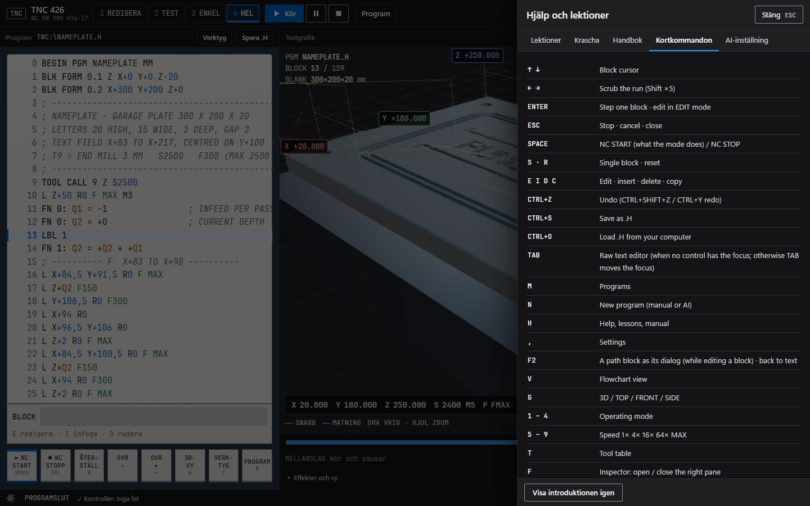

### On a phone

On a screen narrower than 900 pixels the machine workspace is split into three workspaces: Program, Graphics and Status. Switch with the tabs or by swiping sideways. The soft keys stay at the bottom, eight at a time. New program, the machine switch, Help, Profile and the settings are under Menu.

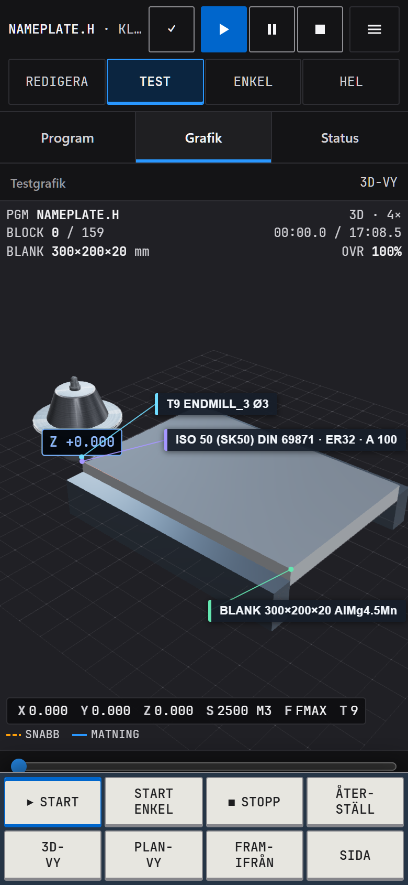

## Programs: saving, loading and the library

### New program

Press `N` or New program. The dialog has two tabs.

- **Manual**: type a program name with A–Z, 0–9 and underscore and press Create. The simulator creates `BEGIN PGM` and `END PGM` in millimetres, and you write the rest block by block.
- **AI**: see [AI programs and the AI key](#ai-programs-and-the-ai-key).

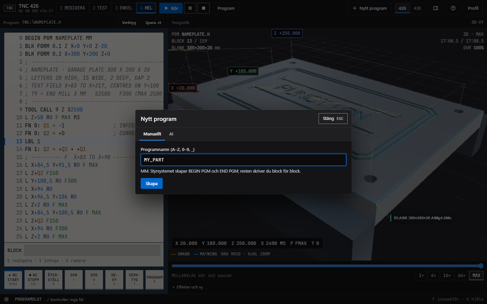

### The program list

Press `M` or the button Programs. The list shows every program in the simulator with its size, status and project. Choose with the arrow keys.

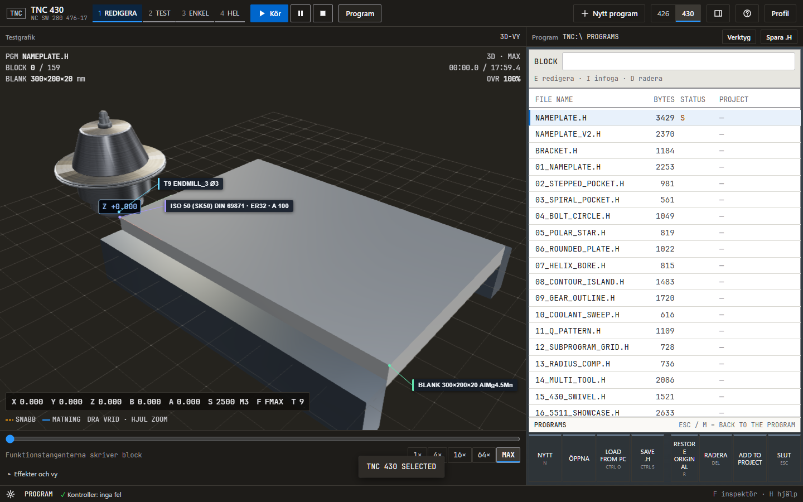

| Soft key | Key | What it does |
|---|---|---|
| NEW | `N` | opens the New program dialog |
| OPEN | ENTER | opens the selected program |
| LOAD FROM PC | `Ctrl+O` | loads a file from the computer |
| SAVE .H | `Ctrl+S` | saves the program as a file |
| RESTORE ORIGINAL | `R` | puts a built-in program back as it was |
| DELETE | DELETE | deletes a program of your own |
| ADD TO PROJECT | | adds the program to the active project |
| END | ESC | goes back to the program |

A built-in program cannot be deleted; the simulator answers `BUILT-IN PROGRAM — USE RESTORE ORIGINAL INSTEAD`.

### Saving and loading files

- **Save**: `Ctrl+S` saves the open program as a `.H` file with block numbers, in the control's listing format.
- **Load**: `Ctrl+O`, or drag a file onto the window. The simulator reads `.H` and `.I` (in UTF-8 or Windows-1252) and `.zip` archives with several programs.
- **Missing tools**: if a program calls a tool that is not in the tool table, the tool is created when the program is loaded, as an import on the control would. A mistyped tool number is therefore not caught on loading.

### The profile

Your programs and your tool table save themselves in the browser. Under Profile you can name the profile, export everything as a `.zip` and import it in another browser. On import you choose **Merge** (add) or **Replace**. Clearing the browser's data for the page removes the profile, so export it first.

A **project** is a named folder of programs. You create one in the Inspector under the tab My programs. New programs join the active project, and ZIP downloads the folder as `.H` files.

### The sixteen showcase programs

Sixteen programs come with the simulator, each showing one technique. They are in the program list and in the folder `examples/showcase`. The introduction card lets you pick one of them as your first program. They are practice examples and have not been run on a real control.

| Program | What it shows |
|---|---|
| `01_NAMEPLATE.H` | Engraves KLARTEXT in single strokes in two passes and mills a frame with rounded corners. |
| `02_STEPPED_POCKET.H` | Three nested rectangular pockets with cycle 4, each step 6 mm deeper. |
| `03_SPIRAL_POCKET.H` | Round pocket Ø70 milled from the centre outwards along a spiral of incremental polar blocks. |
| `04_BOLT_CIRCLE.H` | Eight holes on a pitch circle (cycles 200 and 220) and a milled centre bore (cycle 208). |
| `05_POLAR_STAR.H` | Five-pointed star written entirely with polar blocks (`CC`, `LP PR/PA`) inside a ring. |
| `06_ROUNDED_PLATE.H` | Faced plate with a corner radius, contour-milled with radius compensation, and four holes. |
| `07_HELIX_BORE.H` | Bore milled with helical interpolation (`CP` with `IZ`) at two radii, plus a counterbore. |
| `08_CONTOUR_ISLAND.H` | SL cycles: a pocket with rounded corners and two islands, roughed out, then floor and side finished. |
| `09_GEAR_OUTLINE.H` | Gear-like outline with 12 straight-flanked teeth in polar blocks. A visual demonstration, not a certified involute gear. |
| `10_COOLANT_SWEEP.H` | Face milling with cycle 230 and a serpentine groove with a ball cutter, all under coolant (`M8`). |
| `11_Q_PATTERN.H` | Three rosettes computed with Q parameters, with jumps and a subprogram. |
| `12_SUBPROGRAM_GRID.H` | One subprogram is called 15 times on a grid with datum shift (cycle 7). |
| `13_RADIUS_COMP.H` | The same square is run three times with `RR`, `R0` and `RL`, so the offset shows as a staircase. |
| `14_MULTI_TOOL.H` | Seven tools in one run: face mill, pocket roughing, pocket finishing, spot drill, drill, tap and chamfer mill. |
| `15_430_SWIVEL.H` | TNC 430 only: cycle 19 tilts the swivel head 30 degrees, a sloped face is milled and two holes are drilled square to it. |
| `16_5511_SHOWCASE.H` | A playful shop badge with big numerals, a frame, two polar stars and four rivet marks. |

### The library on the server

With the server running and you signed in, you can put the program on screen in the server's library: open the menu (☰) and choose **Save to library**. The menu answers with one of these lines:

```
NAMEPLATE.H added to the library.
NAMEPLATE.H saved as v2.
NAMEPLATE.H is unchanged (v2).
```

The Programs page on the server shows every program with its versions. There you can open an older version, restore it and share a program by a link.

## AI programs and the AI key

The AI tab of the New program dialog writes a program from a description. Choose **New program** to start from nothing or **Change current** to let the AI change the program that is open, write what you want and press **Generate** or **Change the program**. `Ctrl+Z` undoes a change.

A generation works in rounds. The AI writes a program, the server checks it with the same interpreter the simulator uses, and the simulator measures the cut part against what was asked for. If the program has an error, would crash or does not cut what it should, the findings go back to the AI for a new attempt: the first program plus at most five repair rounds. Only a program that passes is offered for loading. If none passes, the best attempt is kept as a draft that you can open yourself, and nothing is loaded. One generation runs at a time per account.

### Where the key lives

The AI goes through the service OpenRouter and no other. That needs an OpenRouter key, and the key stays on the server side, never in the browser.

- The server takes the key from the environment variable `OPENROUTER_API_KEY`, or from a key an administrator has stored on the server. A stored key wins over the environment variable. Only an administrator can store or remove a key; in the desktop app the one local user is the administrator.
- The key is not tested when it is stored. A wrong key shows up at the first generation.
- A stored key is in the file `openrouter.key` in the server's data folder. Only the account that runs the server can read the file. It is not encrypted, so protect the data folder as you protect other secrets.
- The key is never written to the database, never put in an answer to the browser and never in a log line.
- The browser only sends its sign-in to the server. The server adds the key and passes the question on.
- The server has a limit per user and month, 5 US dollars unless set otherwise (`TNC_AI_MONTHLY_BUDGET_USD`). The models that may be chosen can be limited with `TNC_AI_MODELS`. The default model is `deepseek/deepseek-v4.1-flash`.

### What is sent, and when

Nothing you write leaves your computer until you press **Generate** or **Change the program**. Then your description, the tool table and, when you change a program, the program's text go to OpenRouter and on to whoever runs the model you chose. They process the text under their own terms. So do not put anything confidential in the description. You can cancel a generation that is under way with ESC.

> **TO COMPLETE (the AI dialog and the server's AI interface are still being built).** This section describes only what could be read in the code when the manual was written. The following is to be filled in when the parts are finished:
>
> 1. Where in the interface an administrator stores and removes the key, and what the buttons are called.
> 2. The exact text the dialog shows before anything is sent to OpenRouter.
> 3. What the dialog shows while the rounds run, and how a draft is opened.
> 4. What applies to the simulator file `index.html` without a server.
> 5. The error messages the dialog shows (no key, out of credit, monthly limit reached, the model does not answer).

## Tools and the tool table

Press `T` or the button Tools. The tool table corresponds to `TOOL.T` on the control: one tool per row with its number (T), name, length (L) and radius (R). Each machine has its own table.

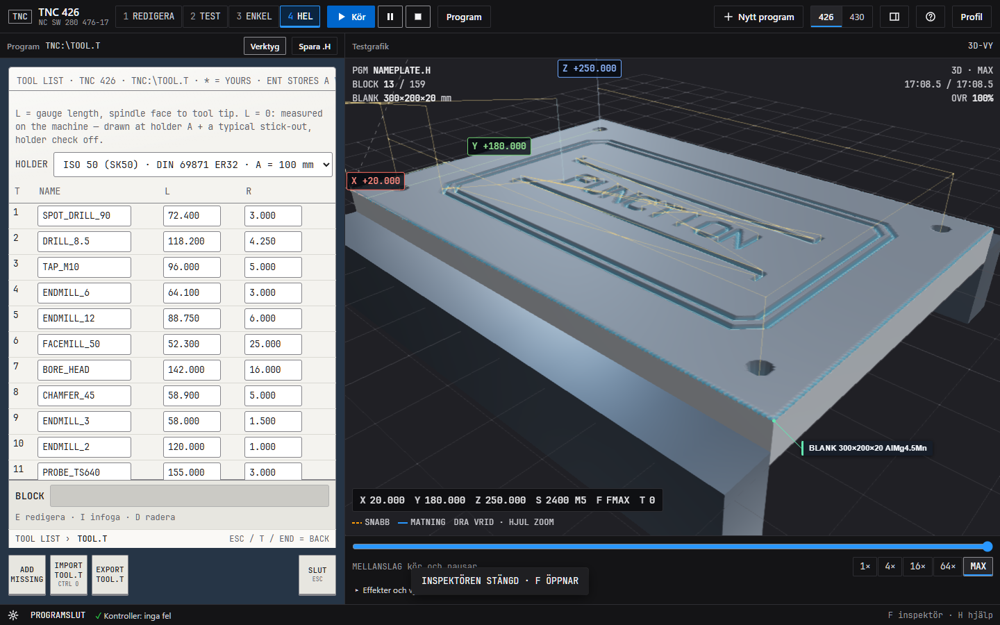

- **L** is the tool's length from the spindle face to the tip. With L = 0 the tool counts as measured on the machine, and the holder check is off for that tool.
- **R** is the radius. The radius compensation (`RL`, `RR`) uses it, and it decides how much material the tool removes.
- **HOLDER** selects the tool holder that is drawn and checked against the part and the vice.
- Change a value by typing in its box. The tool number has to be 0–32767 and the radius must not be negative.

| Soft key | What it does |
|---|---|
| ADD MISSING | adds the tools the program calls that are missing from the table |
| IMPORT TOOL.T | reads a tool table from a file |
| EXPORT TOOL.T | saves the table as a file, for example `TOOL_TNC426.T` |
| END | closes the table (also ESC or `T`) |

A program selects a tool with `TOOL CALL`, for example `TOOL CALL 4 Z S2000`. In PRG EDIT, `W` opens the dialog for `TOOL CALL`. The picture shows the tool in its holder, with labels for the tool, the holder and the blank; `L` switches the labels on and off.

The vice is on from the start and can be switched off under **Effects and view**. The simulator raises an alarm if the tool or the holder runs into the vice.

With the server each machine also has a tool table on the Tool tables page. In Play a tool change writes the new tool into the table, see [Changing the tool](#changing-the-tool).

## Play: the workshop

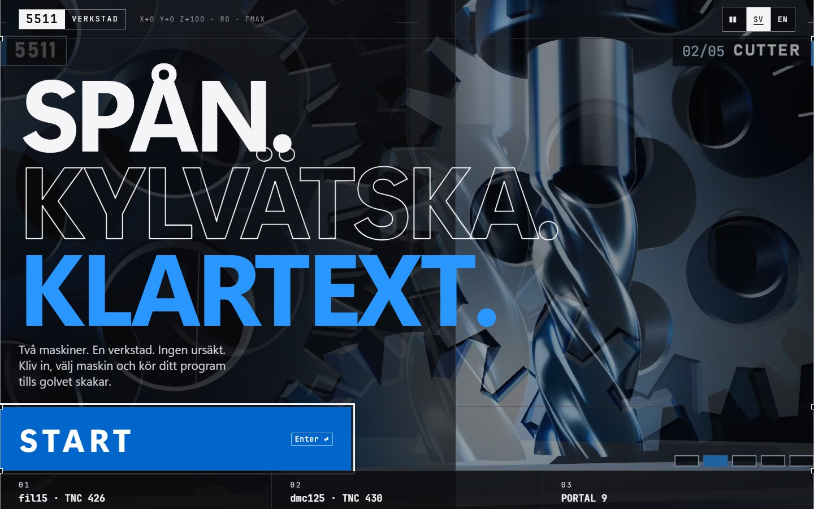

### From the landing page to the machine

1. The landing page shows a START button. Press ENTER or click. At the top right you change the language and pause the background film.
2. The first time, an introduction in three steps is shown. Press Next, or Skip.
3. You are standing in the workshop. Walk up to one of the two marked machines, `fil15` with the TNC 426 or `dmc125` with the TNC 430.
4. Press `E` when the box **Open the control** appears. The camera moves up to the control and the simulator opens, set to that machine's controller.
5. Work as in [The controller and editing](#the-controller-and-editing).
6. Press **To the workshop** in the top bar to go back. The program is still there when you return.

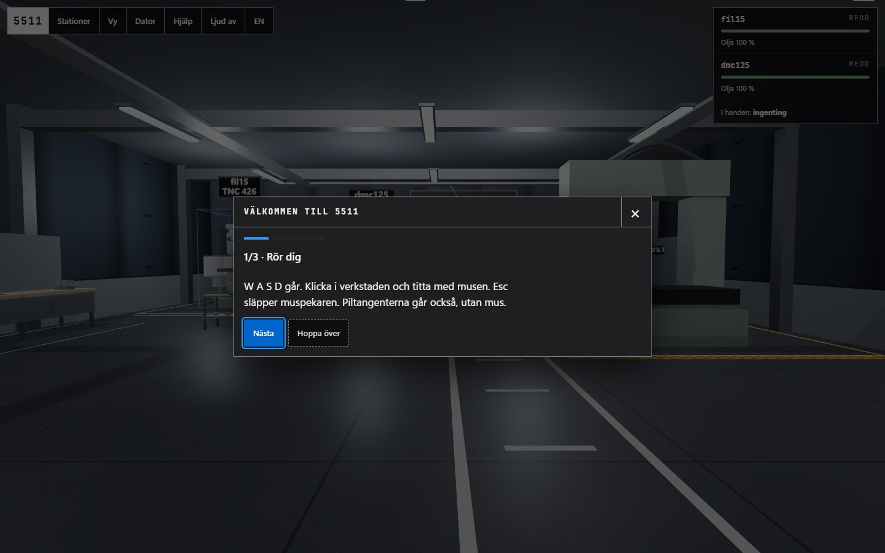

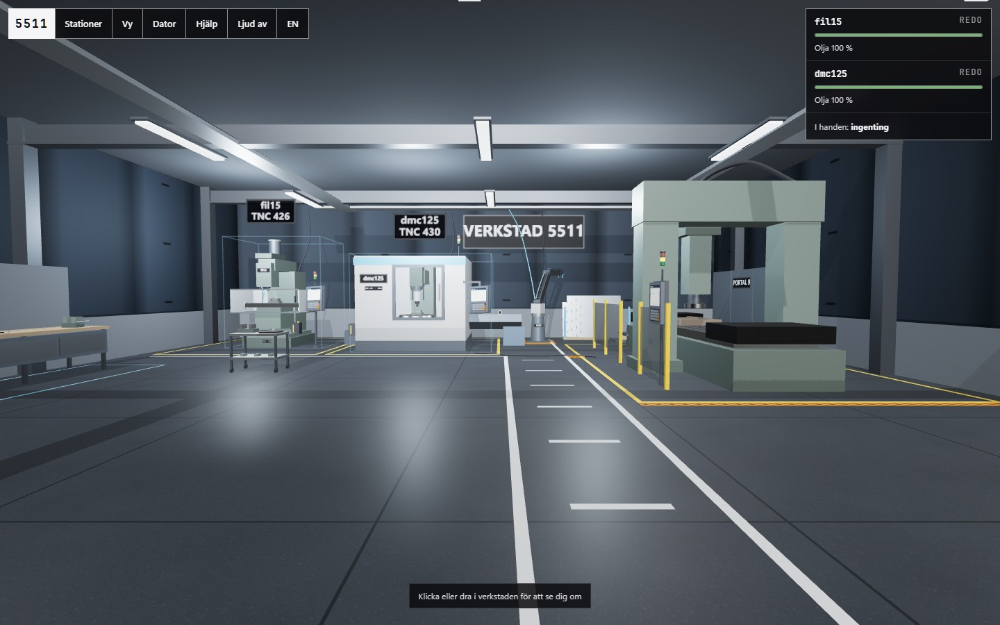

There is a single simulator in the workshop. It runs one program at a time, so if a program is running on one machine you cannot open the control on the other. You then see `The other machine is running. One simulator, one program at a time.` The third machine, PORTAL 9, is shut down and is only for looking at.

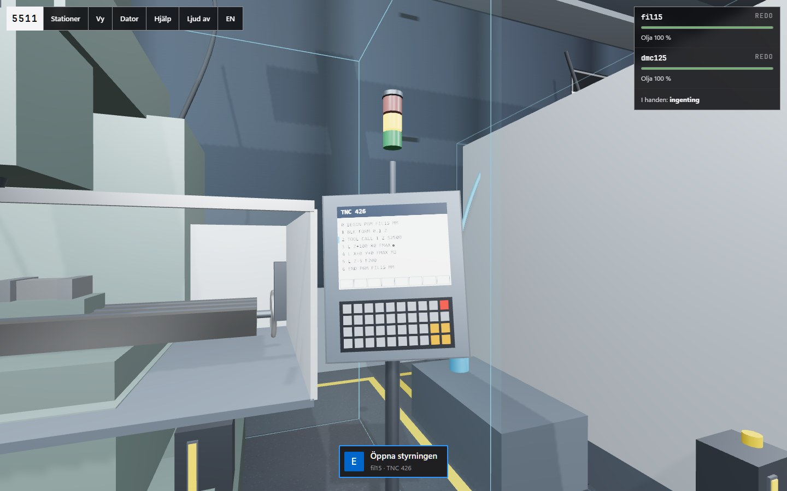

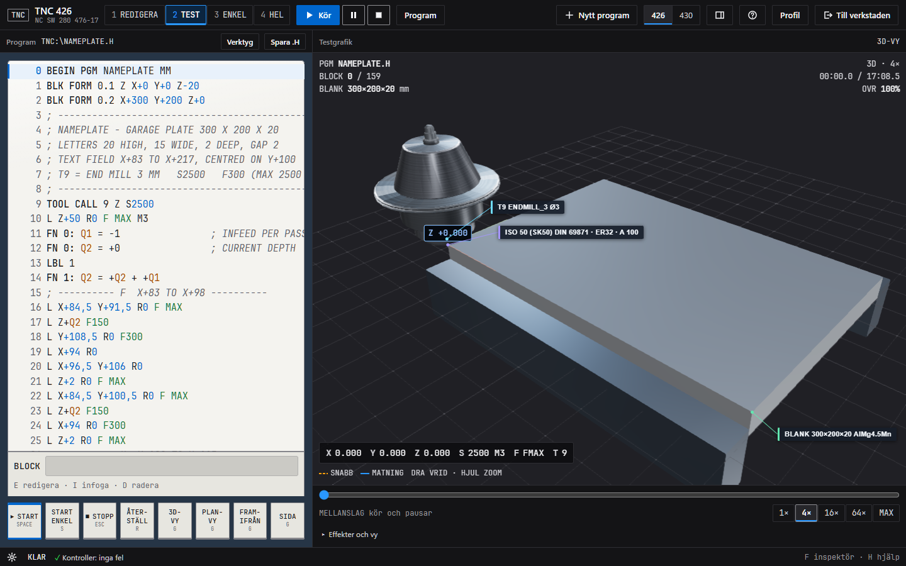

### Moving

| Key or gesture | What happens |
|---|---|
| `W` `S` or `↑` `↓` | walk forwards and backwards |
| `A` `D` | step sideways |
| `←` `→` | turn left and right |
| SHIFT | walk faster while you hold it |
| click in the workshop | the pointer is captured, and you look around by moving the mouse |
| ESC | releases the pointer |
| drag with the mouse or a finger | looks around without capturing the pointer |
| `E` | does what the box at the bottom suggests for the thing you are looking at |

The arrow keys are enough to get around without a mouse. The box at the bottom can also be clicked.

### The row at the top left

| Button | What it does |
|---|---|
| Stations | opens the list of everything that can be done |
| View | changes the camera: Walk, Whole workshop, Around the machine, Cutting POV, Tool close-up, Finished part |
| Computer | opens the workshop computer |
| Help | shows the introduction again |
| Sound off / Sound on | switches the sound off and on |
| the language button | switches to the next language |

The last three views are the simulator's own cameras, so they open the control on the machine.

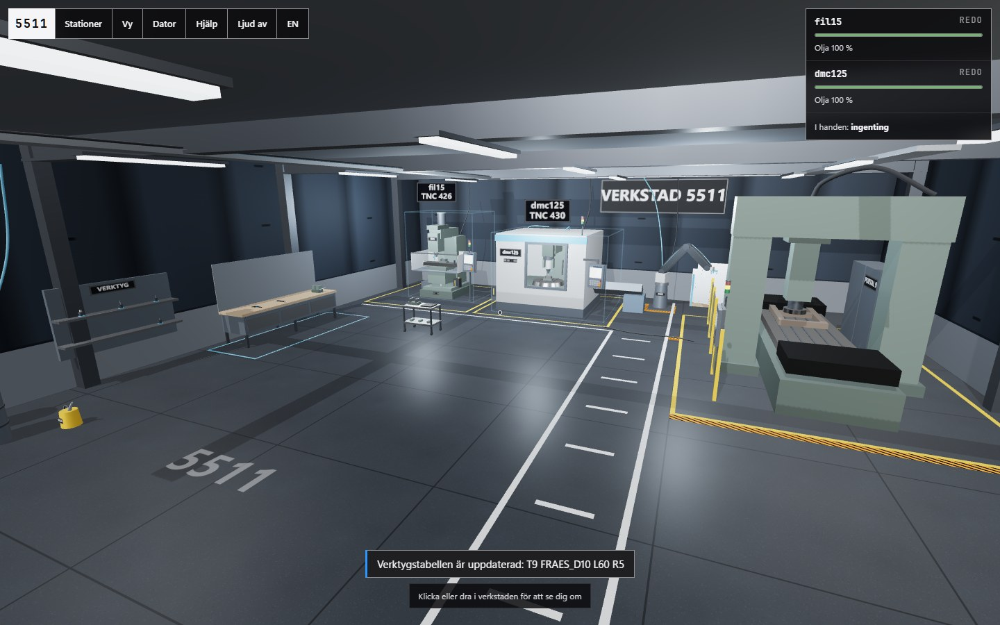

### Stations

Everything that can be done in 3D can also be done from the Stations list, without walking there. Each station has its buttons and a button **Go there** that puts you in front of it. For the machines the list also shows the state, the oil level and the tool in the spindle.

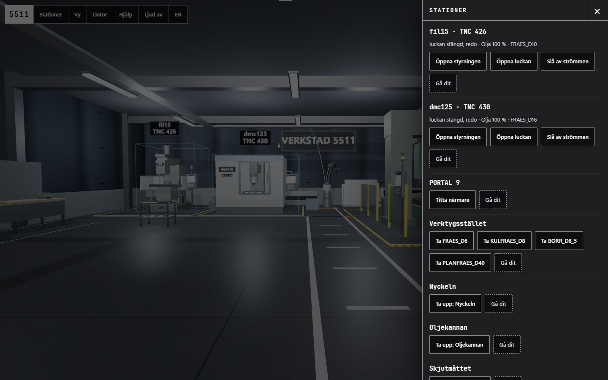

The stations are the two machines, PORTAL 9, the tool rack, the wrench, the oil can, the caliper, the workshop computer, a cabinet and a sheet-metal arm.

You can carry one thing in your hand (the wrench, the oil can or the caliper) and also one tool from the rack. The box at the top right shows what you hold under **In hand**.

### The box at the top right

For each machine it shows the state and an oil meter.

| State | Means |
|---|---|
| READY | the machine can be started |
| RUNNING | a program is running on the machine |
| LOCKED | the door is open, the machine is locked out, a tool change is in progress or the oil is empty |
| POWER OFF | the power is switched off |

### Changing the tool

The tool change is done in a fixed order. If you take a step too early the workshop answers `Not yet. Take the steps in order.` If the program is running it answers `No. The machine is running. Stop the program first.`

1. Pick up the **wrench**. It is on the workbench.
2. At the machine: **Open the door**.
3. **Stop and lock out the machine**. A running program is stopped.
4. **Loosen the tool**. This needs the wrench in your hand.
5. **Take the tool out**. You are now carrying it.
6. At the tool rack: **Hang the tool back** and take another one, for example **Take FRAES_D6**.
7. At the machine: **Fit the tool**.
8. **Clamp the tool**. This needs the wrench again.
9. **Unlock the machine** and **Close the door**.

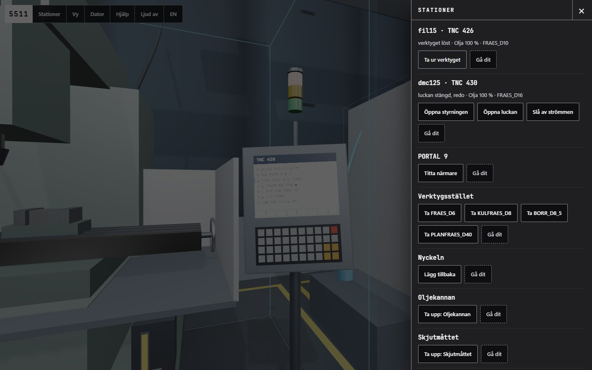

When you have clamped the tool, its name, length and radius are written into the simulator's tool table, in the slot of the tool that is current in the simulator. The workshop confirms with, for example:

```
Tool table updated: T9 FRAES_D10 L60 R5
```

While the door is open, the machine is locked out or the spindle is empty, the program cannot be started. The simulator then shows **LOCKED** and the reason, for example `The door is open` or `A tool change is in progress`.

The tool rack has six tools. The values are made up for the workshop and do not come from a catalogue.

| Tool | L (mm) | R (mm) |
|---|---|---|
| `FRAES_D6` | 50 | 3 |
| `FRAES_D10` | 60 | 5 |
| `FRAES_D16` | 75 | 8 |
| `KULFRAES_D8` | 60 | 4 |
| `BORR_D8_5` | 90 | 4.25 |
| `PLANFRAES_D40` | 45 | 20 |

At the start `FRAES_D10` sits in `fil15` and `FRAES_D16` in `dmc125`. A tool that sits in a spindle cannot be taken from the rack.

### Power

**Switch the power off** and **Switch the power on** are at each machine. The power cannot be switched off while a program is running. With the power off the program cannot be started, and the simulator shows `The machine power is off`.

### Oil and the service meter

Each machine has an oil meter that goes from 100 % to 0 %.

- The oil only drops while the machine is actually cutting, by 2 percentage points per minute. A full tank therefore lasts 50 minutes of cutting. Time you stand still, edit or have the tab hidden does not count.
- At 20 % the meter shows **LOW** and the workshop says `The oil is running low. Fetch the oil can.`
- At 0 % the meter shows **EMPTY**. A running program is stopped, and the machine will not start until you have refilled it.
- Refill like this: pick up the **oil can**, go to the machine and choose **Refill the oil**. The meter goes to 100 %.

### Measuring the part

Pick up the **caliper** and choose **Measure the part** at a machine with its door closed. The control opens with the simulator's camera on the finished part.

### The workshop computer

Open it with the button Computer, or walk up to it and press `E`.

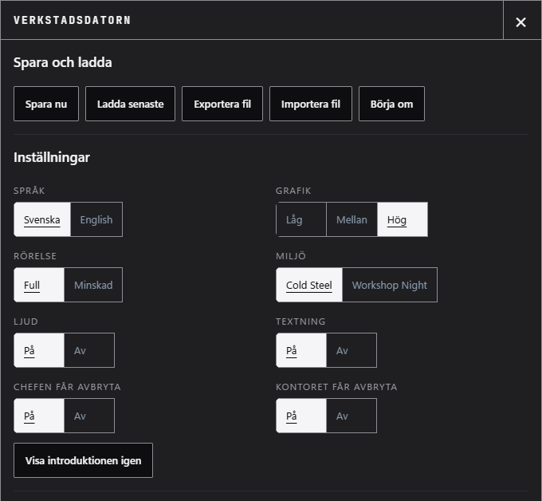

**Save and load.** The game saves itself in the browser every time something changes.

| Button | What it does |
|---|---|
| Save now | saves the state at once |
| Load latest | goes back to the last saved state |
| Export file | downloads the state as the file `tnc-5511-save.json` |
| Import file | reads such a file; an invalid file gives `That file is not a valid save.` |
| Start over | resets the workshop: full oil, power on, the original tools |

What is saved is the oil level, the power and the tool in the spindle of each machine, what you hold in your hand and which Easter eggs you have found. Where you stand is not saved. A machine that was saved with an empty spindle comes back open and locked out, waiting for a tool. Your programs belong to the simulator's profile and are saved there.

**Settings.** Language (Svenska, English, Srpski), Graphics (Low, Medium, High), Motion (Full, Reduced), Environment (Cold Steel, Workshop Night), Sound, Captions and the two characters. Language, graphics, motion, environment and sound are shared with the simulator. **Show the introduction again** opens the three steps once more.

**Secrets.** The computer keeps a list of the Easter eggs. What you have found can be opened from there. The rest is for you to look for.

### The characters

Two characters may come by while you are in the workshop: **The boss** and **The office**. They say a few lines and leave.

- They come at most once every five minutes of active time, and they take turns.
- They never come during the introduction, while a panel is open, while you are at a control or while the simulator shows an error.
- **Next** (or ENTER) goes to the next line. **Skip** (or ESC) ends the visit.

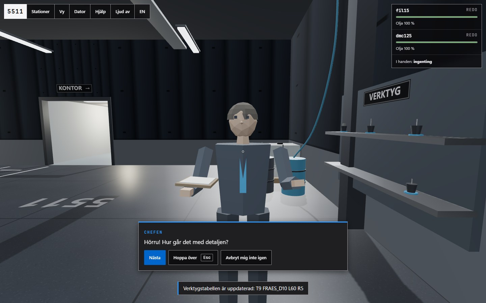

How to switch them off:

| You want to | Do this |
|---|---|
| switch off the character who is talking | press **Do not interrupt me again** in their box |
| switch off the boss | Computer, Settings, **The boss may interrupt**: Off |
| switch off the office | Computer, Settings, **The office may interrupt**: Off |
| switch them on again | the same switch: On |

### Captions and sound

- **Captions** decides whether the characters' lines are shown as text. With Captions Off, `(captions off)` is shown instead of the line. It is on from the start.
- **Sound off** in the row at the top left, or Sound in the computer, switches off the simulator's signals for crashes and warnings. The background film on the landing page has no sound.

### Easter eggs

There are Easter eggs in the workshop. Look around. The workshop computer keeps track of the ones you have found.

### Content of your own

Whoever sets up a Play edition of their own can add a short scene with two characters in a data file, without rebuilding. The format is in [web/src/play/pack/README.md](../web/src/play/pack/README.md).

## Appearance

The appearance never changes how a program runs. It consists of two independent choices that you make under the gear, on the Appearance tab.

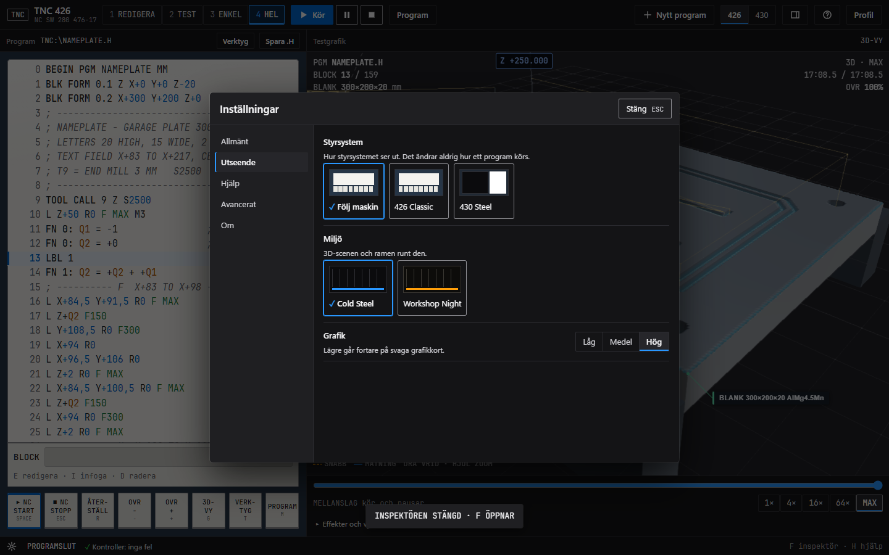

### Controller

| Choice | What it looks like |
|---|---|
| **Follow machine** (default) | 426 Classic when the TNC 426 is selected, 430 Steel when the TNC 430 is selected |
| **426 Classic** | the program on the left, a thick bezel, the block line under the screen, eight square light soft keys |
| **430 Steel** | the 3D view on the left, a thin steel frame, the block line above a white screen, flat keys in two groups of four |

Both looks are drawings of their own and not copies of the real controls' panels.

### Environment

| Choice | What it looks like |
|---|---|
| **Cold Steel** (default) | a cold, blue-grey 3D background |
| **Workshop Night** | a dark workshop with warmer light |

The environment applies to the 3D scene and the frame around it. In Play the same choice also applies to the workshop.

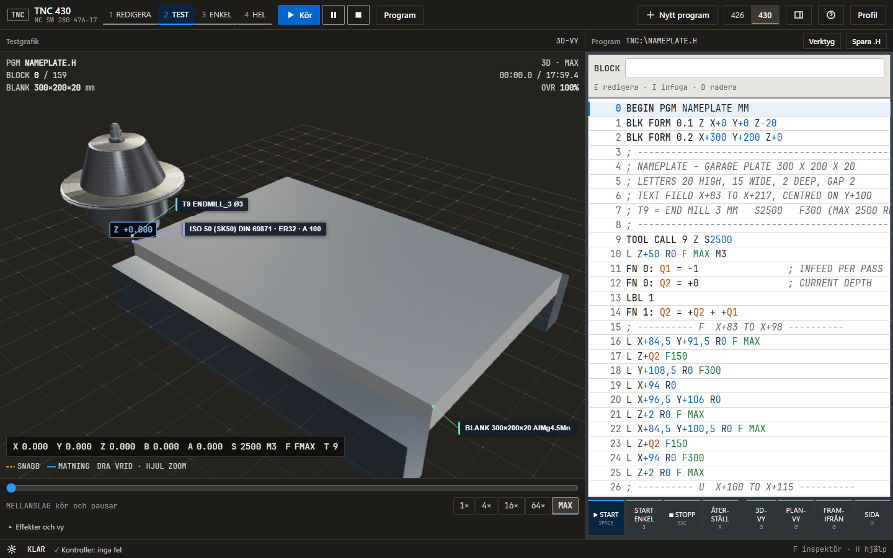

## Settings

Open the settings with the gear at the bottom left or with the key `,`. On a phone they are under Menu. The settings are stored in the browser and apply at once. They are shared between the simulator file, Business and Play when these are on the same address. If they are missing, or a value is damaged, the default is used.

### General

| Setting | Default | Meaning |
|---|---|---|
| Language | Svenska | The language of the interface: Svenska, English or Srpski (Serbian in Latin script). CNC words such as `TOOL CALL` and program text are never translated. |
| Motion | System | System follows the computer's setting for reduced motion. Reduced removes camera shake and animated transitions. |
| Sound | On | Signals for crashes and warnings. |
| Shortcut hints | On | Shows the key on soft keys, buttons and in tooltips. |
| Profile | | Opens the profile: name, programs, tool table, export and import. |

### Appearance

| Setting | Default | Meaning |
|---|---|---|
| Controller | Follow machine | See [Appearance](#appearance). |
| Environment | Cold Steel | See [Appearance](#appearance). |
| Graphics | High | Low, Medium or High. Lower is faster on weak graphics cards. |

### Help, Advanced and About

| Setting | Meaning |
|---|---|
| Help and lessons | Opens the help drawer. |
| Shortcuts | Shows every key. |
| Introduction | Shows the introduction card again: language, controller, motion and graphics, first program. |
| Reset help | Shows the introduction again and clears which lessons are finished. |
| Developer log | Feature log and version history, for whoever develops the simulator. |
| Diagnostics | Facts about the edition, the machine and the browser that you can copy into a bug report. |
| About | The licence and the notice that the simulator is not affiliated with HEIDENHAIN. |

Play has the same choices for language, graphics, motion, environment and sound in the workshop computer, plus Captions and the two characters, see [The workshop computer](#the-workshop-computer).

## Keyboard shortcuts

The shortcuts apply in the machine workspace while no text box has the focus. In Play they apply while the control is open.

### Running and viewing

| Key | What it does |
|---|---|
| SPACE | NC START, or hold if the program is running |
| ENTER | runs one block; in PRG EDIT it edits the block |
| `S` | runs one block |
| `R` | stops and goes to the start |
| ESC | holds; closes an alarm, a dialog or a panel |
| `←` `→` | moves back and forth in the run; with SHIFT five times as far |
| `5` to `9` | speed 1×, 4×, 16×, 64×, MAX |
| `+` `-` | feed override up and down in steps of 10 % |
| `G` | changes the view: 3D, top, front, side |
| `V` | shows the program as a flowchart |
| `P` `K` `B` | chips, coolant, smoke |
| `L` | labels in the 3D view |

### Modes and panels

| Key | What it does |
|---|---|
| `1` to `4`, or `F1` to `F4` | operating mode: PRG EDIT, TEST, SINGLE-BLOCK, FULL-RUN |
| `F` | opens and closes the Inspector |
| `T` | the tool table |
| `M` | the program list |
| `N` | new program |
| `H` | help and lessons |
| `,` | settings |

### Editing

| Key | What it does |
|---|---|
| `↑` `↓` | moves the block cursor |
| HOME, END | first and last block |
| PGUP, PGDN | twelve blocks up and down |
| `E` | edits the block |
| `I` | inserts a block |
| `D` or DELETE | deletes the block |
| `C` | copies the block |
| TAB | raw text, while no button has the focus |
| `F2` | switches between dialog and text while you edit a block |
| `Ctrl+Z` | undo |
| `Ctrl+Shift+Z` or `Ctrl+Y` | redo |
| `Ctrl+S` | saves as `.H` |
| `Ctrl+O` | loads a file |

### In PRG EDIT only

| Key | What it does |
|---|---|
| `Y` | `CYCL DEF` |
| `W` | `TOOL CALL` |
| `A` | `APPR` and `DEP` |
| `Q` | Q parameter |

The keys inside a question are under [Guided block entry](#guided-block-entry). The keys in the workshop are under [Moving](#moving).

## Without a server and without a key

The simulator is built to work on its own. The table shows what needs more.

| Function | The simulator file or an edition, without a server | Needs the server | Needs an AI key |
|---|---|---|---|
| Writing, running and checking programs | yes | | |
| Both machines, every cycle that is simulated | yes | | |
| Guided entry, raw text, undo | yes | | |
| Saving and loading `.H`, `.zip`, `TOOL.T` | yes | | |
| Profile, projects, export and import | yes | | |
| The showcase programs and the lessons | yes | | |
| Controller, environment, language, settings | yes | | |
| Play: the workshop, tool change, oil, characters, save file | yes | | |
| Program library with versions | | yes | |
| Tool tables on the server | | yes | |
| Accounts and users | | yes | |
| Sharing a program by a link | | yes | |
| Writing programs with AI | | yes | yes, on the server |

This applies when you have no server:

- Everything you save is in the browser you are using. Another browser or computer does not see it until you export the profile and import it there.
- The menu (☰) with the library and the account is not shown in Business.
- The simulator file needs no internet at all. The editions only need to reach the place they are hosted on.
- The landing film in Play is only there if the film files are part of the build. Without them the drawn grid is shown instead.

## Troubleshooting

### `PROGRAM MODE — NC START WORKS IN 2 TEST, 3 SINGLE-BLOCK, 4 FULL-RUN`

You pressed Run in PRG EDIT, where nothing runs. Press `2`, `3` or `4` and then SPACE.

### `NO MOVES TO RUN`

The program has no moves, for example because it only has `BEGIN PGM` and `END PGM`, or because an error stops it before the first move. Open the Inspector with `F` and read the checks.

### LOCKED, and the program does not start (Play)

The workshop blocks the start. The reason follows the word LOCKED.

| Reason | Do this |
|---|---|
| `The machine power is off` | go to the machine and choose Switch the power on |
| `The oil is empty: refill it in the workshop` | take the oil can and choose Refill the oil at the machine |
| `The door is open` | choose Close the door |
| `The machine is stopped and locked out in the workshop` | choose Unlock the machine and then Close the door |
| `A tool change is in progress` | finish the tool change, see [Changing the tool](#changing-the-tool) |

### `Not yet. Take the steps in order.` (Play)

The step does not belong to the state the machine is in. Open Stations: it only shows the steps that can be taken right now.

### `You need the wrench. It is on the workbench.` (Play)

Loosening and clamping a tool need the wrench in your hand. Pick it up in Stations or at the workbench.

### `The simulator does not answer the workshop yet` (Play)

The workshop and the simulator have not made contact, so the machine choice, the interlock and the tool change do not reach the simulator. Reload the page. If it happens again, the simulator file in the build is older than the workshop: rebuild the edition with `npm run build:play`.

### The machine workspace is empty, or `index.html missing: run python build.py in the repo root`

The edition cannot find the simulator file. Run `python build.py` in the project root and start the edition again.

### `The TNC server does not answer at /api/v1. The library, tool tables and accounts need it.`

You opened the library, the tool tables or the account while no server is running. Start the server, or choose **Open the machine** to go back to the machine workspace, which works without a server.

### `AI is off on this server (no OPENROUTER_API_KEY)`

The server has no OpenRouter key. Whoever runs the server adds one, see [Where the key lives](#where-the-key-lives).

### `OPENROUTER MODEL LIST UNREACHABLE — SHORT OFFLINE LIST; ANY ID CAN STILL BE TYPED`

The list of models could not be fetched, usually because you have no internet. You see a short list instead and can still type a model name by hand.

### `CYCLE n NOT IMPLEMENTED IN SIMULATOR` or `TCH PROBE n NOT IMPLEMENTED IN SIMULATOR`

The program calls a cycle or a probing cycle the simulator does not run, see [the list](#what-is-and-is-not-simulated). The control would run it; the simulator stops there. Replace the cycle with explicit moves to test the rest of the program.

### `CYCLE n NEEDS A ROTARY TABLE`

Cycles 27 and 28 work on a cylinder surface and need a rotary table. Neither of the two machines in the simulator has one.

### `CYCLE n NOT ON TNC 426/430`

The cycle number belongs to a newer control and does not exist on the TNC 426 or 430.

### `FK NOT SIMULATED`

The block uses FK free contour programming (`FPOL`, `FL`, `FLT`, `FC`, `FCT`, `FSELECT`), which the simulator does not compute. Write the contour with `L`, `C`, `CC`, `CR` and `CT` instead.

### `THIS BLOCK HAS NO DIALOG — EDIT IT AS TEXT`

You pressed `F2` on a block that has no dialog. Change it as text on the block line.

### The cycle time is shorter than on the machine

The simulator leaves out dwell, tool changes and acceleration. Use the time to compare two versions of a program, not as an estimate for the machine.

### A mistyped tool number is not reported

When a program is loaded, the tools missing from the tool table are created. Open the table with `T` and go through the list after loading.

### My programs are gone

The programs are stored in the browser, for the address the page has. They are not visible in another browser, in a private window or if the page has got another address or port. Open the page on the same address as before. If the browser's data was cleared, the programs can only be brought back from an exported profile.

### The graphics are slow

Choose Graphics: Low and Motion: Reduced in the settings. In Play the same choices are in the workshop computer.

### Windows or macOS warns when the desktop app is installed

The installers are not code-signed. On Windows choose **More info** and then **Run anyway**; on macOS right-click the app and choose **Open**.

## What is and is not simulated

### Simulated

- Straight lines, circular arcs, polar moves and helixes.
- Radius compensation (`RL`, `RR`), corner rounding (`RND`) and chamfers (`CHF`), approach and departure (`APPR`, `DEP`).
- Q parameters with formulas and jumps, subprograms and program section repeats.
- The tool table and tool calls.
- Two machines: the TNC 426 with X, Y and Z, and the TNC 430 with a swivel head in A and B as well and cycle 19.
- A vice the tool and the holder can crash into.
- Material removed from the blank, and the removed volume.
- The simulator's own safety checks: rapid traverse into material, cutting with the spindle stopped, the tool below the bottom of the blank, a high chip load.

Cycles with motion of their own: 1, 2, 3, 4, 5, 17, 18, 21–25 (SL cycles), 200–215, 230, 231 and 262–265, 267 (thread milling), plus the patterns 220 and 221. Cycle 12 calls a program.

Cycles that set something up without motion of their own: 7, 8, 9, 10, 11, 14, 19, 20, 26, 32 and 247.

Probing cycles: 400, 403, 408–413, 415, 417 and 419 move. The tool-measuring cycles 30–33, 480–483 and 562 are accepted without motion.

### Not simulated

- Cycle 13 gives `CYCLE 13 NOT IMPLEMENTED IN SIMULATOR`. Cycles 27 and 28 give `CYCLE n NEEDS A ROTARY TABLE`. Other probing cycles give `TCH PROBE n NOT IMPLEMENTED IN SIMULATOR`.
- FK free contour programming: the blocks `FPOL`, `FL`, `FLT`, `FC`, `FCT` and `FSELECT` give `FK NOT SIMULATED`.
- Undercuts. The material is stored as one height per point, so the tool only removes what it sweeps along its axis.
- `F AUTO` uses the feed rate of the `TOOL CALL`. `INCH` programs are not converted; write in millimetres.
- `M128` and `M114`.
- Radius compensation in a tilted working plane on the TNC 430 is approximate.
- The cycle time leaves out dwell, tool changes and acceleration, so it is shorter than on a real machine.
- The coolant is a picture. `M8` and `M9` switch the spray on and off, but there is no fluid model.
- The workshop in Play is a game. Oil, power, door and tool change only affect whether the program may start and what is in the tool table. The machines `fil15`, `dmc125` and PORTAL 9 are made up.

### The simulator's own choices

- Where the control's manual does not show the tool path (parts of the SL cycles 21–24, thread milling and probing), the path is the simulator's own choice. The open points are listed in [CONTINUE.md](../CONTINUE.md) under "Open placeholders".
- The screen form of a block, with `F MAX` and the decimal comma, has not been compared with a real control.
- The Swedish and Serbian texts of the interface are the simulator's own and are not the control's official dialog texts.
- The vice's dimensions are a common standard size, not a measured vice.
- No real control and no programming station has checked the simulator.

## Reference

### Where things are stored

Everything below is in the browser, for the address the page has.

| What | Where |
|---|---|
| Programs, projects and the tool table (the profile) | the browser's database for the page |
| Language, controller, environment, graphics, motion, sound | `tnc.settings.v1` |
| The Inspector's state and the selected machine, per edition | `tnc.edition.business.v1`, `tnc.edition.play.v1` |
| Play: captions, characters, whether the introduction was shown | `tnc.edition.play.v1` |
| Play: the save | `tnc.play.save.v1` |
| Finished lessons | `tnc.lessons.v1` |

On the server, the database `tnc.db` and, if a key is stored, the file `openrouter.key` are in the server's data folder.

### For developers

```sh
npm ci                     # build and test tooling
npm --prefix web ci        # the web part's dependencies
python build.py            # builds index.html from the folder sim
python build.py --wasm     # rebuilds the engine from Rust first (needs the rustup target wasm32-unknown-unknown)
npm run test:manual        # the examples and rules of the control's manual
npm run test:ui            # the browser tests of the simulator
npm run test:play          # the rules of the Play game
npm run test:e2e           # both editions in a browser; build them first
npm run render:hero        # renders the Play landing film again
```

All tests are listed in [CLAUDE.md](../CLAUDE.md#tests). No test needs an AI key.

| Path | What it is |
|---|---|
| `server/crates/tnc-core` | the engine: interpreter, cycles, checks and material model |
| `sim/` | the simulator's interface; `build.py` assembles it into `index.html` |
| `web/` | the editions' web pages; `web/src/play/` is the workshop |
| `server/` | the server |
| `desktop/` | the desktop app |
| `examples/showcase/` | the sixteen showcase programs |
| `media/landing-hyperframes/` | the source of the landing film, see [its README](../media/landing-hyperframes/README.md) |
| `tests/` | all tests |
| [CONTINUE.md](../CONTINUE.md) | the task list |

## Licence

MIT, see [LICENSE](../LICENSE). Third-party code is listed in [THIRD_PARTY_NOTICES.md](../THIRD_PARTY_NOTICES.md). "HEIDENHAIN" and "TNC" are trademarks of DR. JOHANNES HEIDENHAIN GmbH.
