# TNC 426 / 430 Simulator: handbok

Svenska · [English](MANUAL.en.md) · [Srpski](MANUAL.sr.md) · Kort översikt: [README](../README.md)

## Vad det är

Klartext är det dialogstyrda programspråket i styrsystemen TNC 426 och TNC 430. I simulatorn skriver eller laddar du ett Klartext-program, kör det och ser verktyget ta bort material ur ämnet. Simulatorn visar de fel den hittar på det block där de uppstår, så att du kan öva utan maskin.

Simulatorn finns i två utgåvor som delar samma motor och samma programfönster:

- **Business** öppnar maskinvyn direkt. Den är till för den som vill skriva och köra program utan något runt omkring.
- **Play** börjar med en startsida och fortsätter i en verkstad som du går runt i. Där står två maskiner, en med TNC 426 och en med TNC 430. När du öppnar styrningen på en maskin får du samma simulator som i Business. Verkstaden lägger till underhåll, två figurer och några påskägg.

Delarna är:

- **Simulatorfilen** `index.html` är hela simulatorn i en enda fil. Den öppnas direkt i en webbläsare och behöver varken internet eller server.
- **Utgåvorna** Business och Play är webbsidor som visar simulatorfilen i en ram och lägger till sitt eget runt den.
- **Skrivbordsappen** är en utgåva i ett eget fönster, med ett programbibliotek på din dator.
- **Servern** är valfri. Den ger konton, ett programbibliotek med versioner, verktygstabeller och delningslänkar, och den håller AI-nyckeln.

Simulatorn är inte knuten till HEIDENHAIN. Den är till för utbildning och ska inte användas för att kontrollera program till riktiga maskiner.

## Innehåll

1. [Ord som används](#ord-som-används)
2. [Installation](#installation)
3. [Välja utgåva](#välja-utgåva)
4. [Styrsystemet och redigering](#styrsystemet-och-redigering)
5. [Program: spara, ladda och bibliotek](#program-spara-ladda-och-bibliotek)
6. [AI-program och AI-nyckeln](#ai-program-och-ai-nyckeln)
7. [Verktyg och verktygstabellen](#verktyg-och-verktygstabellen)
8. [Play: verkstaden](#play-verkstaden)
9. [Utseende](#utseende)
10. [Inställningar](#inställningar)
11. [Kortkommandon](#kortkommandon)
12. [Utan server och utan nyckel](#utan-server-och-utan-nyckel)
13. [Felsökning](#felsökning)
14. [Vad som simuleras och inte](#vad-som-simuleras-och-inte)
15. [Referens](#referens)

## Ord som används

- **Block**: en rad i ett program, till exempel `L X+10 Y+20 R0 FMAX` (en rak rörelse i snabbtransport).
- **Cykel**: en inbyggd bearbetning, till exempel borrning eller fickfräsning. Den ställs in med `CYCL DEF` och körs med `CYCL CALL`.
- **Ämne**: råmaterialet, som programmet anger med `BLK FORM`.
- **Driftläge**: vad styrsystemet gör just nu. Det finns fyra: PRG REDIGERA (skriva), TEST (kontrollera), ENKELBLOCK (köra ett block i taget) och HELKÖRNING (köra allt). På engelska heter de PRG EDIT, TEST, SINGLE-BLOCK och FULL-RUN.
- **Funktionstangenter**: raden med knappar under programmet. De byter innehåll efter driftläge, som soft keys på styrsystemet.
- **Polära koordinater**: en punkt som anges med avstånd (`PR`) och vinkel (`PA`) från en pol, i stället för med X och Y. Polen sätts med ett `CC`-block.
- **Inspektören**: panelen till höger med mätvärden från körningen, kontroller, referensmaterial och dina program. Den är stängd tills du öppnar den.
- **Profil**: dina program och din verktygstabell, sparade i den här webbläsaren.
- **Utgåva**: Business eller Play.
- **Station**: en sak i Play-verkstaden som du kan göra något vid, till exempel en maskin, verktygsstället eller datorn.

## Installation

Du behöver inte installera något för att använda simulatorfilen: öppna `index.html` i en webbläsare. Resten av det här kapitlet gäller utgåvorna.

### Det här behöver du

| Behov | Till vad | Så kontrollerar du |
|---|---|---|
| Node.js 22 eller nyare, med npm | utgåvorna och verktygen runt dem | `node --version` |
| Python 3 | bara om du vill bygga om simulatorfilen | `python --version` (på macOS och Linux `python3 --version`) |
| Rust | bara för servern och skrivbordsappen | `cargo --version` |

### Steg

1. Hämta beroendena i projektets rot. Det här installerar byggverktygen och testverktygen.

   ```sh
   npm ci
   ```

2. Hämta beroendena för webbdelen, som ligger i mappen `web`.

   ```sh
   npm --prefix web ci
   ```

3. Starta en utgåva. Kommandot startar en lokal webbserver som bara lyssnar på din egen dator.

   ```sh
   npm run dev:business
   ```

4. Kontrollera att det fungerar. Kommandot skriver ut en adress:

   ```
   ➜  Local:   http://127.0.0.1:5426/
   ```

   Öppna adressen. Du ska se maskinvyn med programmet `NAMEPLATE.H` och en ruta som frågar efter språk. Om port 5426 är upptagen väljer kommandot nästa lediga port och skriver ut den i stället.

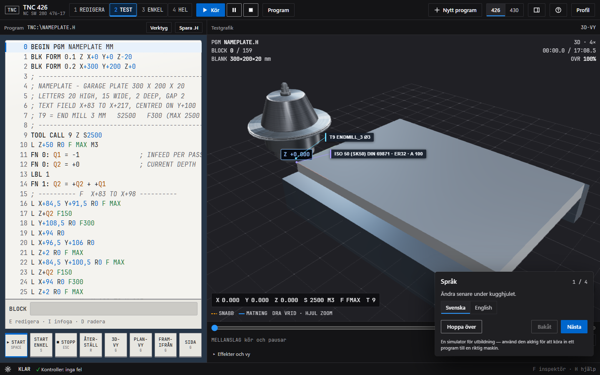

Simulatorfilen `index.html` följer med projektet, så du behöver inte bygga den. Om du har ändrat i mappen `sim` bygger du om den med `python build.py` (på macOS och Linux `python3 build.py`).

## Välja utgåva

| Du vill | Kör | Resultat |
|---|---|---|
| prova Business medan du arbetar | `npm run dev:business` | en lokal adress som öppnar maskinvyn på `/work` |
| prova Play medan du arbetar | `npm run dev:play` | en lokal adress som öppnar startsidan på `/play` |
| bygga Business för en webbplats | `npm run build:business` | mappen `dist/business` |
| bygga Play för en webbplats | `npm run build:play` | mappen `dist/play` |
| bara simulatorn, utan något runt | öppna `index.html` | simulatorn i en fil |
| en app i eget fönster | se [Skrivbordsappen](#skrivbordsappen) | ett installationsprogram |

### De byggda mapparna

`dist/business` och `dist/play` innehåller allt en utgåva behöver, också en kopia av simulatorfilen. Lägg mappen på vilken webbserver som helst som kan lämna ut filer; ingen egen serverprogramvara behövs. Mappen måste ligga i webbplatsens rot och öppnas över `http://` eller `https://`. Det går inte att dubbelklicka på `dist/business/index.html`, eftersom sidan hämtar simulatorn från adressen `/sim/`.

Bygget kopierar simulatorfilen från projektets rot. Om filen saknas stannar bygget med meddelandet `index.html missing in the repo root: run python build.py first`.

Business innehåller inget av Play: verkstaden, startsidans film och figurerna finns bara i `dist/play`. Play innehåller också maskinvyn på `/work`.

### Simulatorfilen

`index.html` är samma simulator som utgåvorna visar, utan något runt. Den har samma maskinvy, samma inställningar och samma program. Använd den när du vill ha en enda fil att ta med dig eller när du inte har internet.

### Skrivbordsappen

Skrivbordsappen är en utgåva i ett eget fönster. Den startar sin egen server inuti appen, på `127.0.0.1` och bara för din dator, sparar sin databas i systemets mapp för programdata och loggar in dig automatiskt. Om du startar appen en gång till kommer det öppna fönstret fram.

| Du vill | Kör | Appens namn |
|---|---|---|
| bygga Business som app | `npm run desktop:business` | TNC 426-430 Business |
| bygga Play som app | `npm run desktop:play` | TNC 5511 Play |

Installationsprogrammen är inte signerade, så Windows och macOS varnar första gången du öppnar dem.

Bygget behöver Rust och dessutom: på Windows MSVC build tools och WebView2 (ingår i Windows 10 och 11); på macOS Xcode command-line tools; på Linux WebKitGTK 4.1 (`libwebkit2gtk-4.1-dev libsoup-3.0-dev libjavascriptcoregtk-4.1-dev librsvg2-dev libxdo-dev libssl-dev`).

### Med servern

Servern behövs bara för det som står under [Utan server och utan nyckel](#utan-server-och-utan-nyckel). Den lyssnar på `127.0.0.1:8426` om du inte anger något annat. För att en utgåva som du kör med `npm run dev:business` eller `npm run dev:play` ska använda en server som redan är igång anger du serverns adress i miljövariabeln `TNC_SERVER` innan du startar:

```powershell
$env:TNC_SERVER = 'http://127.0.0.1:8426'
npm run dev:business
```

När servern svarar får Business en liten menyknapp (☰) i kanten med Program, Verktygstabeller, Konto och, för administratörer, Användare. Första gången du öppnar biblioteket på en ny server ber sidan dig skapa det första kontot, som blir administratör.

## Styrsystemet och redigering

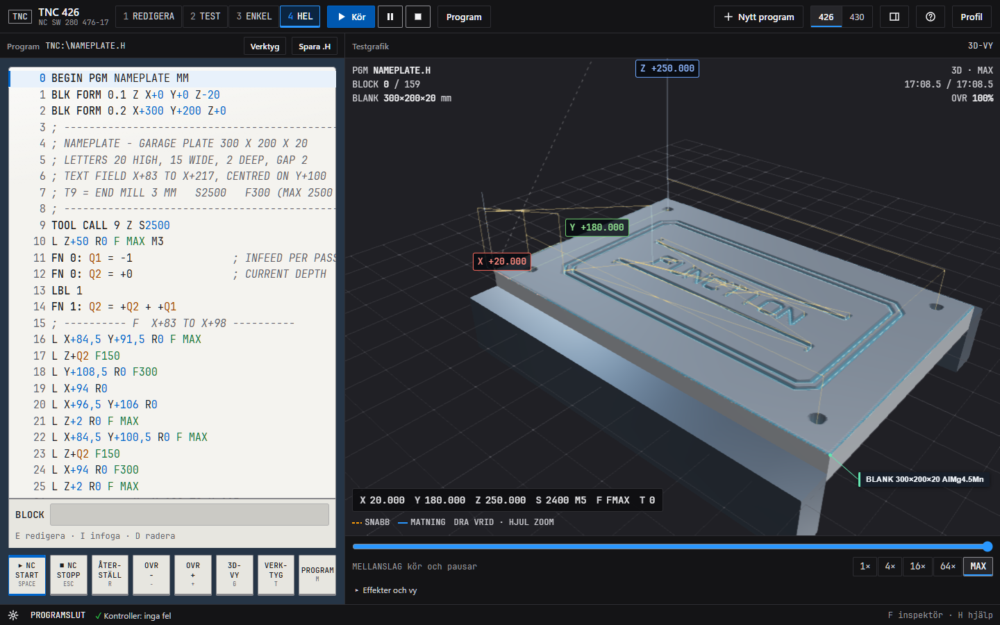

### Skärmen

- **Översta raden** har de fyra driftlägena, knapparna Kör, Paus och Stopp, knappen Nytt program, väljaren 426 | 430, och knapparna för Inspektören, Hjälp och Profil.
- **Programmet** visas till vänster (på styrsystemet 430 Steel till höger). Det markerade blocket är det som körs eller redigeras. Ovanför listan finns knapparna Verktyg och Spara .H.
- **Blockraden** under programmet är där du skriver ett block eller svarar på en fråga.
- **Funktionstangenterna** ligger underst. Varje tangent visar också sin tangent på tangentbordet med liten text.
- **Testgrafiken** visar ämnet, verktyget och verktygsbanan. Dra för att vrida och rulla för att zooma. Streckad linje är snabbtransport, heldragen är matning. Positionen (X, Y, Z, varvtal, matning och verktyg) står i en ruta ovanpå bilden.
- **Nedersta raden** har kugghjulet för inställningar, körtillståndet och antalet fel från kontrollerna.

### Driftlägen

| Tangent | Läge | Vad MELLANSLAG gör |
|---|---|---|
| `1` | PRG REDIGERA | inget; funktionstangenterna skriver block |
| `2` | TEST | kör och pausar |
| `3` | ENKELBLOCK | kör nästa block |
| `4` | HELKÖRNING | kör och pausar |

Om du trycker Kör i PRG REDIGERA svarar simulatorn `PROGRAM MODE — NC START WORKS IN 2 TEST, 3 SINGLE-BLOCK, 4 FULL-RUN`. Byt läge först.

### Köra ett program

1. Tryck `2` för TEST eller `4` för HELKÖRNING.
2. Tryck MELLANSLAG eller Kör. Tryck igen för att pausa.
3. Välj hastighet med `5` till `9`: 1×, 4×, 16×, 64× och MAX.
4. Dra i reglaget under grafiken, eller tryck `←` och `→`, för att gå fram och tillbaka i körningen. Går du bakåt byggs ämnet upp igen.
5. Tryck `R` eller Stopp för att börja om från början.

Fel visas med sitt block. Öppna Inspektören med `F` för att se körtid, matningsväg, snabbväg, lägsta Z och bortfräst volym, och listan över kontroller.

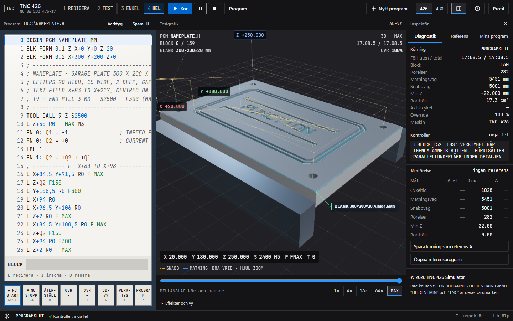

För att jämföra två versioner av ett program: kör färdigt, välj **Spara körning som referens A** i Inspektören, ändra programmet och kör igen. Tabellen Jämförelse visar skillnaden i cykeltid, matningsväg, snabbväg, antal rörelser, lägsta Z och bortfräst volym.

### Guidad inmatning av block

I PRG REDIGERA bygger du ett block genom att svara på en fråga i taget, på samma sätt som på styrsystemet. Du behöver inte kunna blockets stavning.

1. Tryck `1` för PRG REDIGERA.
2. Ställ markören på blocket som det nya ska hamna efter.
3. Tryck funktionstangenten för blocktypen, till exempel `L` för en rät linje. Raden ovanför funktionstangenterna visar vilken fråga du är på.
4. Skriv svaret och tryck ENTER. ENTER utan värde hoppar över en fråga som går att hoppa över.
5. Efter sista frågan sparas blocket och simulatorn kontrollerar programmet igen.

| Tangent | Vad den gör i en fråga |
|---|---|
| ENTER | tar svaret och går till nästa fråga (ENT) |
| SKIFT+ENTER | lämnar frågan utan värde (NO ENT) |
| END | avslutar dialogen och sparar blocket med det du har svarat |
| ESC | avbryter dialogen utan att spara (DEL) |
| DELETE | tömmer det du skrivit (CE) |
| `X` `Y` `Z` | väljer axel i koordinatfrågan; på TNC 430 också `B` och `A` |
| `I` | gör värdet inkrementalt |
| `P` | byter till polära koordinater |
| `Q` | svarar med en Q-parameter |
| `+` `-` | byter tecken |
| `#` | tar den aktuella positionen |

Funktionstangenterna i PRG REDIGERA ligger i tre rader. Första raden har banfunktionerna `L`, `CC`, `C`, `CR`, `CT`, `CP`, `RND` och `CHF`. Andra raden har `APPR/DEP`, `TOOL DEF`, `TOOL CALL`, `CYCL DEF`, `CYCL CALL`, `LBL SET`, `LBL CALL` och `Q`. Tredje raden har redigera, infoga, radera, ångra, gör om, verktyg, råtext och kontroll.

### Polära block: LP med PR och PA

Ett polärt block anger målet med radien `PR` och vinkeln `PA` från polen. Polen måste finnas först, i ett `CC`-block.

1. Skriv polen, till exempel `CC X+0 Y+0`.
2. Tryck funktionstangenten `L`. Frågan gäller först vanliga koordinater.
3. Tryck `P`. Dialogen byter till en polär linje och märks **Polära koordinater**.
4. Svara på radien, till exempel `57`, och tryck ENTER.
5. Svara på vinkeln, till exempel `157,5`, och tryck ENTER.
6. Välj radiekompensering med funktionstangenten `R0`, `RL` eller `RR`.
7. Svara på matningen, till exempel `MAX`, och sedan på M-funktionen, eller tryck ENTER för ingen.

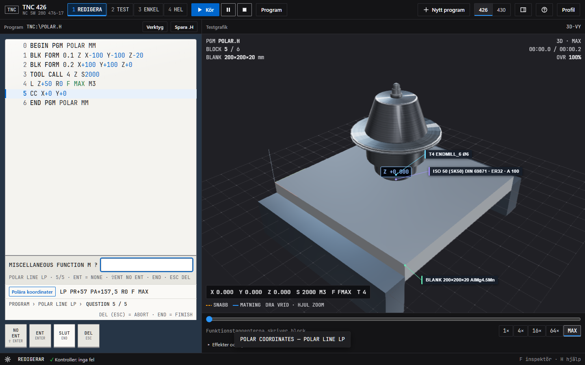

Under frågan visas blocket så långt du har svarat. När du är klar står det i programmet:

```
LP PR+57 PA+157,5 R0 F MAX
```

Så ska du läsa det:

- **Decimalkomma på skärmen.** Med svenskt språk visar skärmen decimaltal med komma. Med engelskt språk visas punkt. Du får skriva antingen komma eller punkt i en fråga; båda betyder samma sak.
- **Punkt i filen.** I den sparade filen står blocket med punkt och utan mellanslag i matningen, så som styrsystemet skriver det: `LP PR+57 PA+157.5 R0 FMAX`. Programtext och kommentarer skrivs aldrig om.
- **Några ord behåller alltid sin punkt** också på svensk skärm: `BLK FORM 0.1`, `CYCL DEF 7.1`, `TCH PROBE 0.0` och `FN 0:`.
- **Ett ogiltigt tal tas inte emot.** Skriver du till exempel `1,2,3` som vinkel står frågan kvar.

`P` fungerar på samma sätt för `C` (blir `CP`), `CT` (blir `CTP`) och för framkörning och frånkörning med `APPR` och `DEP`. `CC` är alltid kartesiskt.

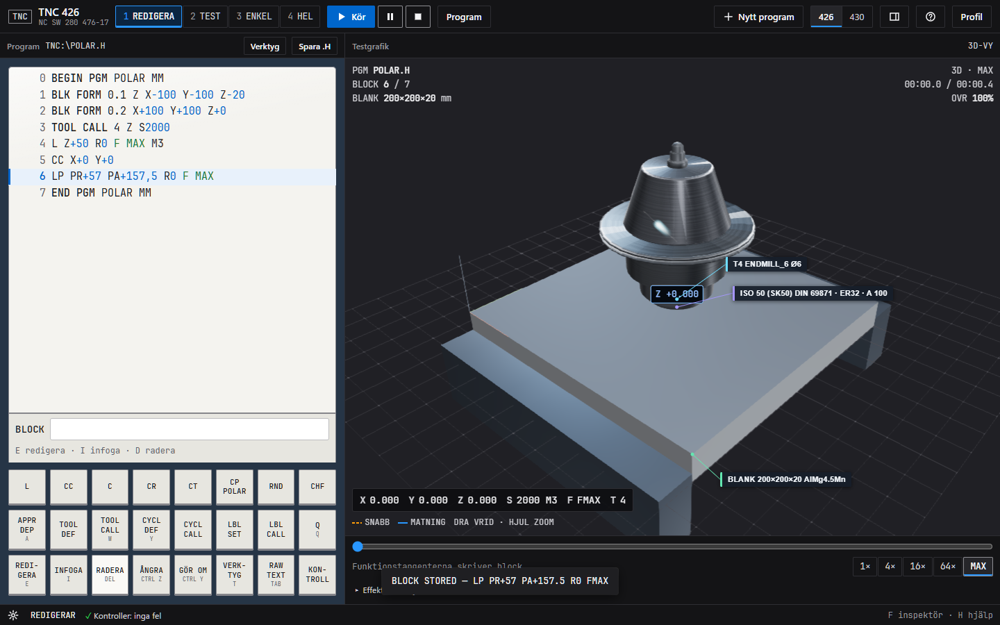

### Ändra ett block

Ställ markören på blocket och tryck `E`.

- Ett polärt block (`LP`, `CP`, `CTP`) öppnas i sin dialog med de nuvarande värdena ifyllda. ENTER behåller ett värde. När du är klar ersätts blocket.
- Alla andra block öppnas på blockraden som text. Ändra texten och tryck ENTER för att spara eller ESC för att ångra.
- `F2` växlar mellan dialog och text medan du redigerar. Blocken `L`, `CC`, `C`, `CR`, `CT`, `RND` och `CHF` går att öppna i dialog på det sättet. För ett block som saknar dialog svarar simulatorn `THIS BLOCK HAS NO DIALOG — EDIT IT AS TEXT`.

`I` infogar ett nytt block efter markören, `D` eller DELETE raderar blocket och `C` kopierar det. `Ctrl+Z` ångrar och `Ctrl+Skift+Z` eller `Ctrl+Y` gör om.

### Redigera som råtext

Tryck TAB när inget reglage eller knapp har fokus. Då visas hela programmet som en textruta där du kan skriva, klistra in och flytta rader fritt. Tryck TAB igen för att gå tillbaka; programmet kontrolleras då på nytt. Om en knapp har fokus flyttar TAB i stället fokus till nästa knapp, som i andra program.

### Hjälp och lektioner

Tryck `H`. Lådan har fem flikar: Lektioner (varje lektion laddar sitt eget program och kör maskinen åt dig), Krascha (kända sätt att köra sönder en maskin, här utan risk), Handbok, Kortkommandon och AI-inställning. Dina egna program rörs inte av lektionerna.

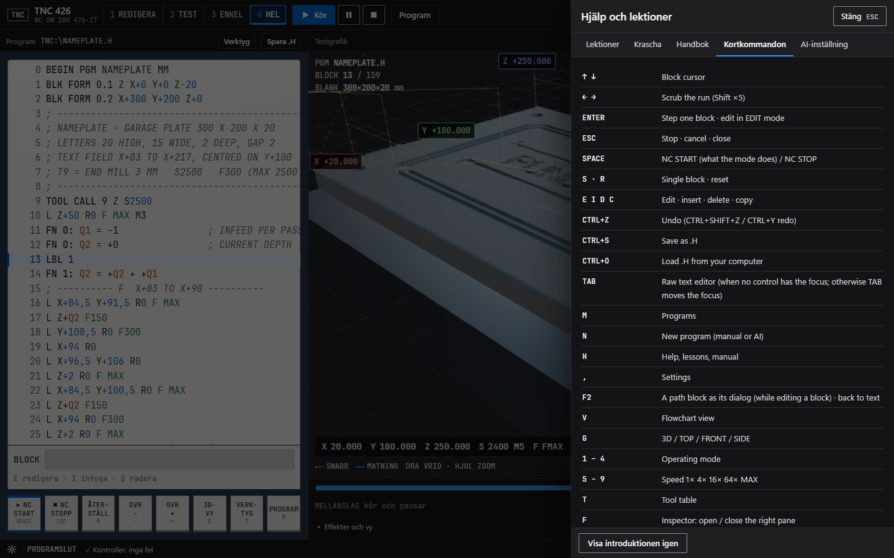

### På telefon

På en skärm smalare än 900 bildpunkter delas maskinvyn i tre arbetsytor: Program, Grafik och Status. Byt med flikarna eller genom att svepa i sidled. Funktionstangenterna ligger kvar längst ner, åtta åt gången. Nytt program, maskinväljaren, Hjälp, Profil och inställningarna finns under Meny.

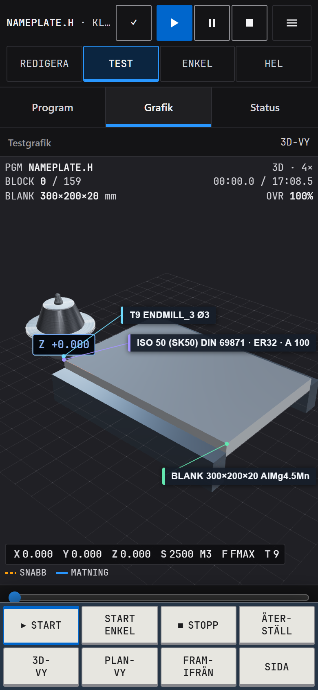

## Program: spara, ladda och bibliotek

### Nytt program

Tryck `N` eller Nytt program. Dialogen har två flikar.

- **Manuellt**: skriv ett programnamn med A–Z, 0–9 och understreck och tryck Skapa. Simulatorn skapar `BEGIN PGM` och `END PGM` i millimeter, och du skriver resten block för block.
- **AI**: se [AI-program och AI-nyckeln](#ai-program-och-ai-nyckeln).

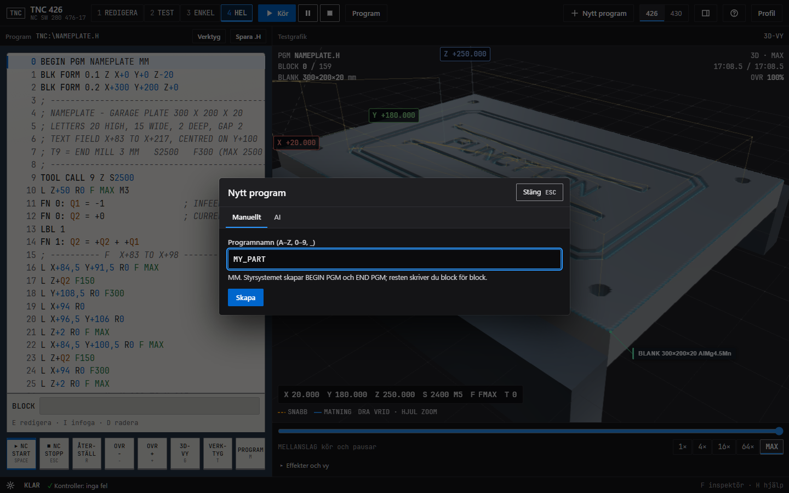

### Programlistan

Tryck `M` eller knappen Program. Listan visar alla program i simulatorn med storlek, status och projekt. Välj med piltangenterna.

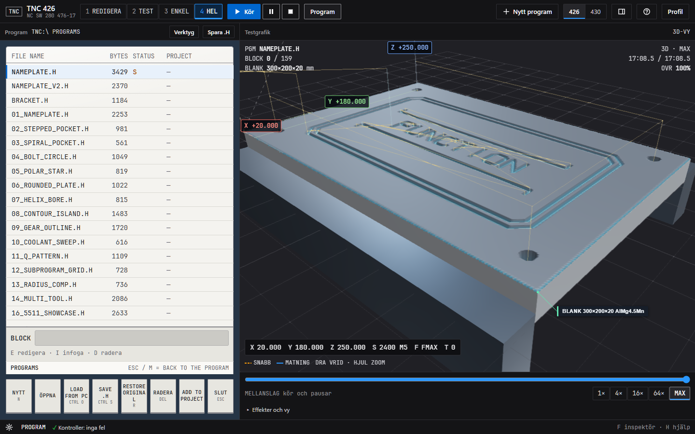

| Funktionstangent | Tangent | Vad den gör |
|---|---|---|
| NYTT | `N` | öppnar dialogen Nytt program |
| ÖPPNA | ENTER | öppnar det markerade programmet |
| LOAD FROM PC | `Ctrl+O` | laddar en fil från datorn |
| SAVE .H | `Ctrl+S` | sparar programmet som fil |
| RESTORE ORIGINAL | `R` | återställer ett inbyggt program till sitt ursprung |
| RADERA | DELETE | raderar ett eget program |
| ADD TO PROJECT | | lägger programmet i det aktiva projektet |
| SLUT | ESC | går tillbaka till programmet |

Ett inbyggt program går inte att radera; simulatorn svarar `BUILT-IN PROGRAM — USE RESTORE ORIGINAL INSTEAD`.

### Spara och ladda filer

- **Spara**: `Ctrl+S` sparar det öppna programmet som en `.H`-fil med radnummer, i styrsystemets listformat.
- **Ladda**: `Ctrl+O`, eller dra en fil till fönstret. Simulatorn läser `.H` och `.I` (i UTF-8 eller Windows-1252) och `.zip` med flera program.
- **Verktyg som saknas**: om ett program anropar ett verktyg som inte finns i verktygstabellen skapas verktyget när programmet laddas, som vid en import på styrsystemet. Ett felskrivet verktygsnummer upptäcks därför inte vid laddningen.

### Profilen

Dina program och din verktygstabell sparas av sig själva i webbläsaren. Under Profil kan du ge profilen ett namn, exportera allt som en `.zip` och importera den i en annan webbläsare. Vid import väljer du **Merge** (lägg till) eller **Replace** (ersätt). Rensar du webbläsarens data för sidan försvinner profilen, så exportera den först.

Ett **projekt** är en namngiven mapp med program. Du skapar det i Inspektören under fliken Mina program. Nya program hamnar i det aktiva projektet, och ZIP hämtar mappen som `.H`-filer.

### De sexton uppvisningsprogrammen

Sexton program följer med och visar var sin teknik. De ligger i programlistan och i mappen `examples/showcase`. Introduktionsrutan låter dig välja ett av dem som första program. De är övningsexempel och har inte körts på ett riktigt styrsystem.

| Program | Vad det visar |
|---|---|
| `01_NAMEPLATE.H` | Graverar KLARTEXT med raka streck i två skär och fräser en ram med rundade hörn. |
| `02_STEPPED_POCKET.H` | Tre rektangulära fickor i varandra med cykel 4, varje steg 6 mm djupare. |
| `03_SPIRAL_POCKET.H` | Rund ficka Ø70 som fräses inifrån och ut i en spiral av inkrementala polära block. |
| `04_BOLT_CIRCLE.H` | Åtta hål på en delningscirkel (cykel 200 och 220) och ett fräst centrumhål (cykel 208). |
| `05_POLAR_STAR.H` | Femuddig stjärna skriven helt med polära block (`CC`, `LP PR/PA`) inuti en ring. |
| `06_ROUNDED_PLATE.H` | Planfräst platta med hörnradie, konturfräst med radiekompensering, och fyra hål. |
| `07_HELIX_BORE.H` | Hål fräst med skruvlinje (`CP` med `IZ`) i två radier, och en försänkning. |
| `08_CONTOUR_ISLAND.H` | SL-cykler: ficka med rundade hörn och två öar, grovfräst, sedan botten och sida finfräst. |
| `09_GEAR_OUTLINE.H` | Kugghjulsliknande kontur med 12 raka kuggar i polära block. En visuell demonstration, inte ett certifierat evolventkugghjul. |
| `10_COOLANT_SWEEP.H` | Planfräsning med cykel 230 och ett slingrande spår med kulfräs, allt med kylvätska (`M8`). |
| `11_Q_PATTERN.H` | Tre rosetter räknade med Q-parametrar, med hopp och underprogram. |
| `12_SUBPROGRAM_GRID.H` | Ett underprogram anropas 15 gånger i ett rutnät med nollpunktsförskjutning (cykel 7). |
| `13_RADIUS_COMP.H` | Samma kvadrat körs tre gånger med `RR`, `R0` och `RL`, så att förskjutningen syns som en trappa. |
| `14_MULTI_TOOL.H` | Sju verktyg i en körning: planfräs, grovficka, finficka, centrumborr, borr, gängtapp och fasfräs. |
| `15_430_SWIVEL.H` | Endast TNC 430: cykel 19 lutar svänghuvudet 30 grader, en sned yta fräses och två hål borras vinkelrätt mot den. |
| `16_5511_SHOWCASE.H` | Ett lekfullt verkstadsmärke med stora siffror, ram, två polära stjärnor och fyra nitmärken. |

### Biblioteket på servern

Med servern igång och inloggad kan du lägga programmet på skärmen i serverns bibliotek: öppna menyn (☰) och välj **Spara i biblioteket**. Menyn svarar med en av de här raderna:

```
NAMEPLATE.H lades till i biblioteket.
NAMEPLATE.H sparad som v2.
NAMEPLATE.H är oförändrad (v2).
```

Sidan Program på servern visar alla program med versioner. Där kan du öppna en äldre version, återställa den och dela ett program med en länk.

## AI-program och AI-nyckeln

AI-fliken i dialogen Nytt program skriver ett program från en beskrivning. Välj **Nytt program** för att börja från noll eller **Ändra aktuellt** för att låta AI:n ändra programmet som är öppet, skriv vad du vill ha och tryck **Generera** eller **Ändra programmet**. `Ctrl+Z` ångrar en ändring.

En generering går i omgångar. AI:n skriver ett program, servern kontrollerar det med samma tolk som simulatorn använder, och simulatorn mäter den frästa detaljen mot det du bad om. Har programmet ett fel, skulle det krascha eller fräser det inte det som det ska, går resultatet tillbaka till AI:n för ett nytt försök: det första programmet och högst fem rättningsomgångar. Bara ett program som går igenom erbjuds för laddning. Går inget igenom sparas det bästa försöket som ett utkast som du själv kan öppna, och ingenting laddas. Varje konto kan ha en generering igång åt gången.

### Var nyckeln finns

AI:n går genom tjänsten OpenRouter och ingen annan. För det behövs en OpenRouter-nyckel, och den ligger på serverns sida, aldrig i webbläsaren.

- Servern tar nyckeln från miljövariabeln `OPENROUTER_API_KEY`, eller från en nyckel som en administratör har sparat på servern. En sparad nyckel går före miljövariabeln. Bara en administratör kan spara eller ta bort en nyckel; i skrivbordsappen är den enda lokala användaren administratör.
- Nyckeln provas inte när den sparas. En felaktig nyckel märks vid första genereringen.
- En sparad nyckel ligger i filen `openrouter.key` i serverns datamapp. Filen kan bara läsas av det konto som kör servern. Den är inte krypterad, så skydda datamappen som du skyddar andra hemligheter.
- Nyckeln skrivs aldrig i databasen, aldrig i ett svar till webbläsaren och aldrig i en loggrad.
- Webbläsaren skickar bara sin inloggning till servern. Servern lägger till nyckeln och skickar frågan vidare.
- Servern har en gräns per användare och månad, 5 US-dollar om inget annat är inställt (`TNC_AI_MONTHLY_BUDGET_USD`). Vilka modeller som får väljas kan begränsas med `TNC_AI_MODELS`. Förvald modell är `deepseek/deepseek-v4.1-flash`.

### Vad som skickas, och när

Ingenting av det du skriver lämnar din dator förrän du trycker **Generera** eller **Ändra programmet**. Då skickas din beskrivning, verktygstabellen och, när du ändrar ett program, programmets text till OpenRouter och vidare till den som driver modellen du valt. De behandlar texten enligt sina egna villkor. Skriv därför inget hemligt i beskrivningen. Du kan avbryta en pågående generering med ESC.

> **ATT KOMPLETTERA (AI-dialogen och serverns AI-gränssnitt byggs fortfarande).** Det här avsnittet beskriver bara det som gick att läsa i koden när handboken skrevs. Följande ska fyllas i när delarna är klara:
>
> 1. Var i gränssnittet en administratör sparar och tar bort nyckeln, och vad knapparna heter.
> 2. Exakt vilken text dialogen visar innan något skickas till OpenRouter.
> 3. Vad dialogen visar medan omgångarna går, och hur ett utkast öppnas.
> 4. Vad som gäller för simulatorfilen `index.html` utan server.
> 5. De felmeddelanden dialogen visar (ingen nyckel, slut på kredit, månadsgränsen nådd, modellen svarar inte).

## Verktyg och verktygstabellen

Tryck `T` eller knappen Verktyg. Verktygstabellen motsvarar `TOOL.T` på styrsystemet: ett verktyg per rad med nummer (T), namn, längd (L) och radie (R). Varje maskin har sin egen tabell.

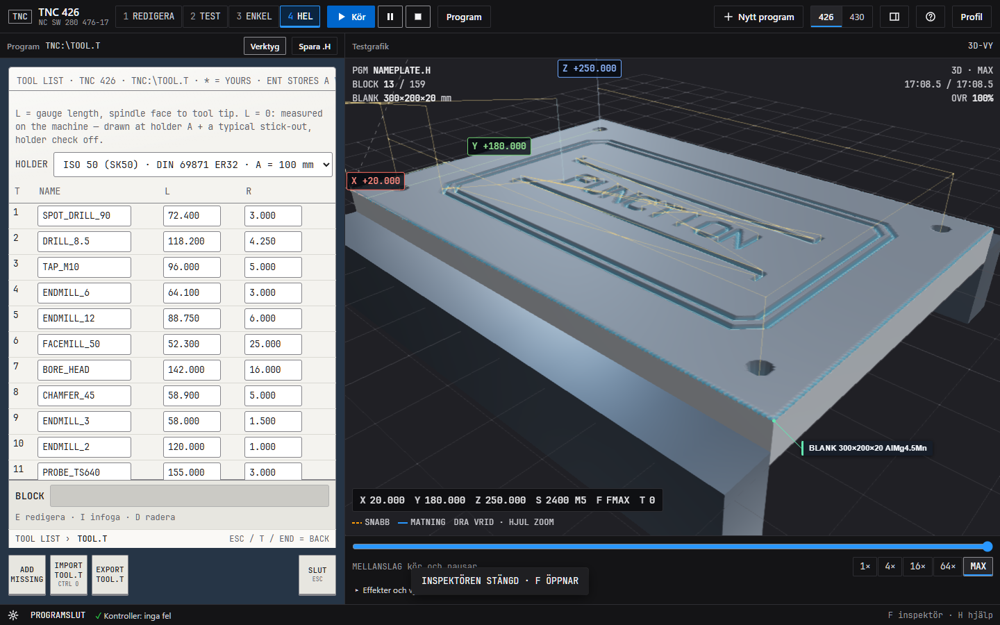

- **L** är verktygets längd från spindelnosen till spetsen. Med L = 0 räknas verktyget som inmätt på maskinen, och hållarkontrollen är avstängd för det verktyget.
- **R** är radien. Den används av radiekompenseringen (`RL`, `RR`) och bestämmer hur mycket material verktyget tar bort.
- **HOLDER** väljer verktygshållaren som ritas och som kontrolleras mot detaljen och skruvstycket.
- Ändra ett värde genom att skriva i rutan. Verktygsnumret ska vara 0–32767 och radien får inte vara negativ.

| Funktionstangent | Vad den gör |
|---|---|
| ADD MISSING | lägger till de verktyg som programmet anropar men som saknas i tabellen |
| IMPORT TOOL.T | läser in en verktygstabell från en fil |
| EXPORT TOOL.T | sparar tabellen som fil, till exempel `TOOL_TNC426.T` |
| SLUT | stänger tabellen (också ESC eller `T`) |

Ett program väljer verktyg med `TOOL CALL`, till exempel `TOOL CALL 4 Z S2000`. I PRG REDIGERA öppnar `W` dialogen för `TOOL CALL`. Bilden visar verktyget i sin hållare, med etiketter för verktyg, hållare och ämne; etiketterna slås av och på med `L`.

Skruvstycket är på från början och kan slås av under **Effekter och vy**. Simulatorn larmar om verktyget eller hållaren går in i skruvstycket.

Med servern har varje maskin också en verktygstabell på sidan Verktygstabeller. I Play skriver ett verktygsbyte in det nya verktyget i tabellen, se [Byta verktyg](#byta-verktyg).

## Play: verkstaden

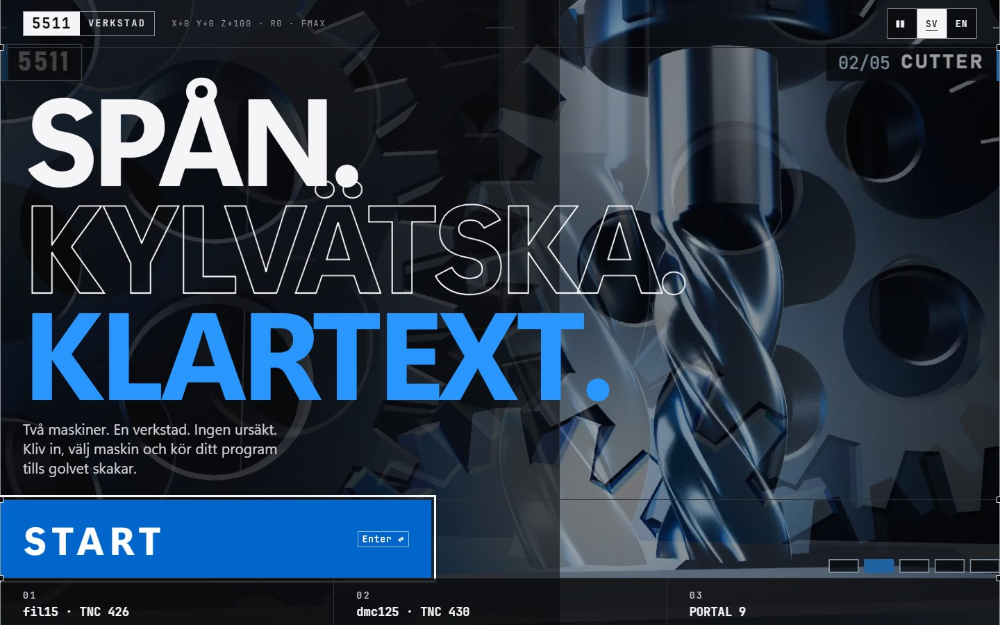

### Från startsidan till maskinen

1. Startsidan visar en START-knapp. Tryck ENTER eller klicka. Uppe till höger byter du språk och pausar bakgrundsfilmen.
2. Första gången visas en introduktion i tre steg. Tryck Nästa, eller Hoppa över.
3. Du står i verkstaden. Gå fram till en av de två märkta maskinerna, `fil15` med TNC 426 eller `dmc125` med TNC 430.
4. Tryck `E` när rutan **Öppna styrningen** visas. Kameran går fram till styrningen och simulatorn öppnas, inställd på den maskinens styrsystem.
5. Arbeta som i [Styrsystemet och redigering](#styrsystemet-och-redigering).
6. Tryck **Till verkstaden** i översta raden för att gå tillbaka. Programmet ligger kvar tills du kommer tillbaka.

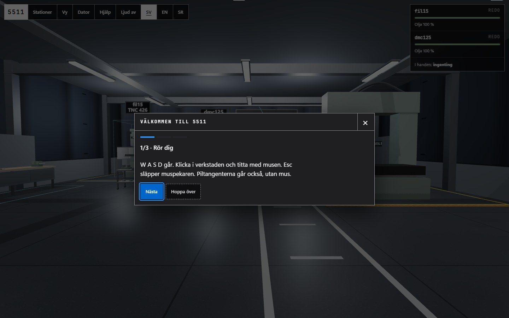

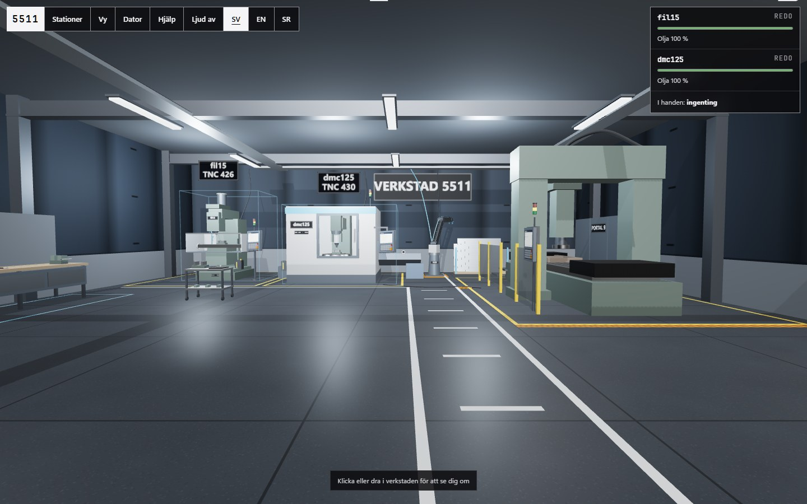

Det finns en enda simulator i verkstaden. Den kör ett program åt gången, så om ett program går på den ena maskinen kan du inte öppna styrningen på den andra. Då visas `Den andra maskinen kör. En simulator, ett program i taget.` Den tredje maskinen, PORTAL 9, står avställd och går bara att titta på.

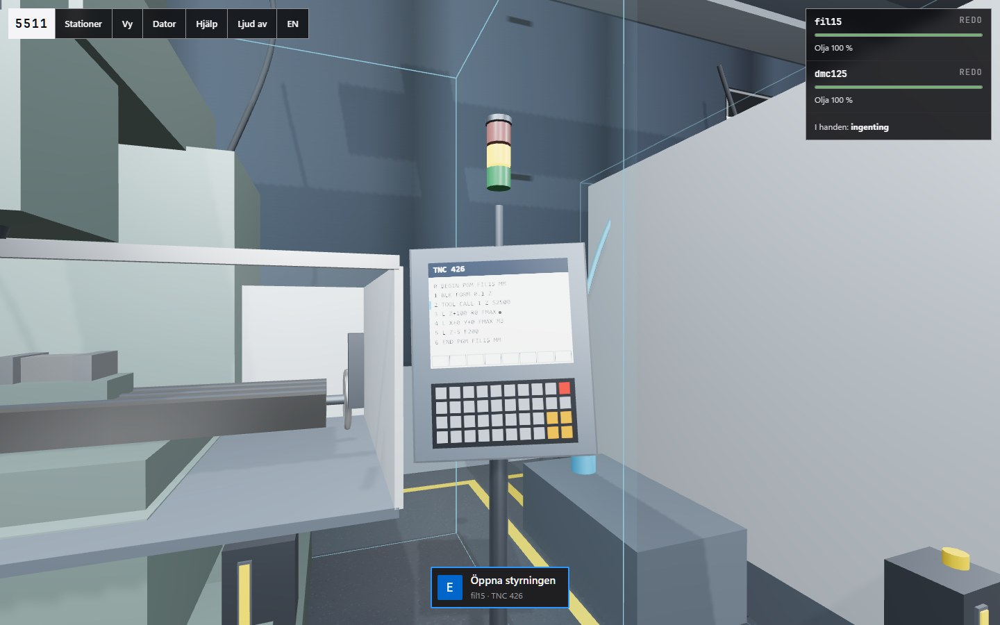

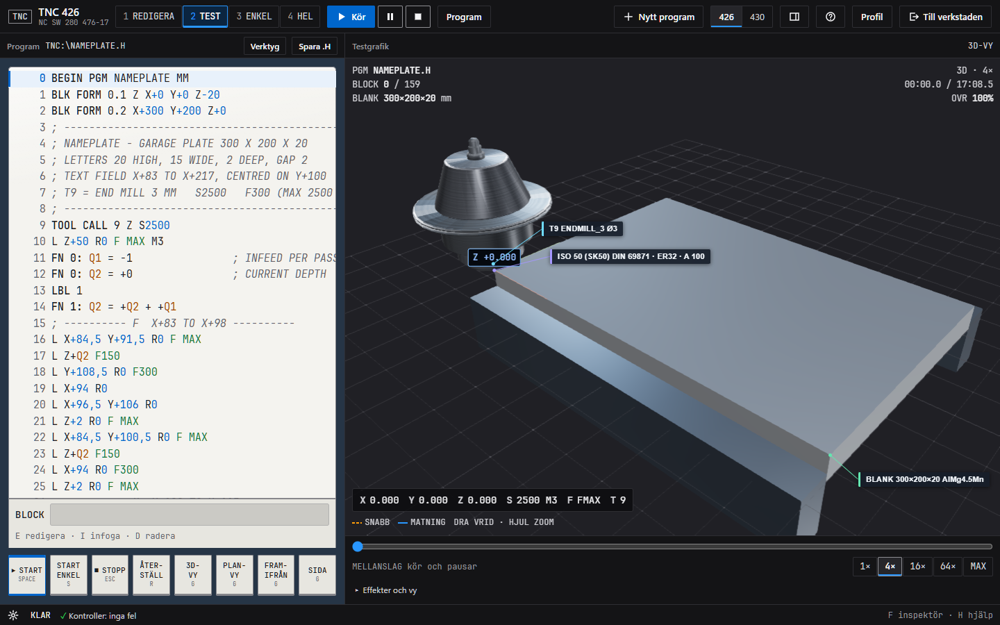

### Röra sig

| Tangent eller rörelse | Vad som händer |
|---|---|
| `W` `S` eller `↑` `↓` | gå framåt och bakåt |
| `A` `D` | gå i sidled |
| `←` `→` | vrid dig åt vänster och höger |
| SKIFT | gå fortare medan du håller den nere |
| klicka i verkstaden | muspekaren fångas, och du tittar runt genom att röra musen |
| ESC | släpper muspekaren |
| dra med musen eller fingret | tittar runt utan att fånga muspekaren |
| `E` | gör det som rutan längst ner föreslår för det du tittar på |

Piltangenterna räcker för att ta sig runt utan mus. Rutan längst ner går också att klicka på.

### Raden uppe till vänster

| Knapp | Vad den gör |
|---|---|
| Stationer | öppnar listan över allt som går att göra |
| Vy | byter kamera: Gå själv, Hela verkstaden, Runt maskinen, Skär-POV, Verktyget nära, Färdig detalj |
| Dator | öppnar verkstadsdatorn |
| Hjälp | visar introduktionen igen |
| Ljud av / Ljud på | stänger av och slår på ljudet |
| språkknappen | byter till nästa språk |

De tre sista vyerna är simulatorns egna kameror, så de öppnar styrningen på maskinen.

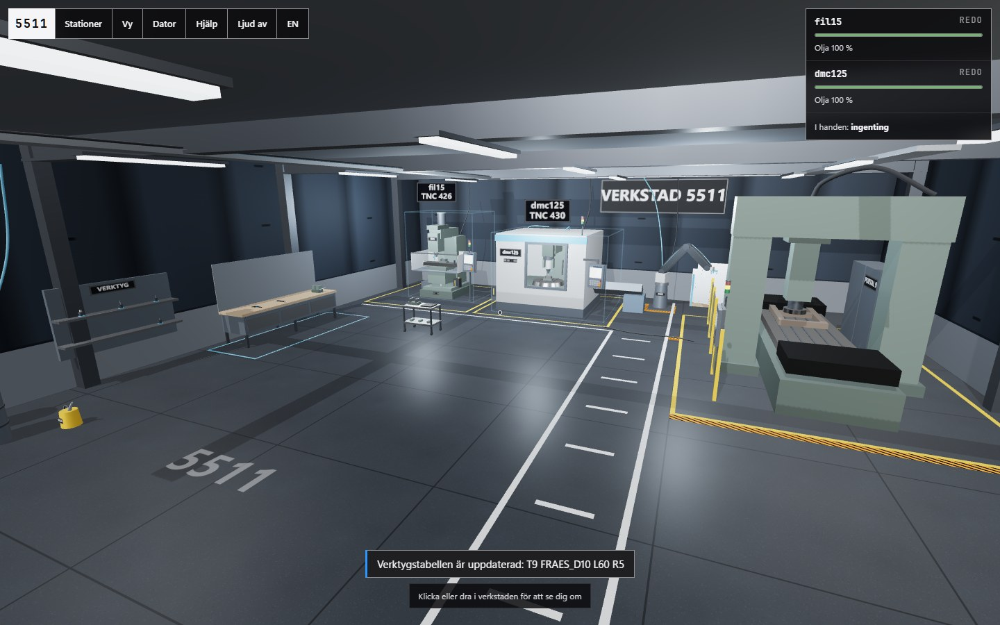

### Stationer

Allt som går att göra i 3D går också att göra i listan Stationer, utan att gå dit. Varje station har sina knappar och en knapp **Gå dit** som ställer dig framför den. För maskinerna visar listan också läget, oljenivån och verktyget i spindeln.

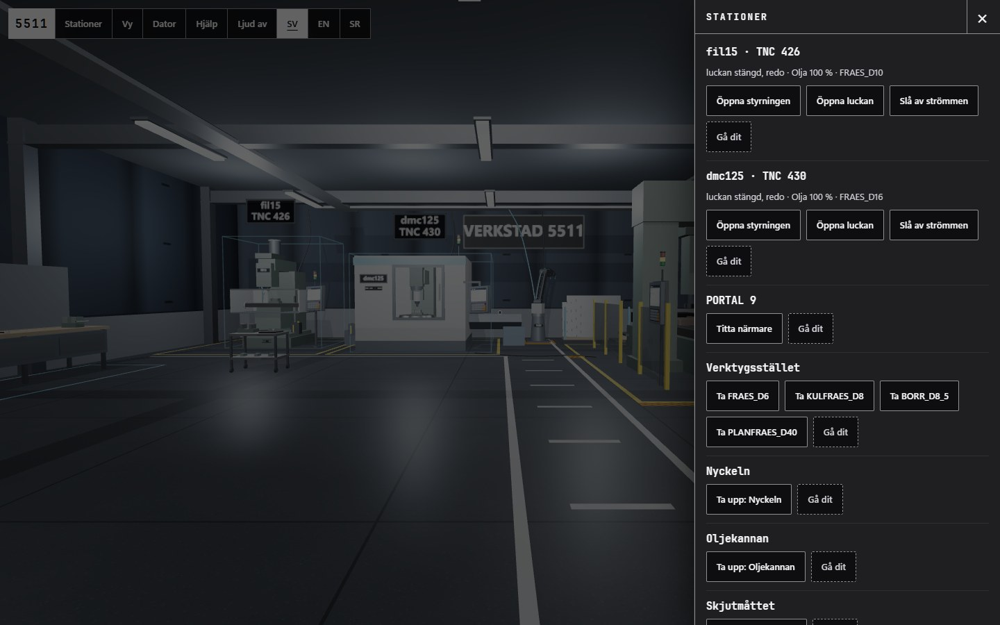

Stationerna är de två maskinerna, PORTAL 9, verktygsstället, nyckeln, oljekannan, skjutmåttet, verkstadsdatorn, ett skåp och en plåtarm.

Du kan bära en sak i handen (nyckeln, oljekannan eller skjutmåttet) och dessutom ett verktyg från stället. Rutan uppe till höger visar vad du har under **I handen**.

### Rutan uppe till höger

För varje maskin visas läget och en oljemätare.

| Läge | Betyder |
|---|---|
| REDO | maskinen går att starta |
| KÖR | ett program går på maskinen |
| SPÄRRAD | luckan är öppen, maskinen är låst, ett verktygsbyte pågår eller oljan är slut |
| STRÖM AV | strömmen är avslagen |

### Byta verktyg

Verktygsbytet görs i en bestämd ordning. Tar du ett steg för tidigt svarar verkstaden `Inte än. Ta stegen i ordning.` Går programmet svarar den `Nej. Maskinen går. Stoppa programmet först.`

1. Ta upp **nyckeln**. Den ligger på arbetsbänken.
2. Vid maskinen: **Öppna luckan**.
3. **Stoppa och lås maskinen**. Ett program som går stoppas.
4. **Lossa verktyget**. Det kräver nyckeln i handen.
5. **Ta ur verktyget**. Nu bär du det.
6. Vid verktygsstället: **Häng tillbaka verktyget** och ta ett annat, till exempel **Ta FRAES_D6**.
7. Vid maskinen: **Sätt i verktyget**.
8. **Dra åt verktyget**. Det kräver nyckeln igen.
9. **Lås upp maskinen** och **Stäng luckan**.

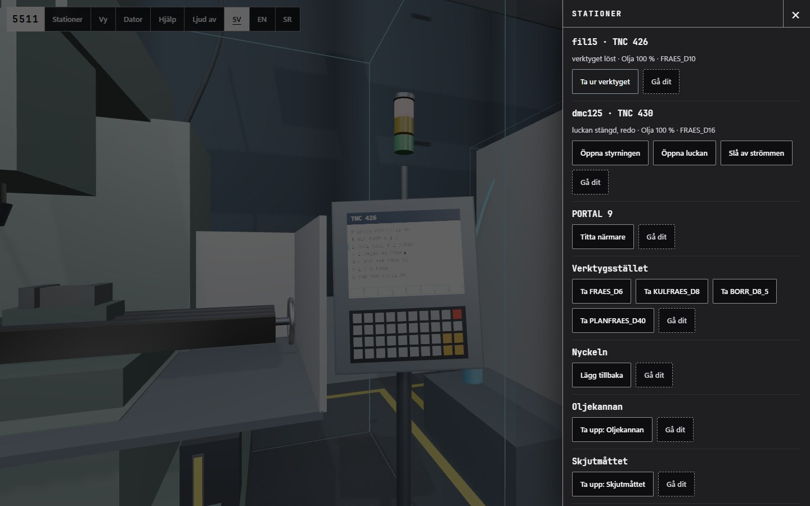

När du har dragit åt skrivs verktygets namn, längd och radie in i simulatorns verktygstabell, på den plats som det aktuella verktyget i simulatorn har. Verkstaden bekräftar med till exempel:

```
Verktygstabellen är uppdaterad: T9 FRAES_D10 L60 R5
```

Så länge luckan är öppen, maskinen är låst eller spindeln är tom går programmet inte att starta. Simulatorn visar då **LÅST** och skälet, till exempel `Luckan är öppen` eller `Verktygsbyte pågår`.

Verktygsstället har sex verktyg. Värdena är påhittade för verkstaden och kommer inte ur någon katalog.

| Verktyg | L (mm) | R (mm) |
|---|---|---|
| `FRAES_D6` | 50 | 3 |
| `FRAES_D10` | 60 | 5 |
| `FRAES_D16` | 75 | 8 |
| `KULFRAES_D8` | 60 | 4 |
| `BORR_D8_5` | 90 | 4,25 |
| `PLANFRAES_D40` | 45 | 20 |

Från början sitter `FRAES_D10` i `fil15` och `FRAES_D16` i `dmc125`. Ett verktyg som sitter i en spindel går inte att ta från stället.

### Ström

**Slå av strömmen** och **Slå på strömmen** finns vid varje maskin. Strömmen går inte att slå av medan ett program går. Med strömmen av går programmet inte att starta, och simulatorn visar `Strömmen är av på maskinen`.

### Olja och servicemätaren

Varje maskin har en oljemätare som går från 100 % till 0 %.

- Oljan sjunker bara medan maskinen faktiskt skär, med 2 procentenheter per minut. En full tank räcker alltså till 50 minuters skärande. Tiden du står stilla, redigerar eller har fliken gömd räknas inte.
- Vid 20 % visar mätaren **LÅG** och verkstaden säger `Oljan börjar ta slut. Hämta oljekannan.`
- Vid 0 % visar mätaren **TOM**. Ett program som går stoppas, och maskinen startar inte förrän du har fyllt på.
- Fyll på så här: ta upp **oljekannan**, gå till maskinen och välj **Fyll på olja**. Mätaren går till 100 %.

### Mäta detaljen

Ta upp **skjutmåttet** och välj **Mät detaljen** vid en maskin med stängd lucka. Styrningen öppnas med simulatorns kamera på den färdiga detaljen.

### Verkstadsdatorn

Öppna den med knappen Dator eller gå fram till den och tryck `E`.

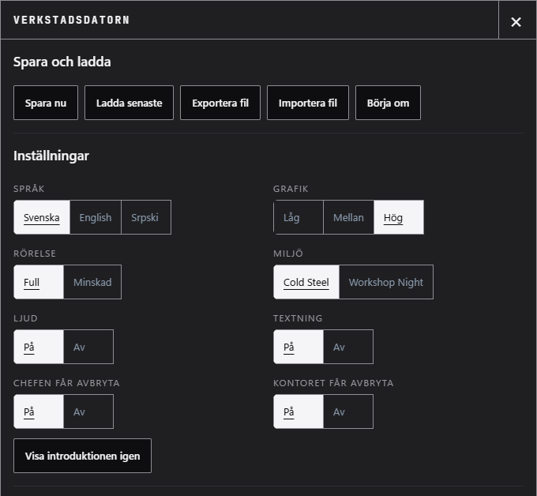

**Spara och ladda.** Spelet sparas av sig självt i webbläsaren varje gång något ändras.

| Knapp | Vad den gör |
|---|---|
| Spara nu | sparar läget direkt |
| Ladda senaste | går tillbaka till det senast sparade läget |
| Exportera fil | hämtar läget som filen `tnc-5511-save.json` |
| Importera fil | läser in en sådan fil; en ogiltig fil ger `Filen är inte en giltig sparfil.` |
| Börja om | återställer verkstaden: full olja, ström på, ursprungliga verktyg |

Det som sparas är oljenivån, strömmen och verktyget i spindeln för varje maskin, vad du har i handen och vilka påskägg du har hittat. Var du står sparas inte. En maskin som sparades med tom spindel kommer tillbaka öppen och låst, i väntan på ett verktyg. Dina program hör till simulatorns profil och sparas där.

**Inställningar.** Språk (Svenska, English, Srpski), Grafik (Låg, Mellan, Hög), Rörelse (Full, Minskad), Miljö (Cold Steel, Workshop Night), Ljud, Textning och de två figurerna. Språk, grafik, rörelse, miljö och ljud delas med simulatorn. **Visa introduktionen igen** öppnar de tre stegen på nytt.

**Hemligheter.** Datorn har en lista över påskäggen. Det du har hittat går att öppna därifrån. Resten får du leta efter själv.

### Figurerna

Två figurer kan komma förbi medan du är i verkstaden: **Chefen** och **Kontoret**. De säger några repliker och går igen.

- De kommer högst en gång var femte minut av aktiv tid, och de turas om.
- De kommer aldrig under introduktionen, medan en panel är öppen, medan du står vid en styrning eller medan simulatorn visar ett fel.
- **Nästa** (eller ENTER) går till nästa replik. **Hoppa över** (eller ESC) avslutar besöket.

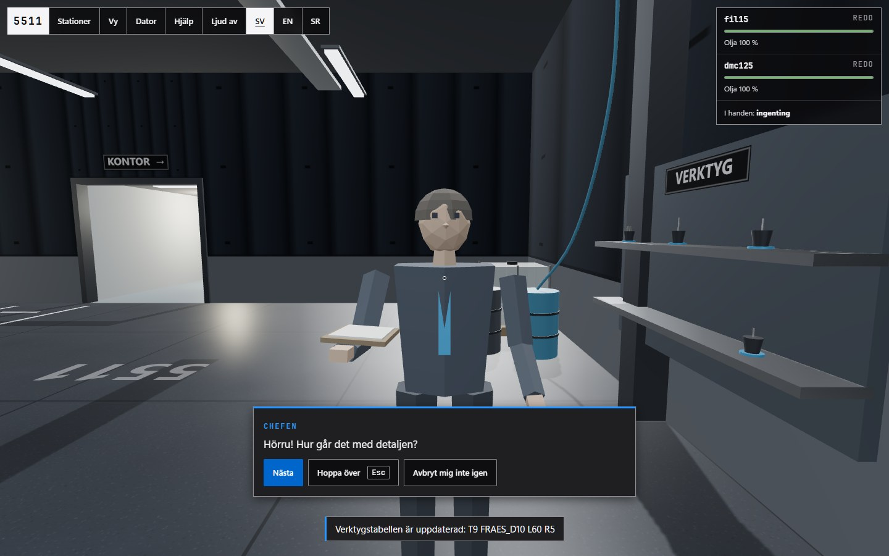

Så stänger du av dem:

| Du vill | Gör så |
|---|---|
| stänga av figuren som just pratar | tryck **Avbryt mig inte igen** i hens ruta |
| stänga av Chefen | Dator, Inställningar, **Chefen får avbryta**: Av |
| stänga av Kontoret | Dator, Inställningar, **Kontoret får avbryta**: Av |
| slå på dem igen | samma reglage: På |

### Textning och ljud

- **Textning** styr om figurernas repliker visas som text. Med Textning Av visas `(textning av)` i stället för repliken. Den är på från början.
- **Ljud av** i raden uppe till vänster, eller Ljud i datorn, stänger av simulatorns ljudsignaler för krascher och varningar. Bakgrundsfilmen på startsidan har inget ljud.

### Påskägg

Det finns påskägg i verkstaden. Titta dig omkring. Verkstadsdatorn håller reda på vilka du har hittat.

### Eget innehåll

Den som sätter upp en egen Play-utgåva kan lägga till en kort scen med två figurer i en datafil, utan att bygga om. Formatet står i [web/src/play/pack/README.md](../web/src/play/pack/README.md).

## Utseende

Utseendet ändrar aldrig hur ett program körs. Det består av två oberoende val som du gör under kugghjulet, fliken Utseende.

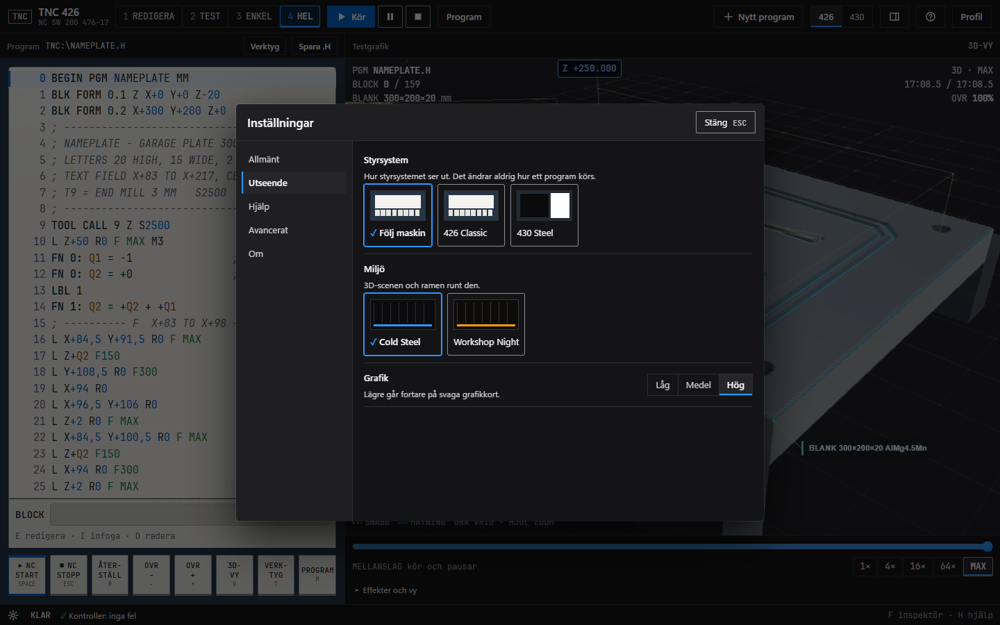

### Styrsystem

| Val | Hur det ser ut |
|---|---|
| **Följ maskin** (förvalt) | 426 Classic när TNC 426 är vald, 430 Steel när TNC 430 är vald |
| **426 Classic** | programmet till vänster, tjock ram, blockraden under skärmen, åtta fyrkantiga ljusa funktionstangenter |
| **430 Steel** | 3D-vyn till vänster, tunn stålram, blockraden ovanför en vit skärm, platta tangenter i två grupper om fyra |

De två utseendena är egna ritningar och inga kopior av de riktiga styrsystemens paneler.

### Miljö

| Val | Hur det ser ut |
|---|---|
| **Cold Steel** (förvalt) | kall, blågrå 3D-bakgrund |
| **Workshop Night** | mörk verkstad med varmare ljus |

Miljön gäller 3D-scenen och ramen runt den. I Play gäller samma val också verkstaden.

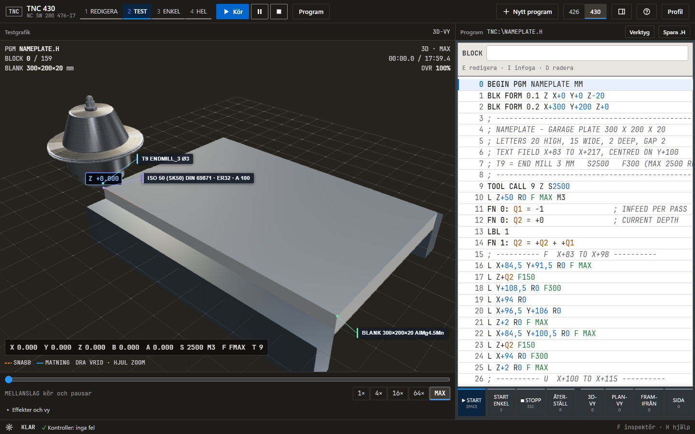

## Inställningar

Öppna inställningarna med kugghjulet nere till vänster eller med tangenten `,`. På telefon ligger de under Meny. Inställningarna sparas i webbläsaren och gäller direkt. De delas mellan simulatorfilen, Business och Play när de ligger på samma adress. Saknas de, eller är ett värde trasigt, används det förvalda värdet.

### Allmänt

| Inställning | Förvalt | Betyder |
|---|---|---|
| Språk | Svenska | Gränssnittets språk: Svenska, English eller Srpski (serbiska med latinska bokstäver). CNC-ord som `TOOL CALL` och programtext översätts aldrig. |
| Rörelse | System | System följer datorns inställning för minskad rörelse. Reducerad tar bort kameraskakning och animerade övergångar. |
| Ljud | På | Ljudsignaler vid krasch och varning. |
| Kortkommandotips | På | Visar tangenten på funktionstangenter, knappar och i tips. |
| Profil | | Öppnar profilen: namn, program, verktygstabell, export och import. |

### Utseende

| Inställning | Förvalt | Betyder |
|---|---|---|
| Styrsystem | Följ maskin | Se [Utseende](#utseende). |
| Miljö | Cold Steel | Se [Utseende](#utseende). |
| Grafik | Hög | Låg, Medel eller Hög. Lägre går fortare på svaga grafikkort. |

### Hjälp, Avancerat och Om

| Inställning | Betyder |
|---|---|
| Hjälp och lektioner | Öppnar hjälplådan. |
| Kortkommandon | Visar alla tangenter. |
| Introduktion | Visar introduktionsrutan igen: språk, styrsystem, rörelse och grafik, första program. |
| Återställ hjälp | Visar introduktionen igen och nollställer vilka lektioner som är klara. |
| Utvecklarlogg | Funktionslogg och versionshistorik, för den som utvecklar simulatorn. |
| Diagnostik | Uppgifter om utgåva, maskin och webbläsare som du kan kopiera in i en felrapport. |
| Om | Licens och meddelandet om att simulatorn inte är knuten till HEIDENHAIN. |

Play har samma val för språk, grafik, rörelse, miljö och ljud i verkstadsdatorn, och dessutom Textning och de två figurerna, se [Verkstadsdatorn](#verkstadsdatorn).

## Kortkommandon

Kortkommandona gäller i maskinvyn när ingen textruta har fokus. I Play gäller de när styrningen är öppen.

### Köra och titta

| Tangent | Vad den gör |
|---|---|
| MELLANSLAG | NC START, eller paus om programmet går |
| ENTER | kör ett block; i PRG REDIGERA redigerar den blocket |
| `S` | kör ett block |
| `R` | stoppar och går till början |
| ESC | pausar; stänger ett larm, en dialog eller en panel |
| `←` `→` | går bakåt och framåt i körningen; med SKIFT fem gånger så långt |
| `5` till `9` | hastighet 1×, 4×, 16×, 64×, MAX |
| `+` `-` | matningsoverride upp och ner i steg om 10 % |
| `G` | byter vy: 3D, uppifrån, framifrån, från sidan |
| `V` | visar programmet som flödesschema |
| `P` `K` `B` | spån, kylvätska, rök |
| `L` | etiketter i 3D-vyn |

### Lägen och paneler

| Tangent | Vad den gör |
|---|---|
| `1` till `4`, eller `F1` till `F4` | driftläge: PRG REDIGERA, TEST, ENKELBLOCK, HELKÖRNING |
| `F` | öppnar och stänger Inspektören |
| `T` | verktygstabellen |
| `M` | programlistan |
| `N` | nytt program |
| `H` | hjälp och lektioner |
| `,` | inställningar |

### Redigera

| Tangent | Vad den gör |
|---|---|
| `↑` `↓` | flyttar blockmarkören |
| HOME, END | första och sista blocket |
| PGUP, PGDN | tolv block upp och ner |
| `E` | redigerar blocket |
| `I` | infogar ett block |
| `D` eller DELETE | raderar blocket |
| `C` | kopierar blocket |
| TAB | råtext, när ingen knapp har fokus |
| `F2` | växlar mellan dialog och text medan du redigerar ett block |
| `Ctrl+Z` | ångrar |
| `Ctrl+Skift+Z` eller `Ctrl+Y` | gör om |
| `Ctrl+S` | sparar som `.H` |
| `Ctrl+O` | laddar en fil |

### Bara i PRG REDIGERA

| Tangent | Vad den gör |
|---|---|
| `Y` | `CYCL DEF` |
| `W` | `TOOL CALL` |
| `A` | `APPR` och `DEP` |
| `Q` | Q-parameter |

Tangenterna i en fråga står under [Guidad inmatning av block](#guidad-inmatning-av-block). Tangenterna i verkstaden står under [Röra sig](#röra-sig).

## Utan server och utan nyckel

Simulatorn är byggd för att fungera ensam. Tabellen visar vad som kräver mer.

| Funktion | Simulatorfilen eller en utgåva, utan server | Kräver servern | Kräver AI-nyckel |
|---|---|---|---|
| Skriva, köra och kontrollera program | ja | | |
| Båda maskinerna, alla cykler som simuleras | ja | | |
| Guidad inmatning, råtext, ångra | ja | | |
| Spara och ladda `.H`, `.zip`, `TOOL.T` | ja | | |
| Profil, projekt, export och import | ja | | |
| Uppvisningsprogrammen och lektionerna | ja | | |
| Styrsystem, miljö, språk, inställningar | ja | | |
| Play: verkstaden, verktygsbyte, olja, figurer, sparfil | ja | | |
| Programbibliotek med versioner | | ja | |
| Verktygstabeller på servern | | ja | |
| Konton och användare | | ja | |
| Dela ett program med en länk | | ja | |
| Skriva program med AI | | ja | ja, på servern |

Det här gäller när du är utan server:

- Allt du sparar ligger i den webbläsare du använder. En annan webbläsare eller dator ser det inte förrän du exporterar profilen och importerar den där.
- Menyn (☰) med bibliotek och konto visas inte i Business.
- Simulatorfilen behöver inget internet alls. Utgåvorna behöver bara nå den plats de själva ligger på.
- Startsidans film i Play finns bara om filmfilerna ligger med i bygget. Saknas de visas det ritade rutnätet i stället.

## Felsökning

### `PROGRAM MODE — NC START WORKS IN 2 TEST, 3 SINGLE-BLOCK, 4 FULL-RUN`

Du tryckte Kör i PRG REDIGERA, där inget körs. Tryck `2`, `3` eller `4` och sedan MELLANSLAG.

### `NO MOVES TO RUN`

Programmet har inga rörelser, till exempel för att det bara har `BEGIN PGM` och `END PGM`, eller för att ett fel stoppar det före första rörelsen. Öppna Inspektören med `F` och läs kontrollerna.

### LÅST, och programmet startar inte (Play)

Verkstaden spärrar starten. Skälet står efter ordet LÅST.

| Skäl | Gör så |
|---|---|
| `Strömmen är av på maskinen` | gå till maskinen och välj Slå på strömmen |
| `Oljan är slut: fyll på i verkstaden` | ta oljekannan och välj Fyll på olja vid maskinen |
| `Luckan är öppen` | välj Stäng luckan |
| `Maskinen är stoppad och låst i verkstaden` | välj Lås upp maskinen och sedan Stäng luckan |
| `Verktygsbyte pågår` | gör klart verktygsbytet, se [Byta verktyg](#byta-verktyg) |

### `Inte än. Ta stegen i ordning.` (Play)

Steget hör inte hemma i det läge maskinen är i. Öppna Stationer: där visas bara de steg som går att ta just nu.

### `Du behöver nyckeln. Den ligger på arbetsbänken.` (Play)

Att lossa och dra åt ett verktyg kräver nyckeln i handen. Ta upp den i Stationer eller på arbetsbänken.

### `Simulatorn svarar inte på verkstadens meddelanden ännu` (Play)

Verkstaden och simulatorn har inte fått kontakt, så maskinval, spärr och verktygsbyte når inte simulatorn. Ladda om sidan. Händer det igen är simulatorfilen i bygget äldre än verkstaden: bygg om utgåvan med `npm run build:play`.

### Maskinvyn är tom, eller `index.html missing: run python build.py in the repo root`

Utgåvan hittar inte simulatorfilen. Kör `python build.py` i projektets rot och starta utgåvan igen.

### `The TNC server does not answer at /api/v1. The library, tool tables and accounts need it.`

Du öppnade biblioteket, verktygstabellerna eller kontot utan att en server är igång. Starta servern, eller välj **Open the machine** för att gå tillbaka till maskinvyn, som fungerar utan server.

### `AI is off on this server (no OPENROUTER_API_KEY)`

Servern har ingen OpenRouter-nyckel. Den som sköter servern lägger in en, se [Var nyckeln finns](#var-nyckeln-finns).

### `OPENROUTER MODEL LIST UNREACHABLE — SHORT OFFLINE LIST; ANY ID CAN STILL BE TYPED`

Listan över modeller gick inte att hämta, oftast för att du saknar internet. Du ser en kort lista i stället och kan fortfarande skriva ett modellnamn för hand.

### `CYCLE n NOT IMPLEMENTED IN SIMULATOR` eller `TCH PROBE n NOT IMPLEMENTED IN SIMULATOR`

Programmet anropar en cykel eller en mätcykel som simulatorn inte kör, se [listan](#vad-som-simuleras-och-inte). Styrsystemet skulle köra den; simulatorn stannar där. Byt cykeln mot uttryckliga rörelser för att testa resten av programmet.

### `CYCLE n NEEDS A ROTARY TABLE`

Cyklerna 27 och 28 arbetar på en cylindermantel och kräver ett rundbord. Ingen av de två maskinerna i simulatorn har något.

### `CYCLE n NOT ON TNC 426/430`

Cykelnumret hör till ett nyare styrsystem och finns inte på TNC 426 eller 430.

### `FK NOT SIMULATED`

Blocket använder fri konturprogrammering (`FPOL`, `FL`, `FLT`, `FC`, `FCT`, `FSELECT`), som simulatorn inte räknar ut. Skriv konturen med `L`, `C`, `CC`, `CR` och `CT` i stället.

### `THIS BLOCK HAS NO DIALOG — EDIT IT AS TEXT`

Du tryckte `F2` på ett block som inte har någon dialog. Ändra det som text på blockraden.

### Cykeltiden är kortare än på maskinen

Simulatorn räknar inte med väntetider, verktygsbyten eller acceleration. Använd tiden för att jämföra två versioner av ett program, inte som en uppskattning för maskinen.

### Ett felskrivet verktygsnummer rapporteras inte

När ett program laddas skapas de verktyg som saknas i verktygstabellen. Öppna tabellen med `T` och gå igenom listan efter laddningen.

### Mina program är borta

Programmen sparas i webbläsaren, för den adress sidan har. De syns inte i en annan webbläsare, i ett privat fönster eller om sidan har fått en annan adress eller port. Öppna sidan på samma adress som förut. Har webbläsarens data rensats går programmen bara att få tillbaka från en exporterad profil.

### Grafiken går trögt

Välj Grafik: Låg och Rörelse: Reducerad under inställningarna. I Play finns samma val i verkstadsdatorn.

### Windows eller macOS varnar när skrivbordsappen installeras

Installationsprogrammen är inte signerade. På Windows väljer du **Mer information** och sedan **Kör ändå**; på macOS högerklickar du på appen och väljer **Öppna**.

## Vad som simuleras och inte

### Simuleras

- Räta linjer, cirkelbågar, polära rörelser och skruvlinjer.
- Radiekompensering (`RL`, `RR`), hörnrundning (`RND`) och fas (`CHF`), framkörning och frånkörning (`APPR`, `DEP`).
- Q-parametrar med formler och hopp, underprogram och programdelsupprepningar.
- Verktygstabellen och verktygsanrop.
- Två maskiner: TNC 426 med X, Y och Z, och TNC 430 med dessutom ett svänghuvud i A och B och cykel 19.
- Ett skruvstycke som verktyget och hållaren kan köra in i.
- Material som tas bort ur ämnet, och bortfräst volym.
- Simulatorns egna säkerhetskontroller: snabbtransport in i material, skärning med stillastående spindel, verktyg under ämnets botten, hög spånbelastning.

Cykler med egen rörelse: 1, 2, 3, 4, 5, 17, 18, 21–25 (SL-cykler), 200–215, 230, 231 och 262–265, 267 (gängfräsning), samt mönstren 220 och 221. Cykel 12 anropar ett program.

Cykler som ställer in något utan egen rörelse: 7, 8, 9, 10, 11, 14, 19, 20, 26, 32 och 247.

Mätcykler: 400, 403, 408–413, 415, 417 och 419 rör sig. Verktygsmätcyklerna 30–33, 480–483 och 562 tas emot utan rörelse.

### Simuleras inte

- Cykel 13 ger `CYCLE 13 NOT IMPLEMENTED IN SIMULATOR`. Cyklerna 27 och 28 ger `CYCLE n NEEDS A ROTARY TABLE`. Andra mätcykler ger `TCH PROBE n NOT IMPLEMENTED IN SIMULATOR`.
- FK, fri konturprogrammering: blocken `FPOL`, `FL`, `FLT`, `FC`, `FCT` och `FSELECT` ger `FK NOT SIMULATED`.
- Underskärningar. Materialet lagras som en höjd för varje punkt, så verktyget tar bara bort det som det sveper över längs sin axel.
- `F AUTO` använder matningen från `TOOL CALL`. `INCH`-program räknas inte om; skriv i millimeter.
- `M128` och `M114`.
- Radiekompensering i ett lutat bearbetningsplan på TNC 430 är ungefärlig.
- Cykeltiden räknar inte med väntetider, verktygsbyten eller acceleration, så den blir kortare än på en riktig maskin.
- Kylvätskan är en bild. `M8` och `M9` slår av och på sprutet, men det finns ingen vätskemodell.
- Verkstaden i Play är ett spel. Olja, ström, lucka och verktygsbyte påverkar bara om programmet får starta och vad som står i verktygstabellen. Maskinerna `fil15`, `dmc125` och PORTAL 9 är påhittade.

### Simulatorns egna val

- Där styrsystemets handbok inte visar verktygsbanan (delar av SL-cyklerna 21–24, gängfräsning och mätning) är banan simulatorns eget val. De öppna punkterna står i [CONTINUE.md](../CONTINUE.md) under "Open placeholders".
- Skärmformen för ett block, med `F MAX` och decimalkomma, är inte jämförd med ett riktigt styrsystem.
- De svenska och serbiska texterna i gränssnittet är simulatorns egna och är inte styrsystemets officiella svenska dialogtexter.
- Skruvstyckets mått är ett vanligt standardmått, inte ett uppmätt skruvstycke.
- Inget riktigt styrsystem och ingen programmeringsstation har kontrollerat simulatorn.

## Referens

### Var saker sparas

Allt nedan ligger i webbläsaren, för den adress sidan har.

| Vad | Var |
|---|---|
| Program, projekt och verktygstabell (profilen) | webbläsarens databas för sidan |
| Språk, styrsystem, miljö, grafik, rörelse, ljud | `tnc.settings.v1` |
| Inspektörens läge och vald maskin, per utgåva | `tnc.edition.business.v1`, `tnc.edition.play.v1` |
| Play: textning, figurer, om introduktionen är visad | `tnc.edition.play.v1` |
| Play: sparfilen | `tnc.play.save.v1` |
| Klara lektioner | `tnc.lessons.v1` |

På servern ligger databasen `tnc.db` och, om en nyckel är sparad, filen `openrouter.key` i serverns datamapp.

### För utvecklare

```sh
npm ci                     # bygg- och testverktyg
npm --prefix web ci        # webbdelens beroenden
python build.py            # bygger index.html ur mappen sim
python build.py --wasm     # bygger först om motorn från Rust (kräver rustup-målet wasm32-unknown-unknown)
npm run test:manual        # exemplen och reglerna ur styrsystemets handbok
npm run test:ui            # webbläsartesterna för simulatorn
npm run test:play          # Play-spelets regler
npm run test:e2e           # båda utgåvorna i en webbläsare; bygg dem först
npm run render:hero        # renderar om startsidans film i Play
```

Alla tester står i [CLAUDE.md](../CLAUDE.md#tests). Inget test behöver en AI-nyckel.

| Sökväg | Vad det är |
|---|---|
| `server/crates/tnc-core` | motorn: tolk, cykler, kontroller och materialmodell |
| `sim/` | simulatorns gränssnitt; `build.py` sätter ihop det till `index.html` |
| `web/` | utgåvornas webbsidor; `web/src/play/` är verkstaden |
| `server/` | servern |
| `desktop/` | skrivbordsappen |
| `examples/showcase/` | de sexton uppvisningsprogrammen |
| `media/landing-hyperframes/` | källan till startsidans film, se [dess README](../media/landing-hyperframes/README.md) |
| `tests/` | alla tester |
| [CONTINUE.md](../CONTINUE.md) | uppgiftslistan |

## Licens

MIT, se [LICENSE](../LICENSE). Tredjepartskod står i [THIRD_PARTY_NOTICES.md](../THIRD_PARTY_NOTICES.md). "HEIDENHAIN" och "TNC" är varumärken som tillhör DR. JOHANNES HEIDENHAIN GmbH.
