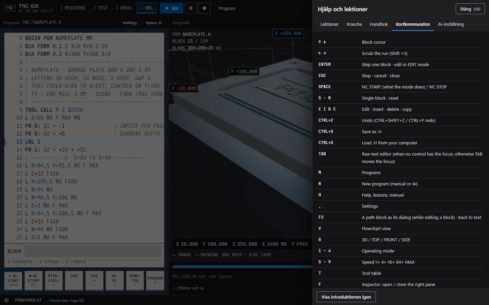
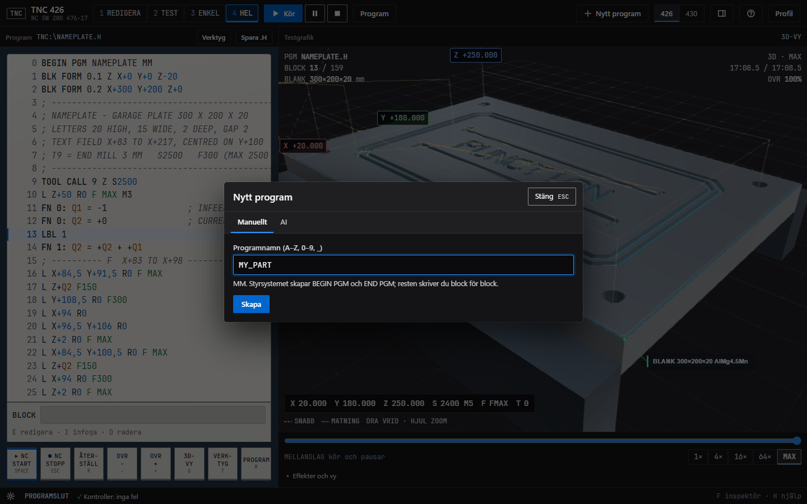
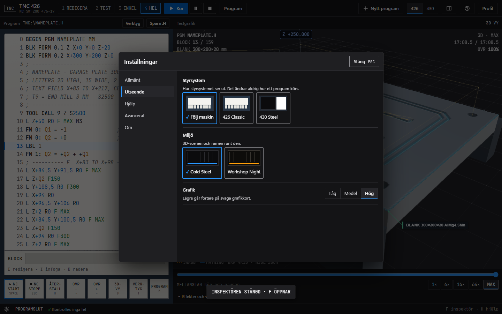
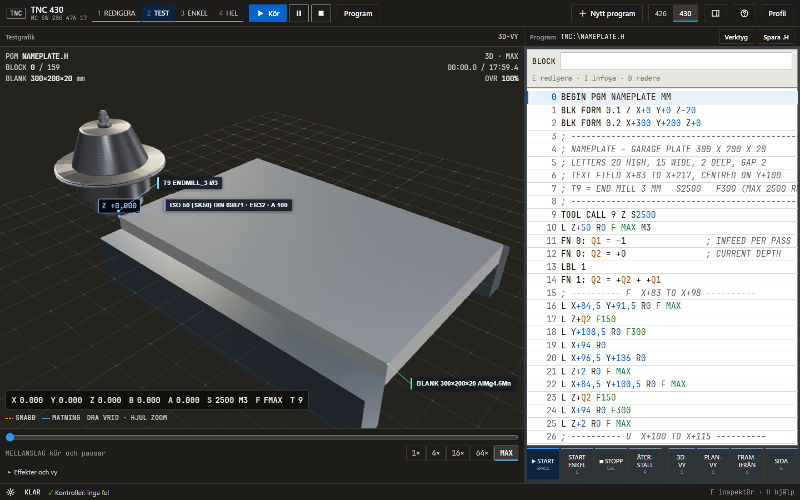

# TNC 426 / 430 Simulator: priručnik

[Svenska](MANUAL.md) · [English](MANUAL.en.md) · Srpski · Kratak pregled: [README](../README.md)

Slike prikazuju švedski interfejs, koji je podrazumevan. Nazivi dugmadi, kartica i poruka u tekstu navedeni su onako kako ih prikazuje engleski interfejs, da biste ih lako pronašli na ekranu. CNC sintaksa i imena se nikada ne prevode.

## Šta je ovo

Klartext je dijaloški programski jezik upravljačkih jedinica TNC 426 i TNC 430. U simulatoru pišete ili učitavate Klartext program, pokrećete ga i gledate kako alat skida materijal sa pripremka. Simulator prikazuje greške koje pronađe na bloku u kome nastaju, tako da možete da vežbate bez mašine.

Simulator postoji u dva izdanja koja dele isti motor i isti prozor programa:

- **Business** odmah otvara radni prostor mašine. Namenjen je onome ko želi da piše i pokreće programe bez ičega okolo.
- **Play** počinje početnom stranom i nastavlja se u radionici kroz koju se sami krećete. Tu stoje dve mašine, jedna sa TNC 426 i jedna sa TNC 430. Kada otvorite upravljanje na mašini, dobijate isti simulator kao u izdanju Business. Radionica dodaje održavanje, dva lika i nekoliko skrivenih iznenađenja.

Delovi su:

- **Datoteka simulatora** `index.html` je ceo simulator u jednoj datoteci. Otvara se direktno u pregledaču i ne treba joj ni internet ni server.
- **Izdanja** Business i Play su veb-strane koje prikazuju datoteku simulatora u okviru i dodaju svoje okruženje.
- **Desktop aplikacija** je izdanje u sopstvenom prozoru, sa bibliotekom programa na vašem računaru.
- **Server** nije obavezan. On daje naloge, biblioteku programa sa verzijama, tabele alata i linkove za deljenje, i čuva AI ključ.

Simulator nije povezan sa kompanijom HEIDENHAIN. Namenjen je obuci i ne služi za proveru programa za prave mašine.

## Sadržaj

1. [Pojmovi](#pojmovi)
2. [Instalacija](#instalacija)
3. [Izbor izdanja](#izbor-izdanja)
4. [Upravljanje i uređivanje](#upravljanje-i-uređivanje)
5. [Programi: čuvanje, učitavanje i biblioteka](#programi-čuvanje-učitavanje-i-biblioteka)
6. [AI programi i AI ključ](#ai-programi-i-ai-ključ)
7. [Alati i tabela alata](#alati-i-tabela-alata)
8. [Play: radionica](#play-radionica)
9. [Izgled](#izgled)
10. [Podešavanja](#podešavanja)
11. [Prečice na tastaturi](#prečice-na-tastaturi)
12. [Bez servera i bez ključa](#bez-servera-i-bez-ključa)
13. [Rešavanje problema](#rešavanje-problema)
14. [Šta se simulira, a šta ne](#šta-se-simulira-a-šta-ne)
15. [Referenca](#referenca)

## Pojmovi

- **Blok**: jedan red programa, na primer `L X+10 Y+20 R0 FMAX` (pravolinijsko kretanje brzim hodom).
- **Ciklus**: ugrađena obrada, na primer bušenje ili glodanje džepa. Podešava se sa `CYCL DEF`, a pokreće sa `CYCL CALL`.
- **Pripremak**: sirovi materijal, koji program zadaje sa `BLK FORM`.
- **Režim rada**: ono što upravljanje trenutno radi. Postoje četiri: PRG EDIT (pisanje), TEST (provera), SINGLE-BLOCK (izvršavanje blok po blok) i FULL-RUN (izvršavanje celog programa).
- **Softverski tasteri**: red dugmadi ispod programa. Njihov sadržaj se menja sa režimom rada, kao soft keys na upravljanju.
- **Polarne koordinate**: tačka zadata rastojanjem (`PR`) i uglom (`PA`) od pola, umesto sa X i Y. Pol se postavlja blokom `CC`.
- **Inspektor** (Inspector): tabla sa desne strane sa merenjima iz izvršavanja, proverama, referentnim materijalom i vašim programima. Zatvorena je dok je ne otvorite.
- **Profil** (Profile): vaši programi i vaša tabela alata, sačuvani u ovom pregledaču.
- **Izdanje**: Business ili Play.
- **Stanica**: stvar u Play radionici kod koje nešto možete da uradite, na primer mašina, stalak za alate ili računar.

## Instalacija

Za datoteku simulatora ne morate ništa da instalirate: otvorite `index.html` u pregledaču. Ostatak ovog poglavlja odnosi se na izdanja.

### Šta vam je potrebno

| Potrebno | Za šta | Kako da proverite |
|---|---|---|
| Node.js 22 ili noviji, sa npm | izdanja i alati oko njih | `node --version` |
| Python 3 | samo ako želite ponovo da izgradite datoteku simulatora | `python --version` (na macOS i Linux sistemima `python3 --version`) |
| Rust | samo za server i desktop aplikaciju | `cargo --version` |

### Koraci

1. Preuzmite zavisnosti u korenu projekta. Ovo instalira alate za izgradnju i testiranje.

   ```sh
   npm ci
   ```

2. Preuzmite zavisnosti veb-dela, koji se nalazi u fascikli `web`.

   ```sh
   npm --prefix web ci
   ```

3. Pokrenite izdanje. Komanda pokreće lokalni veb-server koji sluša samo na vašem računaru.

   ```sh
   npm run dev:business
   ```

4. Proverite da li radi. Komanda ispisuje adresu:

   ```
   ➜  Local:   http://127.0.0.1:5426/
   ```

   Otvorite adresu. Treba da vidite radni prostor mašine sa programom `NAMEPLATE.H` i karticu koja pita za jezik. Ako je port 5426 zauzet, komanda bira sledeći slobodan port i ispisuje njega.


Datoteka simulatora `index.html` dolazi uz projekat, pa ne morate da je gradite. Ako ste nešto promenili u fascikli `sim`, izgradite je ponovo sa `python build.py` (na macOS i Linux sistemima `python3 build.py`).

## Izbor izdanja

| Želite | Pokrenite | Rezultat |
|---|---|---|
| da isprobate Business dok radite | `npm run dev:business` | lokalna adresa koja otvara radni prostor mašine na `/work` |
| da isprobate Play dok radite | `npm run dev:play` | lokalna adresa koja otvara početnu stranu na `/play` |
| da izgradite Business za veb-sajt | `npm run build:business` | fascikla `dist/business` |
| da izgradite Play za veb-sajt | `npm run build:play` | fascikla `dist/play` |
| samo simulator, bez ičega okolo | otvorite `index.html` | simulator u jednoj datoteci |
| aplikaciju u sopstvenom prozoru | vidite [Desktop aplikacija](#desktop-aplikacija) | instalacioni program |

### Izgrađene fascikle

`dist/business` i `dist/play` sadrže sve što je izdanju potrebno, uključujući kopiju datoteke simulatora. Stavite fasciklu na bilo koji veb-server koji ume da isporučuje datoteke; poseban serverski softver nije potreban. Fascikla mora da bude u korenu veb-sajta i da se otvara preko `http://` ili `https://`. Dvoklik na `dist/business/index.html` ne radi, jer strana preuzima simulator sa adrese `/sim/`.

Izgradnja kopira datoteku simulatora iz korena projekta. Ako datoteka nedostaje, izgradnja staje sa porukom `index.html missing in the repo root: run python build.py first`.

Business ne sadrži ništa od izdanja Play: radionica, film sa početne strane i likovi postoje samo u `dist/play`. Play sadrži i radni prostor mašine na `/work`.

### Datoteka simulatora

`index.html` je isti simulator koji prikazuju izdanja, bez ičega okolo. Ima isti radni prostor mašine, ista podešavanja i iste programe. Koristite je kada želite jednu datoteku koju nosite sa sobom ili kada nemate internet.

### Desktop aplikacija

Desktop aplikacija je izdanje u sopstvenom prozoru. Ona pokreće sopstveni server unutar aplikacije, na `127.0.0.1` i samo za vaš računar, čuva bazu podataka u sistemskoj fascikli za podatke aplikacija i automatski vas prijavljuje. Ako aplikaciju pokrenete još jednom, otvoreni prozor dolazi u prvi plan.

| Želite | Pokrenite | Ime aplikacije |
|---|---|---|
| da izgradite Business kao aplikaciju | `npm run desktop:business` | TNC 426-430 Business |
| da izgradite Play kao aplikaciju | `npm run desktop:play` | TNC 5511 Play |

Instalacioni programi nisu potpisani, pa Windows i macOS upozoravaju kada ih prvi put otvorite.

Za izgradnju je potreban Rust, a pored toga: na Windows sistemu MSVC build tools i WebView2 (ugrađen u Windows 10 i 11); na macOS sistemu Xcode command-line tools; na Linux sistemu WebKitGTK 4.1 (`libwebkit2gtk-4.1-dev libsoup-3.0-dev libjavascriptcoregtk-4.1-dev librsvg2-dev libxdo-dev libssl-dev`).

### Sa serverom

Server je potreban samo za ono što je navedeno pod [Bez servera i bez ključa](#bez-servera-i-bez-ključa). On sluša na `127.0.0.1:8426` ako ne zadate drugačije. Da bi izdanje koje pokrećete sa `npm run dev:business` ili `npm run dev:play` koristilo server koji već radi, upišite adresu servera u promenljivu okruženja `TNC_SERVER` pre pokretanja:

```powershell
$env:TNC_SERVER = 'http://127.0.0.1:8426'
npm run dev:business
```

Kada server odgovara, Business dobija malo dugme menija (☰) na ivici sa stavkama Programs, Tool tables, Account i, za administratore, Users. Kada prvi put otvorite biblioteku na novom serveru, strana traži da napravite prvi nalog, koji postaje administrator.

## Upravljanje i uređivanje


### Ekran

- **Gornja traka** ima četiri režima rada, dugmad Run, Pause i Stop, dugme New program, prekidač 426 | 430 i dugmad za Inspector, Help i Profile.
- **Program** je levo (sa upravljanjem 430 Steel desno). Označeni blok je onaj koji se izvršava ili uređuje. Iznad liste su dugmad Tools i Save .H.
- **Red bloka** ispod programa je mesto gde kucate blok ili odgovarate na pitanje.
- **Softverski tasteri** su na dnu. Svaki taster sitnim slovima prikazuje i svoj taster na tastaturi.
- **Test grafika** prikazuje pripremak, alat i putanju alata. Prevucite da rotirate, točkićem zumirajte. Isprekidana linija je brzi hod, puna linija je pomak. Pozicija (X, Y, Z, broj obrtaja, pomak i alat) nalazi se u okviru preko slike.
- **Donja traka** ima zupčanik za podešavanja, stanje izvršavanja i broj grešaka iz provera.

### Režimi rada

| Taster | Režim | Šta radi RAZMAKNICA |
|---|---|---|
| `1` | PRG EDIT | ništa; softverski tasteri pišu blokove |
| `2` | TEST | pokreće i zaustavlja |
| `3` | SINGLE-BLOCK | izvršava sledeći blok |
| `4` | FULL-RUN | pokreće i zaustavlja |

Ako pritisnete Run u režimu PRG EDIT, simulator odgovara `PROGRAM MODE — NC START WORKS IN 2 TEST, 3 SINGLE-BLOCK, 4 FULL-RUN`. Prvo promenite režim.

### Pokretanje programa

1. Pritisnite `2` za TEST ili `4` za FULL-RUN.
2. Pritisnite RAZMAKNICU ili Run. Pritisnite ponovo za pauzu.
3. Izaberite brzinu tasterima `5` do `9`: 1×, 4×, 16×, 64× i MAX.
4. Povucite klizač ispod grafike, ili pritisnite `←` i `→`, da se krećete napred i nazad kroz izvršavanje. Kada idete unazad, pripremak se ponovo izgrađuje.
5. Pritisnite `R` ili Stop da krenete od početka.

Greške se prikazuju uz svoj blok. Otvorite Inspector tasterom `F` da vidite vreme izvršavanja, put u pomaku, put u brzom hodu, najniži Z i skinutu zapreminu, kao i listu provera.


Da uporedite dve verzije programa: završite izvršavanje, izaberite **Store run as reference A** u Inspectoru, promenite program i pokrenite ga ponovo. Tabela Compare prikazuje razliku u vremenu ciklusa, putu u pomaku, putu u brzom hodu, broju kretanja, najnižem Z i skinutoj zapremini.

### Vođeni unos bloka

U režimu PRG EDIT blok gradite odgovarajući na jedno po jedno pitanje, kao na upravljanju. Ne morate da znate kako se blok piše.

1. Pritisnite `1` za PRG EDIT.
2. Postavite kursor na blok posle koga treba da dođe novi.
3. Pritisnite softverski taster za vrstu bloka, na primer `L` za pravu liniju. Red iznad softverskih tastera pokazuje na kom ste pitanju.
4. Upišite odgovor i pritisnite ENTER. ENTER bez vrednosti preskače pitanje koje može da se preskoči.
5. Posle poslednjeg pitanja blok se čuva i simulator ponovo proverava program.

| Taster | Šta radi u pitanju |
|---|---|
| ENTER | prihvata odgovor i prelazi na sledeće pitanje (ENT) |
| SHIFT+ENTER | ostavlja pitanje bez vrednosti (NO ENT) |
| END | završava dijalog i čuva blok sa onim što ste odgovorili |
| ESC | prekida dijalog bez čuvanja (DEL) |
| DELETE | briše ono što ste upisali (CE) |
| `X` `Y` `Z` | bira osu u pitanju o koordinatama; na TNC 430 i `B` i `A` |
| `I` | čini vrednost inkrementalnom |
| `P` | prelazi na polarne koordinate |
| `Q` | odgovara Q parametrom |
| `+` `-` | menja znak |
| `#` | uzima trenutnu poziciju |

Softverski tasteri u režimu PRG EDIT raspoređeni su u tri reda. Prvi red ima funkcije putanje `L`, `CC`, `C`, `CR`, `CT`, `CP`, `RND` i `CHF`. Drugi red ima `APPR/DEP`, `TOOL DEF`, `TOOL CALL`, `CYCL DEF`, `CYCL CALL`, `LBL SET`, `LBL CALL` i `Q`. Treći red ima uređivanje, umetanje, brisanje, poništavanje, ponavljanje, alate, sirovi tekst i proveru.

### Polarni blokovi: LP sa PR i PA

Polarni blok zadaje cilj radijusom `PR` i uglom `PA` od pola. Pol mora da postoji pre toga, u bloku `CC`.

1. Upišite pol, na primer `CC X+0 Y+0`.
2. Pritisnite softverski taster `L`. Pitanje se najpre odnosi na obične koordinate.
3. Pritisnite `P`. Dijalog prelazi na polarnu liniju i dobija oznaku **Polar coordinates**.
4. Odgovorite na radijus, na primer `57`, i pritisnite ENTER.
5. Odgovorite na ugao, na primer `157,5`, i pritisnite ENTER.
6. Izaberite korekciju radijusa softverskim tasterom `R0`, `RL` ili `RR`.
7. Odgovorite na pomak, na primer `MAX`, a zatim na M funkciju, ili pritisnite ENTER ako je nema.


Ispod pitanja prikazuje se blok dokle ste stigli sa odgovorima. Kada završite, na švedskom ekranu u programu stoji:

```
LP PR+57 PA+157,5 R0 F MAX
```

Kako se to čita:

- **Decimalni zarez na ekranu.** Kada je jezik švedski, ekran prikazuje decimalne brojeve sa zarezom. Kada je jezik engleski, prikazuje tačku: `LP PR+57 PA+157.5 R0 F MAX`. U pitanju smete da upišete zarez ili tačku; oba znače isto.
- **Tačka u datoteci.** U sačuvanoj datoteci blok ima tačku i nema razmak u pomaku, onako kako ga upravljanje piše: `LP PR+57 PA+157.5 R0 FMAX`. Tekst programa i komentari se nikada ne prepravljaju.
- **Neke reči uvek zadržavaju tačku**, i na švedskom ekranu: `BLK FORM 0.1`, `CYCL DEF 7.1`, `TCH PROBE 0.0` i `FN 0:`.
- **Neispravan broj se ne prihvata.** Ako, na primer, kao ugao upišete `1,2,3`, pitanje ostaje.

`P` radi na isti način za `C` (postaje `CP`), `CT` (postaje `CTP`) i za prilaz i odlazak sa `APPR` i `DEP`. `CC` je uvek u Dekartovim koordinatama.


### Izmena bloka

Postavite kursor na blok i pritisnite `E`.

- Polarni blok (`LP`, `CP`, `CTP`) otvara se u svom dijalogu sa popunjenim trenutnim vrednostima. ENTER zadržava vrednost. Kada završite, blok se zamenjuje.
- Svaki drugi blok otvara se u redu bloka kao tekst. Izmenite tekst i pritisnite ENTER da sačuvate ili ESC da odustanete.
- `F2` prebacuje između dijaloga i teksta dok uređujete. Blokovi `L`, `CC`, `C`, `CR`, `CT`, `RND` i `CHF` mogu se tako otvoriti u dijalogu. Za blok koji nema dijalog simulator odgovara `THIS BLOCK HAS NO DIALOG — EDIT IT AS TEXT`.

`I` umeće novi blok posle kursora, `D` ili DELETE briše blok, a `C` ga kopira. `Ctrl+Z` poništava, a `Ctrl+Shift+Z` ili `Ctrl+Y` ponavlja.

### Uređivanje sirovog teksta

Pritisnite TAB dok nijedno dugme ni klizač nema fokus. Ceo program se tada prikazuje kao polje za tekst u kome slobodno kucate, lepite i pomerate redove. Pritisnite TAB ponovo da se vratite; program se tada ponovo proverava. Ako neko dugme ima fokus, TAB umesto toga pomera fokus na sledeće dugme, kao u drugim programima.

### Pomoć i lekcije

Pritisnite `H`. Fioka ima pet kartica: Lessons (svaka lekcija učitava sopstveni program i pokreće mašinu umesto vas), Crash it (poznati načini da se mašina slupa, ovde bez rizika), Manual, Shortcuts i AI setup. Lekcije ne diraju vaše programe.



### Na telefonu

Na ekranu užem od 900 piksela radni prostor mašine deli se na tri radne površine: Program, Graphics i Status. Menjajte ih karticama ili prevlačenjem u stranu. Softverski tasteri ostaju na dnu, po osam odjednom. New program, prekidač mašine, Help, Profile i podešavanja nalaze se pod Menu.


## Programi: čuvanje, učitavanje i biblioteka

### Novi program

Pritisnite `N` ili New program. Dijalog ima dve kartice.

- **Manual**: upišite ime programa sa A–Z, 0–9 i donjom crtom i pritisnite Create. Simulator pravi `BEGIN PGM` i `END PGM` u milimetrima, a ostatak pišete blok po blok.
- **AI**: vidite [AI programi i AI ključ](#ai-programi-i-ai-ključ).



### Lista programa

Pritisnite `M` ili dugme Programs. Lista prikazuje sve programe u simulatoru sa veličinom, statusom i projektom. Birajte strelicama.


| Softverski taster | Taster | Šta radi |
|---|---|---|
| NEW | `N` | otvara dijalog New program |
| OPEN | ENTER | otvara označeni program |
| LOAD FROM PC | `Ctrl+O` | učitava datoteku sa računara |
| SAVE .H | `Ctrl+S` | čuva program kao datoteku |
| RESTORE ORIGINAL | `R` | vraća ugrađeni program u izvorno stanje |
| DELETE | DELETE | briše vaš program |
| ADD TO PROJECT | | dodaje program u aktivni projekat |
| END | ESC | vraća na program |

Ugrađeni program ne može da se obriše; simulator odgovara `BUILT-IN PROGRAM — USE RESTORE ORIGINAL INSTEAD`.

### Čuvanje i učitavanje datoteka

- **Čuvanje**: `Ctrl+S` čuva otvoreni program kao datoteku `.H` sa brojevima blokova, u formatu listinga upravljanja.
- **Učitavanje**: `Ctrl+O`, ili prevucite datoteku u prozor. Simulator čita `.H` i `.I` (u UTF-8 ili Windows-1252) i `.zip` arhive sa više programa.
- **Alati koji nedostaju**: ako program poziva alat koga nema u tabeli alata, alat se pravi kada se program učita, kao pri uvozu na upravljanju. Pogrešno upisan broj alata se zato ne otkriva pri učitavanju.

### Profil

Vaši programi i vaša tabela alata sami se čuvaju u pregledaču. Pod Profile možete profilu da date ime, da izvezete sve kao `.zip` i da ga uvezete u drugom pregledaču. Pri uvozu birate **Merge** (dodaj) ili **Replace** (zameni). Brisanjem podataka pregledača za stranu profil nestaje, zato ga prethodno izvezite.

**Projekat** je imenovana fascikla sa programima. Pravite ga u Inspectoru na kartici My programs. Novi programi ulaze u aktivni projekat, a ZIP preuzima fasciklu kao datoteke `.H`.

### Šesnaest pokaznih programa

Uz simulator dolazi šesnaest programa, od kojih svaki pokazuje jednu tehniku. Nalaze se u listi programa i u fascikli `examples/showcase`. Uvodna kartica vam nudi da jedan od njih izaberete kao prvi program. To su primeri za vežbu i nisu izvršavani na pravom upravljanju.

| Program | Šta pokazuje |
|---|---|
| `01_NAMEPLATE.H` | Gravira KLARTEXT pravim potezima u dva prolaza i gloda okvir sa zaobljenim uglovima. |
| `02_STEPPED_POCKET.H` | Tri pravougaona džepa jedan u drugom sa ciklusom 4, svaki stepenik 6 mm dublji. |
| `03_SPIRAL_POCKET.H` | Okrugli džep Ø70 glodan iz sredine ka spolja po spirali od inkrementalnih polarnih blokova. |
| `04_BOLT_CIRCLE.H` | Osam rupa na podeonom krugu (ciklusi 200 i 220) i glodani središnji otvor (ciklus 208). |
| `05_POLAR_STAR.H` | Petokraka zvezda napisana u potpunosti polarnim blokovima (`CC`, `LP PR/PA`) unutar prstena. |
| `06_ROUNDED_PLATE.H` | Čeono glodana ploča sa radijusom na uglovima, konturno glodana sa korekcijom radijusa, i četiri rupe. |
| `07_HELIX_BORE.H` | Otvor glodan zavojnicom (`CP` sa `IZ`) na dva radijusa, i upuštanje. |
| `08_CONTOUR_ISLAND.H` | SL ciklusi: džep sa zaobljenim uglovima i dva ostrva, grubo glodan, zatim fino obrađeni dno i strana. |
| `09_GEAR_OUTLINE.H` | Kontura nalik zupčaniku sa 12 zubaca pravih bokova u polarnim blokovima. Vizuelna demonstracija, ne sertifikovan evolventni zupčanik. |
| `10_COOLANT_SWEEP.H` | Čeono glodanje ciklusom 230 i vijugavi žleb loptastim glodalom, sve sa rashladnom tečnošću (`M8`). |
| `11_Q_PATTERN.H` | Tri rozete izračunate Q parametrima, sa skokovima i potprogramom. |
| `12_SUBPROGRAM_GRID.H` | Jedan potprogram poziva se 15 puta u mreži sa pomeranjem nulte tačke (ciklus 7). |
| `13_RADIUS_COMP.H` | Isti kvadrat izvršava se tri puta sa `RR`, `R0` i `RL`, pa se pomak putanje vidi kao stepenice. |
| `14_MULTI_TOOL.H` | Sedam alata u jednom izvršavanju: čeono glodalo, grubi džep, fini džep, zabušivač, burgija, ureznik i glodalo za obaranje ivica. |
| `15_430_SWIVEL.H` | Samo TNC 430: ciklus 19 naginje zakretnu glavu za 30 stepeni, gloda se kosa površina i buše se dve rupe upravno na nju. |
| `16_5511_SHOWCASE.H` | Razigrana radionička značka sa velikim ciframa, okvirom, dve polarne zvezde i četiri oznake zakivaka. |

### Biblioteka na serveru

Kada server radi i prijavljeni ste, program sa ekrana možete da stavite u biblioteku servera: otvorite meni (☰) i izaberite **Save to library**. Meni odgovara jednim od ovih redova:

```
NAMEPLATE.H added to the library.
NAMEPLATE.H saved as v2.
NAMEPLATE.H is unchanged (v2).
```

Strana Programs na serveru prikazuje sve programe sa verzijama. Tu možete da otvorite stariju verziju, da je vratite i da podelite program linkom.

## AI programi i AI ključ

Kartica AI u dijalogu New program piše program na osnovu opisa. Izaberite **New program** da krenete od nule ili **Change current** da AI izmeni program koji je otvoren, napišite šta želite i pritisnite **Generate** ili **Change the program**. `Ctrl+Z` poništava izmenu.

Generisanje se odvija u krugovima. AI napiše program, server ga proverava istim interpreterom koji koristi simulator, a simulator meri izglodani obradak prema onome što ste tražili. Ako program ima grešku, ako bi izazvao sudar ili ne reže ono što treba, nalazi se vraćaju AI-ju na novi pokušaj: prvi program i najviše pet krugova ispravki. Za učitavanje se nudi samo program koji prođe proveru. Ako nijedan ne prođe, najbolji pokušaj se čuva kao nacrt koji sami možete da otvorite, i ništa se ne učitava. Po nalogu može da radi jedno generisanje odjednom.

### Gde se nalazi ključ

AI radi preko servisa OpenRouter i nijednog drugog. Za to je potreban OpenRouter ključ, a on ostaje na strani servera, nikada u pregledaču.

- Server uzima ključ iz promenljive okruženja `OPENROUTER_API_KEY`, ili iz ključa koji je administrator sačuvao na serveru. Sačuvani ključ ima prednost nad promenljivom okruženja. Samo administrator može da sačuva ili ukloni ključ; u desktop aplikaciji jedini lokalni korisnik je administrator.
- Ključ se ne proverava kada se čuva. Pogrešan ključ se pokaže pri prvom generisanju.
- Sačuvani ključ se nalazi u datoteci `openrouter.key` u fascikli sa podacima servera. Datoteku može da čita samo nalog koji pokreće server. Nije šifrovana, pa fasciklu sa podacima čuvajte kao i druge tajne.
- Ključ se nikada ne upisuje u bazu podataka, nikada u odgovor pregledaču i nikada u red dnevnika.
- Pregledač serveru šalje samo svoju prijavu. Server dodaje ključ i prosleđuje pitanje.
- Server ima ograničenje po korisniku i mesecu, 5 američkih dolara ako nije drugačije podešeno (`TNC_AI_MONTHLY_BUDGET_USD`). Modeli koji smeju da se biraju mogu se ograničiti sa `TNC_AI_MODELS`. Podrazumevani model je `deepseek/deepseek-v4.1-flash`.

### Šta se šalje i kada

Ništa od onoga što napišete ne napušta vaš računar dok ne pritisnete **Generate** ili **Change the program**. Tada se vaš opis, tabela alata i, kada menjate program, tekst programa šalju servisu OpenRouter i dalje onome ko pokreće model koji ste izabrali. Oni obrađuju tekst prema sopstvenim uslovima. Zato u opis ne unosite ništa poverljivo. Generisanje koje je u toku možete da prekinete tasterom ESC.

> **ZA DOPUNU (AI dijalog i AI interfejs servera se još grade).** Ovaj odeljak opisuje samo ono što se moglo pročitati u kodu u trenutku pisanja priručnika. Kada delovi budu završeni, treba dopuniti sledeće:
>
> 1. Gde u interfejsu administrator čuva i uklanja ključ i kako se dugmad zovu.
> 2. Tačan tekst koji dijalog prikazuje pre nego što se bilo šta pošalje servisu OpenRouter.
> 3. Šta dijalog prikazuje dok krugovi traju i kako se otvara nacrt.
> 4. Šta važi za datoteku simulatora `index.html` bez servera.
> 5. Poruke o greškama koje dijalog prikazuje (nema ključa, nema kredita, dostignuto mesečno ograničenje, model ne odgovara).

## Alati i tabela alata

Pritisnite `T` ili dugme Tools. Tabela alata odgovara datoteci `TOOL.T` na upravljanju: jedan alat po redu sa brojem (T), imenom, dužinom (L) i radijusom (R). Svaka mašina ima svoju tabelu.


- **L** je dužina alata od čela vretena do vrha. Sa L = 0 alat se smatra izmerenim na mašini, a provera držača je isključena za taj alat.
- **R** je radijus. Koristi ga korekcija radijusa (`RL`, `RR`) i on određuje koliko materijala alat skida.
- **HOLDER** bira držač alata koji se crta i proverava prema obratku i stegi.
- Vrednost menjate kucanjem u njeno polje. Broj alata mora biti 0–32767, a radijus ne sme biti negativan.

| Softverski taster | Šta radi |
|---|---|
| ADD MISSING | dodaje alate koje program poziva, a kojih nema u tabeli |
| IMPORT TOOL.T | učitava tabelu alata iz datoteke |
| EXPORT TOOL.T | čuva tabelu kao datoteku, na primer `TOOL_TNC426.T` |
| END | zatvara tabelu (takođe ESC ili `T`) |

Program bira alat sa `TOOL CALL`, na primer `TOOL CALL 4 Z S2000`. U režimu PRG EDIT taster `W` otvara dijalog za `TOOL CALL`. Slika prikazuje alat u držaču, sa oznakama za alat, držač i pripremak; oznake se uključuju i isključuju tasterom `L`.

Stega je uključena od početka i može se isključiti pod **Effects and view**. Simulator javlja alarm ako alat ili držač uđe u stegu.

Sa serverom svaka mašina ima i tabelu alata na strani Tool tables. U izdanju Play zamena alata upisuje novi alat u tabelu, vidite [Zamena alata](#zamena-alata).

## Play: radionica


### Od početne strane do mašine

1. Početna strana prikazuje dugme START. Pritisnite ENTER ili kliknite. Gore desno menjate jezik i pauzirate pozadinski film.
2. Prvi put se prikazuje uvod u tri koraka. Pritisnite Next ili Skip.
3. Stojite u radionici. Priđite jednoj od dve označene mašine, `fil15` sa TNC 426 ili `dmc125` sa TNC 430.
4. Pritisnite `E` kada se pojavi okvir **Open the control**. Kamera prilazi upravljanju i simulator se otvara, podešen na upravljanje te mašine.
5. Radite kao u poglavlju [Upravljanje i uređivanje](#upravljanje-i-uređivanje).
6. Pritisnite **To the workshop** u gornjoj traci da se vratite. Program ostaje tu dok se ne vratite.


U radionici postoji samo jedan simulator. On izvršava jedan program odjednom, pa ako program radi na jednoj mašini, ne možete da otvorite upravljanje na drugoj. Tada vidite `The other machine is running. One simulator, one program at a time.` Treća mašina, PORTAL 9, isključena je i može samo da se gleda.


### Kretanje

| Taster ili pokret | Šta se dešava |
|---|---|
| `W` `S` ili `↑` `↓` | hodate napred i nazad |
| `A` `D` | koračate u stranu |
| `←` `→` | okrećete se levo i desno |
| SHIFT | hodate brže dok ga držite |
| klik u radionici | pokazivač se hvata, a vi gledate okolo pomeranjem miša |
| ESC | oslobađa pokazivač |
| prevlačenje mišem ili prstom | gledate okolo bez hvatanja pokazivača |
| `E` | radi ono što okvir na dnu predlaže za stvar koju gledate |

Strelice su dovoljne da se krećete bez miša. Na okvir na dnu može i da se klikne.

### Red gore levo

| Dugme | Šta radi |
|---|---|
| Stations | otvara listu svega što može da se uradi |
| View | menja kameru: Walk, Whole workshop, Around the machine, Cutting POV, Tool close-up, Finished part |
| Computer | otvara računar radionice |
| Help | ponovo prikazuje uvod |
| Sound off / Sound on | isključuje i uključuje zvuk |
| dugme za jezik | prelazi na sledeći jezik |

Poslednja tri pogleda su kamere samog simulatora, pa otvaraju upravljanje na mašini.


### Stanice

Sve što može da se uradi u 3D prostoru može da se uradi i iz liste Stations, bez hodanja. Svaka stanica ima svoju dugmad i dugme **Go there** koje vas postavlja ispred nje. Za mašine lista prikazuje i stanje, nivo ulja i alat u vretenu.


Stanice su dve mašine, PORTAL 9, stalak za alate, ključ, kanta za ulje, pomično merilo, računar radionice, jedan orman i jedna limena ruka.

U ruci možete da nosite jednu stvar (ključ, kantu za ulje ili pomično merilo) i uz to jedan alat sa stalka. Okvir gore desno pokazuje šta držite, pod **In hand**.

### Okvir gore desno

Za svaku mašinu prikazuje stanje i merač ulja.

| Stanje | Znači |
|---|---|
| READY | mašina može da se pokrene |
| RUNNING | na mašini radi program |
| LOCKED | vrata su otvorena, mašina je zaključana, zamena alata je u toku ili je ulje potrošeno |
| POWER OFF | napajanje je isključeno |

### Zamena alata

Zamena alata se radi utvrđenim redom. Ako neki korak uradite prerano, radionica odgovara `Not yet. Take the steps in order.` Ako program radi, odgovara `No. The machine is running. Stop the program first.`

1. Uzmite **ključ** (Wrench). Nalazi se na radnom stolu.
2. Kod mašine: **Open the door**.
3. **Stop and lock out the machine**. Program koji radi se zaustavlja.
4. **Loosen the tool**. Za ovo vam treba ključ u ruci.
5. **Take the tool out**. Sada ga nosite.
6. Kod stalka za alate: **Hang the tool back** i uzmite drugi, na primer **Take FRAES_D6**.
7. Kod mašine: **Fit the tool**.
8. **Clamp the tool**. Za ovo vam ponovo treba ključ.
9. **Unlock the machine** i **Close the door**.


Kada stegnete alat, njegovo ime, dužina i radijus upisuju se u tabelu alata simulatora, na mesto alata koji je trenutno aktivan u simulatoru. Radionica potvrđuje, na primer:

```
Tool table updated: T9 FRAES_D10 L60 R5
```

Dok su vrata otvorena, mašina zaključana ili vreteno prazno, program ne može da se pokrene. Simulator tada prikazuje **LOCKED** i razlog, na primer `The door is open` ili `A tool change is in progress`.

Stalak za alate ima šest alata. Vrednosti su izmišljene za radionicu i ne potiču ni iz jednog kataloga.

| Alat | L (mm) | R (mm) |
|---|---|---|
| `FRAES_D6` | 50 | 3 |
| `FRAES_D10` | 60 | 5 |
| `FRAES_D16` | 75 | 8 |
| `KULFRAES_D8` | 60 | 4 |
| `BORR_D8_5` | 90 | 4,25 |
| `PLANFRAES_D40` | 45 | 20 |

Na početku je `FRAES_D10` u mašini `fil15`, a `FRAES_D16` u mašini `dmc125`. Alat koji je u vretenu ne može da se uzme sa stalka.

### Napajanje

**Switch the power off** i **Switch the power on** nalaze se kod svake mašine. Napajanje ne može da se isključi dok program radi. Kada je napajanje isključeno, program ne može da se pokrene, a simulator prikazuje `The machine power is off`.

### Ulje i servisni merač

Svaka mašina ima merač ulja koji ide od 100 % do 0 %.

- Ulje opada samo dok mašina zaista reže, i to 2 procentna poena u minuti. Pun rezervoar zato traje 50 minuta rezanja. Vreme dok stojite, uređujete ili je kartica pregledača skrivena ne računa se.
- Na 20 % merač prikazuje **LOW**, a radionica kaže `The oil is running low. Fetch the oil can.`
- Na 0 % merač prikazuje **EMPTY**. Program koji radi se zaustavlja, a mašina se ne pokreće dok ne dolijete ulje.
- Dolivanje: uzmite **kantu za ulje** (Oil can), idite do mašine i izaberite **Refill the oil**. Merač se vraća na 100 %.

### Merenje obratka

Uzmite **pomično merilo** (Caliper) i izaberite **Measure the part** kod mašine sa zatvorenim vratima. Upravljanje se otvara sa kamerom simulatora na gotovom obratku.

### Računar radionice

Otvorite ga dugmetom Computer, ili mu priđite i pritisnite `E`.


**Čuvanje i učitavanje (Save and load).** Igra se sama čuva u pregledaču svaki put kada se nešto promeni.

| Dugme | Šta radi |
|---|---|
| Save now | odmah čuva stanje |
| Load latest | vraća na poslednje sačuvano stanje |
| Export file | preuzima stanje kao datoteku `tnc-5511-save.json` |
| Import file | učitava takvu datoteku; neispravna datoteka daje `That file is not a valid save.` |
| Start over | vraća radionicu na početak: puno ulje, uključeno napajanje, prvobitni alati |

Čuva se nivo ulja, napajanje i alat u vretenu svake mašine, ono što držite u ruci i skrivena iznenađenja koja ste pronašli. Mesto na kome stojite se ne čuva. Mašina koja je sačuvana sa praznim vretenom vraća se otvorena i zaključana, u čekanju na alat. Vaši programi pripadaju profilu simulatora i čuvaju se tamo.

**Podešavanja (Settings).** Language (Svenska, English, Srpski), Graphics (Low, Medium, High), Motion (Full, Reduced), Environment (Cold Steel, Workshop Night), Sound, Captions i dva lika. Jezik, grafika, kretanje, okruženje i zvuk dele se sa simulatorom. **Show the introduction again** ponovo otvara tri koraka uvoda.

**Tajne (Secrets).** Računar vodi listu skrivenih iznenađenja. Ono što ste pronašli možete da otvorite odatle. Ostalo tražite sami.

### Likovi

Dok ste u radionici mogu da naiđu dva lika: **The boss** (šef) i **The office** (kancelarija). Kažu nekoliko rečenica i odu.

- Dolaze najviše jednom u pet minuta aktivnog vremena i smenjuju se.
- Nikada ne dolaze tokom uvoda, dok je otvorena neka tabla, dok ste kod upravljanja ili dok simulator prikazuje grešku.
- **Next** (ili ENTER) prelazi na sledeću rečenicu. **Skip** (ili ESC) završava posetu.


Kako da ih isključite:

| Želite | Uradite ovo |
|---|---|
| da isključite lik koji upravo govori | pritisnite **Do not interrupt me again** u njegovom okviru |
| da isključite šefa | Computer, Settings, **The boss may interrupt**: Off |
| da isključite kancelariju | Computer, Settings, **The office may interrupt**: Off |
| da ih ponovo uključite | isti prekidač: On |

### Titlovi i zvuk

- **Captions** određuje da li se rečenice likova prikazuju kao tekst. Kada je Captions na Off, umesto rečenice se prikazuje `(captions off)`. Uključeno je od početka.
- **Sound off** u redu gore levo, ili Sound u računaru, isključuje zvučne signale simulatora za sudare i upozorenja. Pozadinski film na početnoj strani nema zvuk.

### Skrivena iznenađenja

U radionici ima skrivenih iznenađenja (Easter eggs). Razgledajte. Računar radionice pamti koja ste pronašli.

### Sopstveni sadržaj

Ko postavlja sopstveno izdanje Play može da doda kratku scenu sa dva lika u datoteci sa podacima, bez ponovne izgradnje. Format je opisan u [web/src/play/pack/README.md](../web/src/play/pack/README.md).

## Izgled

Izgled nikada ne menja način na koji se program izvršava. Sastoji se od dva nezavisna izbora koja pravite pod zupčanikom, na kartici Appearance.



### Upravljanje (Controller)

| Izbor | Kako izgleda |
|---|---|
| **Follow machine** (podrazumevano) | 426 Classic kada je izabran TNC 426, 430 Steel kada je izabran TNC 430 |
| **426 Classic** | program levo, debeo okvir, red bloka ispod ekrana, osam četvrtastih svetlih softverskih tastera |
| **430 Steel** | 3D prikaz levo, tanak čelični okvir, red bloka iznad belog ekrana, ravni tasteri u dve grupe po četiri |

Oba izgleda su sopstveni crteži, a ne kopije panela pravih upravljanja.

### Okruženje (Environment)

| Izbor | Kako izgleda |
|---|---|
| **Cold Steel** (podrazumevano) | hladna, plavosiva 3D pozadina |
| **Workshop Night** | mračna radionica sa toplijim svetlom |

Okruženje se odnosi na 3D scenu i okvir oko nje. U izdanju Play isti izbor važi i za radionicu.



## Podešavanja

Podešavanja otvarate zupčanikom dole levo ili tasterom `,`. Na telefonu su pod Menu. Podešavanja se čuvaju u pregledaču i važe odmah. Dele ih datoteka simulatora, Business i Play kada su na istoj adresi. Ako nedostaju, ili je neka vrednost oštećena, koristi se podrazumevana vrednost.

### General

| Podešavanje | Podrazumevano | Značenje |
|---|---|---|
| Language | Svenska | Jezik interfejsa: Svenska, English ili Srpski (srpski, latinica). CNC reči kao što je `TOOL CALL` i tekst programa nikada se ne prevode. |
| Motion | System | System prati podešavanje računara za smanjeno kretanje. Reduced uklanja podrhtavanje kamere i animirane prelaze. |
| Sound | On | Zvučni signali pri sudaru i upozorenju. |
| Shortcut hints | On | Prikazuje taster na softverskim tasterima, dugmadima i u opisima. |
| Profile | | Otvara profil: ime, programi, tabela alata, izvoz i uvoz. |

### Appearance

| Podešavanje | Podrazumevano | Značenje |
|---|---|---|
| Controller | Follow machine | Vidite [Izgled](#izgled). |
| Environment | Cold Steel | Vidite [Izgled](#izgled). |
| Graphics | High | Low, Medium ili High. Niža vrednost radi brže na slabim grafičkim karticama. |

### Help, Advanced i About

| Podešavanje | Značenje |
|---|---|
| Help and lessons | Otvara fioku pomoći. |
| Shortcuts | Prikazuje sve tastere. |
| Introduction | Ponovo prikazuje uvodnu karticu: jezik, upravljanje, kretanje i grafika, prvi program. |
| Reset help | Ponovo prikazuje uvod i briše evidenciju završenih lekcija. |
| Developer log | Dnevnik funkcija i istorija verzija, za one koji razvijaju simulator. |
| Diagnostics | Podaci o izdanju, mašini i pregledaču koje možete da kopirate u prijavu greške. |
| About | Licenca i napomena da simulator nije povezan sa kompanijom HEIDENHAIN. |

Play ima iste izbore za jezik, grafiku, kretanje, okruženje i zvuk u računaru radionice, a uz to Captions i dva lika, vidite [Računar radionice](#računar-radionice).

## Prečice na tastaturi

Prečice važe u radnom prostoru mašine dok nijedno polje za tekst nema fokus. U izdanju Play važe dok je upravljanje otvoreno.

### Izvršavanje i prikaz

| Taster | Šta radi |
|---|---|
| RAZMAKNICA | NC START, ili pauza ako program radi |
| ENTER | izvršava jedan blok; u režimu PRG EDIT uređuje blok |
| `S` | izvršava jedan blok |
| `R` | zaustavlja i vraća na početak |
| ESC | pauzira; zatvara alarm, dijalog ili tablu |
| `←` `→` | kreće se nazad i napred kroz izvršavanje; sa SHIFT pet puta dalje |
| `5` do `9` | brzina 1×, 4×, 16×, 64×, MAX |
| `+` `-` | korekcija pomaka naviše i naniže u koracima od 10 % |
| `G` | menja prikaz: 3D, odozgo, spreda, sa strane |
| `V` | prikazuje program kao dijagram toka |
| `P` `K` `B` | strugotina, rashladna tečnost, dim |
| `L` | oznake u 3D prikazu |

### Režimi i table

| Taster | Šta radi |
|---|---|
| `1` do `4`, ili `F1` do `F4` | režim rada: PRG EDIT, TEST, SINGLE-BLOCK, FULL-RUN |
| `F` | otvara i zatvara Inspector |
| `T` | tabela alata |
| `M` | lista programa |
| `N` | novi program |
| `H` | pomoć i lekcije |
| `,` | podešavanja |

### Uređivanje

| Taster | Šta radi |
|---|---|
| `↑` `↓` | pomera kursor bloka |
| HOME, END | prvi i poslednji blok |
| PGUP, PGDN | dvanaest blokova gore i dole |
| `E` | uređuje blok |
| `I` | umeće blok |
| `D` ili DELETE | briše blok |
| `C` | kopira blok |
| TAB | sirovi tekst, dok nijedno dugme nema fokus |
| `F2` | prebacuje između dijaloga i teksta dok uređujete blok |
| `Ctrl+Z` | poništava |
| `Ctrl+Shift+Z` ili `Ctrl+Y` | ponavlja |
| `Ctrl+S` | čuva kao `.H` |
| `Ctrl+O` | učitava datoteku |

### Samo u režimu PRG EDIT

| Taster | Šta radi |
|---|---|
| `Y` | `CYCL DEF` |
| `W` | `TOOL CALL` |
| `A` | `APPR` i `DEP` |
| `Q` | Q parametar |

Tasteri unutar pitanja navedeni su pod [Vođeni unos bloka](#vođeni-unos-bloka). Tasteri u radionici navedeni su pod [Kretanje](#kretanje).

## Bez servera i bez ključa

Simulator je napravljen da radi samostalno. Tabela pokazuje šta zahteva više.

| Funkcija | Datoteka simulatora ili izdanje, bez servera | Zahteva server | Zahteva AI ključ |
|---|---|---|---|
| Pisanje, izvršavanje i provera programa | da | | |
| Obe mašine, svi ciklusi koji se simuliraju | da | | |
| Vođeni unos, sirovi tekst, poništavanje | da | | |
| Čuvanje i učitavanje `.H`, `.zip`, `TOOL.T` | da | | |
| Profil, projekti, izvoz i uvoz | da | | |
| Pokazni programi i lekcije | da | | |
| Upravljanje, okruženje, jezik, podešavanja | da | | |
| Play: radionica, zamena alata, ulje, likovi, sačuvana igra | da | | |
| Biblioteka programa sa verzijama | | da | |
| Tabele alata na serveru | | da | |
| Nalozi i korisnici | | da | |
| Deljenje programa linkom | | da | |
| Pisanje programa pomoću AI | | da | da, na serveru |

Kada nemate server, važi sledeće:

- Sve što sačuvate nalazi se u pregledaču koji koristite. Drugi pregledač ili računar to ne vidi dok ne izvezete profil i ne uvezete ga tamo.
- Meni (☰) sa bibliotekom i nalogom ne prikazuje se u izdanju Business.
- Datoteci simulatora internet uopšte nije potreban. Izdanja treba samo da dosegnu mesto na kome se sama nalaze.
- Film na početnoj strani izdanja Play postoji samo ako su datoteke filma deo izgradnje. Bez njih se prikazuje nacrtana mreža.

## Rešavanje problema

### `PROGRAM MODE — NC START WORKS IN 2 TEST, 3 SINGLE-BLOCK, 4 FULL-RUN`

Pritisnuli ste Run u režimu PRG EDIT, u kome se ništa ne izvršava. Pritisnite `2`, `3` ili `4`, a zatim RAZMAKNICU.

### `NO MOVES TO RUN`

Program nema kretanja, na primer zato što ima samo `BEGIN PGM` i `END PGM`, ili zato što ga greška zaustavlja pre prvog kretanja. Otvorite Inspector tasterom `F` i pročitajte provere.

### LOCKED, a program se ne pokreće (Play)

Radionica blokira pokretanje. Razlog stoji posle reči LOCKED.

| Razlog | Uradite ovo |
|---|---|
| `The machine power is off` | idite do mašine i izaberite Switch the power on |
| `The oil is empty: refill it in the workshop` | uzmite kantu za ulje i izaberite Refill the oil kod mašine |
| `The door is open` | izaberite Close the door |
| `The machine is stopped and locked out in the workshop` | izaberite Unlock the machine, a zatim Close the door |
| `A tool change is in progress` | završite zamenu alata, vidite [Zamena alata](#zamena-alata) |

### `Not yet. Take the steps in order.` (Play)

Korak ne odgovara stanju u kome je mašina. Otvorite Stations: tamo su prikazani samo koraci koji su trenutno mogući.

### `You need the wrench. It is on the workbench.` (Play)

Za otpuštanje i stezanje alata potreban je ključ u ruci. Uzmite ga u listi Stations ili na radnom stolu.

### `The simulator does not answer the workshop yet` (Play)

Radionica i simulator nisu uspostavili vezu, pa izbor mašine, blokada i zamena alata ne stižu do simulatora. Ponovo učitajte stranu. Ako se ponovi, datoteka simulatora u izgradnji je starija od radionice: ponovo izgradite izdanje sa `npm run build:play`.

### Radni prostor mašine je prazan, ili `index.html missing: run python build.py in the repo root`

Izdanje ne nalazi datoteku simulatora. Pokrenite `python build.py` u korenu projekta i ponovo pokrenite izdanje.

### `The TNC server does not answer at /api/v1. The library, tool tables and accounts need it.`

Otvorili ste biblioteku, tabele alata ili nalog, a server ne radi. Pokrenite server, ili izaberite **Open the machine** da se vratite u radni prostor mašine, koji radi bez servera.

### `AI is off on this server (no OPENROUTER_API_KEY)`

Server nema OpenRouter ključ. Ko održava server treba da ga doda, vidite [Gde se nalazi ključ](#gde-se-nalazi-ključ).

### `OPENROUTER MODEL LIST UNREACHABLE — SHORT OFFLINE LIST; ANY ID CAN STILL BE TYPED`

Lista modela nije mogla da se preuzme, najčešće zato što nemate internet. Umesto nje vidite kratku listu, a ime modela i dalje možete da upišete ručno.

### `CYCLE n NOT IMPLEMENTED IN SIMULATOR` ili `TCH PROBE n NOT IMPLEMENTED IN SIMULATOR`

Program poziva ciklus ili merni ciklus koji simulator ne izvršava, vidite [listu](#šta-se-simulira-a-šta-ne). Upravljanje bi ga izvršilo; simulator tu staje. Zamenite ciklus izričitim kretanjima da biste testirali ostatak programa.

### `CYCLE n NEEDS A ROTARY TABLE`

Ciklusi 27 i 28 rade na omotaču cilindra i zahtevaju obrtni sto. Nijedna od dve mašine u simulatoru ga nema.

### `CYCLE n NOT ON TNC 426/430`

Broj ciklusa pripada novijem upravljanju i ne postoji na TNC 426 ni na TNC 430.

### `FK NOT SIMULATED`

Blok koristi slobodno programiranje konture FK (`FPOL`, `FL`, `FLT`, `FC`, `FCT`, `FSELECT`), koje simulator ne računa. Napišite konturu sa `L`, `C`, `CC`, `CR` i `CT`.

### `THIS BLOCK HAS NO DIALOG — EDIT IT AS TEXT`

Pritisnuli ste `F2` na bloku koji nema dijalog. Izmenite ga kao tekst u redu bloka.

### Vreme ciklusa je kraće nego na mašini

Simulator ne računa zadrške, zamene alata ni ubrzanje. Koristite vreme za poređenje dve verzije programa, a ne kao procenu za mašinu.

### Pogrešno upisan broj alata se ne prijavljuje

Kada se program učita, prave se alati kojih nema u tabeli alata. Otvorite tabelu tasterom `T` i pregledajte listu posle učitavanja.

### Moji programi su nestali

Programi se čuvaju u pregledaču, za adresu koju strana ima. Ne vide se u drugom pregledaču, u privatnom prozoru ili ako je strana dobila drugu adresu ili port. Otvorite stranu na istoj adresi kao ranije. Ako su podaci pregledača obrisani, programi se mogu vratiti samo iz izvezenog profila.

### Grafika je spora

Izaberite Graphics: Low i Motion: Reduced u podešavanjima. U izdanju Play isti izbori su u računaru radionice.

### Windows ili macOS upozorava pri instalaciji desktop aplikacije

Instalacioni programi nisu potpisani. Na Windows sistemu izaberite **More info**, a zatim **Run anyway**; na macOS sistemu kliknite desnim tasterom na aplikaciju i izaberite **Open**.

## Šta se simulira, a šta ne

### Simulira se

- Prave linije, kružni lukovi, polarna kretanja i zavojnice.
- Korekcija radijusa (`RL`, `RR`), zaobljavanje uglova (`RND`) i obaranje ivica (`CHF`), prilaz i odlazak (`APPR`, `DEP`).
- Q parametri sa formulama i skokovima, potprogrami i ponavljanja delova programa.
- Tabela alata i pozivi alata.
- Dve mašine: TNC 426 sa X, Y i Z, i TNC 430 koja uz to ima zakretnu glavu u A i B i ciklus 19.
- Stega u koju alat i držač mogu da udare.
- Materijal skinut sa pripremka i skinuta zapremina.
- Sopstvene bezbednosne provere simulatora: brzi hod u materijal, rezanje sa zaustavljenim vretenom, alat ispod dna pripremka, veliko opterećenje po zubu.

Ciklusi sa sopstvenim kretanjem: 1, 2, 3, 4, 5, 17, 18, 21–25 (SL ciklusi), 200–215, 230, 231 i 262–265, 267 (glodanje navoja), kao i šabloni 220 i 221. Ciklus 12 poziva program.

Ciklusi koji nešto podešavaju bez sopstvenog kretanja: 7, 8, 9, 10, 11, 14, 19, 20, 26, 32 i 247.

Merni ciklusi: 400, 403, 408–413, 415, 417 i 419 se kreću. Ciklusi za merenje alata 30–33, 480–483 i 562 prihvataju se bez kretanja.

### Ne simulira se

- Ciklus 13 daje `CYCLE 13 NOT IMPLEMENTED IN SIMULATOR`. Ciklusi 27 i 28 daju `CYCLE n NEEDS A ROTARY TABLE`. Drugi merni ciklusi daju `TCH PROBE n NOT IMPLEMENTED IN SIMULATOR`.
- Slobodno programiranje konture FK: blokovi `FPOL`, `FL`, `FLT`, `FC`, `FCT` i `FSELECT` daju `FK NOT SIMULATED`.
- Podrezivanja. Materijal se čuva kao jedna visina po tački, pa alat skida samo ono preko čega prelazi duž svoje ose.
- `F AUTO` koristi pomak iz `TOOL CALL`. Programi u `INCH` se ne preračunavaju; pišite u milimetrima.
- `M128` i `M114`.
- Korekcija radijusa u nagnutoj radnoj ravni na TNC 430 je približna.
- Vreme ciklusa ne računa zadrške, zamene alata ni ubrzanje, pa je kraće nego na pravoj mašini.
- Rashladna tečnost je slika. `M8` i `M9` uključuju i isključuju mlaz, ali model tečnosti ne postoji.
- Radionica u izdanju Play je igra. Ulje, napajanje, vrata i zamena alata utiču samo na to da li program sme da se pokrene i šta piše u tabeli alata. Mašine `fil15`, `dmc125` i PORTAL 9 su izmišljene.

### Sopstveni izbori simulatora

- Tamo gde priručnik upravljanja ne prikazuje putanju alata (delovi SL ciklusa 21–24, glodanje navoja i merenje), putanja je sopstveni izbor simulatora. Otvorene tačke navedene su u [CONTINUE.md](../CONTINUE.md) pod "Open placeholders".
- Oblik bloka na ekranu, sa `F MAX` i decimalnim zarezom, nije upoređen sa pravim upravljanjem.
- Švedski i srpski tekstovi interfejsa su sopstveni tekstovi simulatora i nisu zvanični dijaloški tekstovi upravljanja.
- Mere stege su uobičajena standardna veličina, a ne izmerena stega.
- Nijedno pravo upravljanje i nijedna programerska stanica nisu proverili simulator.

## Referenca

### Gde se šta čuva

Sve navedeno nalazi se u pregledaču, za adresu koju strana ima.

| Šta | Gde |
|---|---|
| Programi, projekti i tabela alata (profil) | baza podataka pregledača za stranu |
| Jezik, upravljanje, okruženje, grafika, kretanje, zvuk | `tnc.settings.v1` |
| Stanje Inspectora i izabrana mašina, po izdanju | `tnc.edition.business.v1`, `tnc.edition.play.v1` |
| Play: titlovi, likovi, da li je uvod prikazan | `tnc.edition.play.v1` |
| Play: sačuvana igra | `tnc.play.save.v1` |
| Završene lekcije | `tnc.lessons.v1` |

Na serveru se baza podataka `tnc.db` i, ako je ključ sačuvan, datoteka `openrouter.key` nalaze u fascikli sa podacima servera.

### Za programere

```sh
npm ci                     # alati za izgradnju i testiranje
npm --prefix web ci        # zavisnosti veb-dela
python build.py            # gradi index.html iz fascikle sim
python build.py --wasm     # prvo ponovo gradi motor iz Rust koda (zahteva rustup cilj wasm32-unknown-unknown)
npm run test:manual        # primeri i pravila iz priručnika upravljanja
npm run test:ui            # testovi simulatora u pregledaču
npm run test:play          # pravila Play igre
npm run test:e2e           # oba izdanja u pregledaču; prvo ih izgradite
npm run render:hero        # ponovo renderuje film početne strane izdanja Play
```

Svi testovi navedeni su u [CLAUDE.md](../CLAUDE.md#tests). Nijedan test ne zahteva AI ključ.

| Putanja | Šta je |
|---|---|
| `server/crates/tnc-core` | motor: interpreter, ciklusi, provere i model materijala |
| `sim/` | interfejs simulatora; `build.py` ga sklapa u `index.html` |
| `web/` | veb-strane izdanja; `web/src/play/` je radionica |
| `server/` | server |
| `desktop/` | desktop aplikacija |
| `examples/showcase/` | šesnaest pokaznih programa |
| `media/landing-hyperframes/` | izvor filma početne strane, vidite [njegov README](../media/landing-hyperframes/README.md) |
| `tests/` | svi testovi |
| [CONTINUE.md](../CONTINUE.md) | lista zadataka |

## Licenca

MIT, vidite [LICENSE](../LICENSE). Kod trećih strana naveden je u [THIRD_PARTY_NOTICES.md](../THIRD_PARTY_NOTICES.md). "HEIDENHAIN" i "TNC" su zaštićeni znaci kompanije DR. JOHANNES HEIDENHAIN GmbH.
