# TNC 426 / 430 Simulator: priručnik

[Svenska](MANUAL.md) · [English](MANUAL.en.md) · Srpski · Kratak pregled: [README](../README.md)

Nazivi dugmadi, kartica i poruka u tekstu navedeni su onako kako ih prikazuje srpski interfejs (Podešavanja, Opšte, **Jezik**: Srpski, vidite [Jezik](#jezik)). Većina slika prikazuje švedski interfejs, koji je podrazumevan; raspored je isti. CNC sintaksa, imena i poruke interpretera se nikada ne prevode.

## Šta je ovo

Klartext je dijaloški programski jezik upravljačkih jedinica TNC 426 i TNC 430. U simulatoru pišete ili učitavate Klartext program, pokrećete ga i gledate kako alat skida materijal sa pripremka. Simulator prikazuje greške koje pronađe na bloku u kome nastaju, tako da možete da vežbate bez mašine.

Simulator postoji u dva izdanja koja dele isti motor i isti prozor programa:

- **Business** odmah otvara radni prostor mašine. Namenjen je onome ko želi da piše i pokreće programe bez ičega okolo.
- **Play** počinje početnom stranom i nastavlja se u radionici kroz koju se sami krećete. Tu stoje dve mašine, jedna sa TNC 426 i jedna sa TNC 430. Kada otvorite upravljanje na mašini, dobijate isti simulator kao u izdanju Business. Radionica dodaje održavanje, dva lika i nekoliko skrivenih iznenađenja.

Delovi su:

- **Datoteka simulatora** `index.html` je ceo simulator u jednoj datoteci. Otvara se direktno u pregledaču i ne treba joj ni internet ni server.
- **Izdanja** Business i Play su veb-strane koje prikazuju datoteku simulatora u okviru i dodaju svoje okruženje.
- **Desktop aplikacija** je izdanje u sopstvenom prozoru, sa bibliotekom programa na vašem računaru.
- **Server** nije obavezan. On daje naloge, biblioteku programa sa verzijama, tabele alata i linkove za deljenje, i čuva AI ključ.

Simulator nije povezan sa kompanijom HEIDENHAIN. Namenjen je obuci i ne služi za proveru programa za prave mašine.

## Sadržaj

1. [Pojmovi](#pojmovi)
2. [Instalacija](#instalacija)
3. [Izbor izdanja](#izbor-izdanja)
4. [Upravljanje i uređivanje](#upravljanje-i-uređivanje)
5. [Programi: čuvanje, učitavanje i biblioteka](#programi-čuvanje-učitavanje-i-biblioteka)
6. [AI programi i AI ključ](#ai-programi-i-ai-ključ)
7. [Alati i tabela alata](#alati-i-tabela-alata)
8. [Play: radionica](#play-radionica)
9. [Izgled](#izgled)
10. [Podešavanja](#podešavanja)
11. [Prečice na tastaturi](#prečice-na-tastaturi)
12. [Bez servera i bez ključa](#bez-servera-i-bez-ključa)
13. [Rešavanje problema](#rešavanje-problema)
14. [Šta se simulira, a šta ne](#šta-se-simulira-a-šta-ne)
15. [Referenca](#referenca)

## Pojmovi

- **Blok**: jedan red programa, na primer `L X+10 Y+20 R0 FMAX` (pravolinijsko kretanje brzim hodom).
- **Ciklus**: ugrađena obrada, na primer bušenje ili glodanje džepa. Podešava se sa `CYCL DEF`, a pokreće sa `CYCL CALL`.
- **Pripremak**: sirovi materijal, koji program zadaje sa `BLK FORM`.
- **Režim rada**: ono što upravljanje trenutno radi. Postoje četiri: PRG IZMENA (pisanje), TEST (provera), BLOK PO BLOK (izvršavanje blok po blok) i CEO PROGRAM (izvršavanje celog programa). Na engleskom se zovu PRG EDIT, TEST, SINGLE-BLOCK i FULL-RUN.
- **Funkcijski tasteri**: red dugmadi ispod programa. Njihov sadržaj se menja sa režimom rada, kao soft keys na upravljanju.
- **Polarne koordinate**: tačka zadata rastojanjem (`PR`) i uglom (`PA`) od pola, umesto sa X i Y. Pol se postavlja blokom `CC`.
- **Inspektor**: tabla sa desne strane sa merenjima iz izvršavanja, proverama, referentnim materijalom i vašim programima. Zatvorena je dok je ne otvorite.
- **Profil**: vaši programi i vaša tabela alata, sačuvani u ovom pregledaču.
- **Izdanje**: Business ili Play.
- **Stanica**: stvar u Play radionici kod koje nešto možete da uradite, na primer mašina, stalak za alate ili računar.

## Instalacija

Za datoteku simulatora ne morate ništa da instalirate: otvorite `index.html` u pregledaču. Ostatak ovog poglavlja odnosi se na izdanja.

### Šta vam je potrebno

| Potrebno | Za šta | Kako da proverite |
|---|---|---|
| Node.js 22 ili noviji, sa npm | izdanja i alati oko njih | `node --version` |
| Python 3 | samo ako želite ponovo da izgradite datoteku simulatora | `python --version` (na macOS i Linux sistemima `python3 --version`) |
| Rust | samo za server i desktop aplikaciju | `cargo --version` |

### Koraci

1. Preuzmite zavisnosti u korenu projekta. Ovo instalira alate za izgradnju i testiranje.

   ```sh
   npm ci
   ```

2. Preuzmite zavisnosti veb-dela, koji se nalazi u fascikli `web`.

   ```sh
   npm --prefix web ci
   ```

3. Pokrenite izdanje. Komanda pokreće lokalni veb-server koji sluša samo na vašem računaru.

   ```sh
   npm run dev:business
   ```

4. Proverite da li radi. Komanda ispisuje adresu:

   ```
   ➜  Local:   http://127.0.0.1:5426/
   ```

   Otvorite adresu. Treba da vidite radni prostor mašine sa programom `NAMEPLATE.H` i karticu koja pita za jezik. Ako je port 5426 zauzet, komanda bira sledeći slobodan port i ispisuje njega.

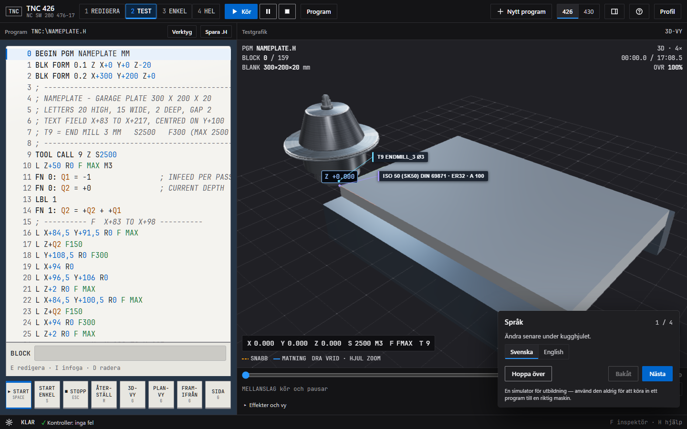

Datoteka simulatora `index.html` dolazi uz projekat, pa ne morate da je gradite. Ako ste nešto promenili u fascikli `sim`, izgradite je ponovo sa `python build.py` (na macOS i Linux sistemima `python3 build.py`).

## Izbor izdanja

| Želite | Pokrenite | Rezultat |
|---|---|---|
| da isprobate Business dok radite | `npm run dev:business` | lokalna adresa koja otvara radni prostor mašine na `/work` |
| da isprobate Play dok radite | `npm run dev:play` | lokalna adresa koja otvara početnu stranu na `/play` |
| da izgradite Business za veb-sajt | `npm run build:business` | fascikla `dist/business` |
| da izgradite Play za veb-sajt | `npm run build:play` | fascikla `dist/play` |
| samo simulator, bez ičega okolo | otvorite `index.html` | simulator u jednoj datoteci |
| aplikaciju u sopstvenom prozoru | vidite [Desktop aplikacija](#desktop-aplikacija) | instalacioni program |

### Izgrađene fascikle

`dist/business` i `dist/play` sadrže sve što je izdanju potrebno, uključujući kopiju datoteke simulatora. Stavite fasciklu na bilo koji veb-server koji ume da isporučuje datoteke; poseban serverski softver nije potreban. Fascikla mora da bude u korenu veb-sajta i da se otvara preko `http://` ili `https://`. Dvoklik na `dist/business/index.html` ne radi, jer strana preuzima simulator sa adrese `/sim/`.

Izgradnja kopira datoteku simulatora iz korena projekta. Ako datoteka nedostaje, izgradnja staje sa porukom `index.html missing in the repo root: run python build.py first`.

Business ne sadrži ništa od izdanja Play: radionica, film sa početne strane i likovi postoje samo u `dist/play`. Play sadrži i radni prostor mašine na `/work`.

### Datoteka simulatora

`index.html` je isti simulator koji prikazuju izdanja, bez ičega okolo. Ima isti radni prostor mašine, ista podešavanja i iste programe. Koristite je kada želite jednu datoteku koju nosite sa sobom ili kada nemate internet.

### Desktop aplikacija

Desktop aplikacija je izdanje u sopstvenom prozoru. Ona pokreće sopstveni server unutar aplikacije, na `127.0.0.1` i samo za vaš računar, čuva bazu podataka u sistemskoj fascikli za podatke aplikacija i automatski vas prijavljuje. Ako aplikaciju pokrenete još jednom, otvoreni prozor dolazi u prvi plan.

| Želite | Pokrenite | Ime aplikacije |
|---|---|---|
| da izgradite Business kao aplikaciju | `npm run desktop:business` | TNC 426-430 Business |
| da izgradite Play kao aplikaciju | `npm run desktop:play` | TNC 5511 Play |

Instalacioni programi nisu potpisani, pa Windows i macOS upozoravaju kada ih prvi put otvorite.

Za izgradnju je potreban Rust, a pored toga: na Windows sistemu MSVC build tools i WebView2 (ugrađen u Windows 10 i 11); na macOS sistemu Xcode command-line tools; na Linux sistemu WebKitGTK 4.1 (`libwebkit2gtk-4.1-dev libsoup-3.0-dev libjavascriptcoregtk-4.1-dev librsvg2-dev libxdo-dev libssl-dev`).

### Sa serverom

Server je potreban samo za ono što je navedeno pod [Bez servera i bez ključa](#bez-servera-i-bez-ključa). On sluša na `127.0.0.1:8426` ako ne zadate drugačije. Da bi izdanje koje pokrećete sa `npm run dev:business` ili `npm run dev:play` koristilo server koji već radi, upišite adresu servera u promenljivu okruženja `TNC_SERVER` pre pokretanja:

```powershell
$env:TNC_SERVER = 'http://127.0.0.1:8426'
npm run dev:business
```

Kada server odgovara, Business dobija malo dugme menija (☰) na ivici sa stavkama Programi, Tabele alata, Nalog i, za administratore, Korisnici. Kada prvi put otvorite biblioteku na novom serveru, strana traži da napravite prvi nalog, koji postaje administrator.

## Upravljanje i uređivanje

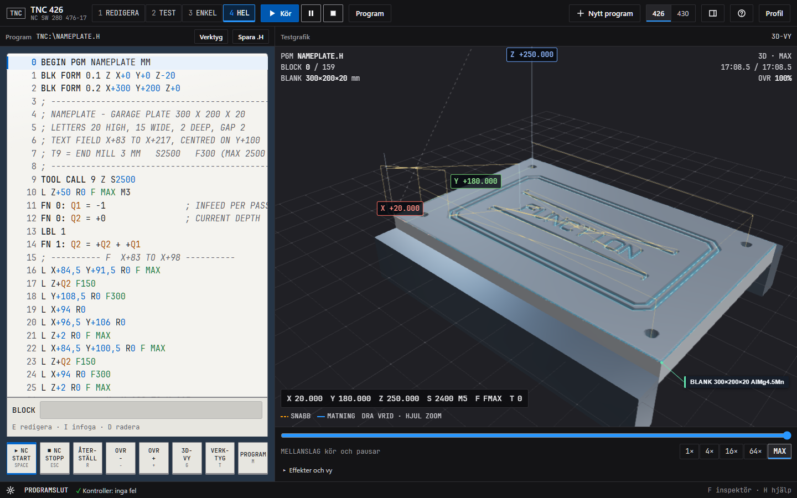

### Ekran

- **Gornja traka** ima četiri režima rada, dugmad Pokreni, Pauza i Zaustavi, dugme Programi, dugme Novi program, prekidač 426 | 430 i dugmad Inspektor, Pomoć i Profil.
- **Program** je levo (sa upravljanjem 430 Steel desno). Označeni blok je onaj koji se izvršava ili uređuje. Iznad liste su dugmad Alat i Sačuvaj .H.
- **Red bloka** ispod programa je mesto gde kucate blok ili odgovarate na pitanje.
- **Funkcijski tasteri** su na dnu. Svaki taster sitnim slovima prikazuje i svoj taster na tastaturi.
- **Test grafika** prikazuje pripremak, alat i putanju alata. Prevucite da rotirate, točkićem zumirajte. Isprekidana linija je brzi hod, puna linija je pomak. Pozicija (X, Y, Z, broj obrtaja, pomak i alat) nalazi se u okviru preko slike. Ispod klizača je **Efekti i prikaz**, vidite [Efekti i prikaz](#efekti-i-prikaz).
- **Donja traka** ima zupčanik za podešavanja, stanje izvršavanja i broj grešaka iz provera.

### Režimi rada

| Taster | Režim | Šta radi RAZMAK |
|---|---|---|
| `1` | PRG IZMENA | ništa; funkcijski tasteri pišu blokove |
| `2` | TEST | pokreće i zaustavlja |
| `3` | BLOK PO BLOK | izvršava sledeći blok |
| `4` | CEO PROGRAM | pokreće i zaustavlja |

Ako pritisnete Pokreni u režimu PRG IZMENA, simulator odgovara `REŽIM PROGRAMIRANJA — NC START RADI U 2 TEST, 3 BLOK PO BLOK, 4 CEO PROGRAM`. Prvo promenite režim.

### Pokretanje programa

1. Pritisnite `2` za TEST ili `4` za CEO PROGRAM.
2. Pritisnite RAZMAK ili Pokreni. Pritisnite ponovo za pauzu.
3. Izaberite brzinu tasterima `5` do `9`: 1×, 4×, 16×, 64× i MAX.
4. Povucite klizač ispod grafike, ili pritisnite `←` i `→`, da se krećete napred i nazad kroz izvršavanje. Kada idete unazad, pripremak se ponovo izgrađuje.
5. Pritisnite `R` ili Zaustavi da krenete od početka.

Greške se prikazuju uz svoj blok. Otvorite Inspektor tasterom `F` da vidite vreme izvršavanja, put u pomaku, put u brzom hodu, najniži Z i skinutu zapreminu, kao i listu provera.

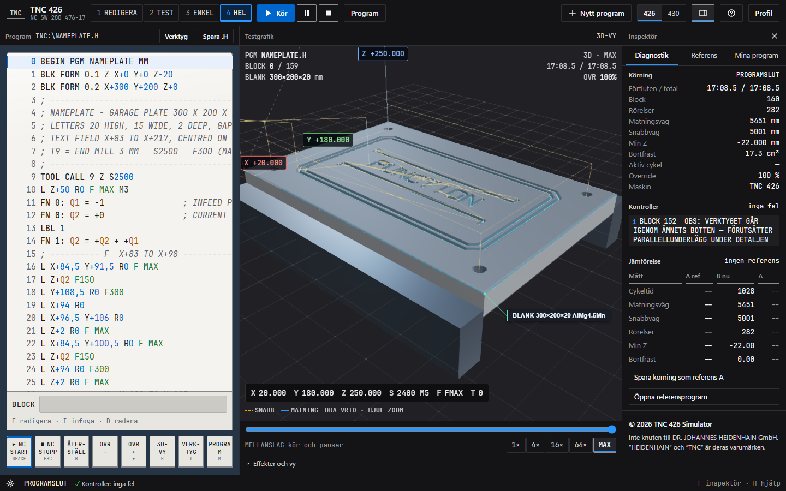

Da uporedite dve verzije programa: završite izvršavanje, izaberite **Sačuvaj rad kao referencu A** u Inspektoru, promenite program i pokrenite ga ponovo. Tabela Poređenje prikazuje razliku u vremenu ciklusa, putu u pomaku, putu u brzom hodu, broju kretanja, najnižem Z i skinutoj zapremini.

### Efekti i prikaz

Ispod klizača u test grafici je red **Efekti i prikaz**. Pritisnite ga da razvijete dugmad. Nijedno od njih ne menja način na koji se program izvršava, osim dugmeta Stega, koje uključuje i isključuje i proveru prema stegi.

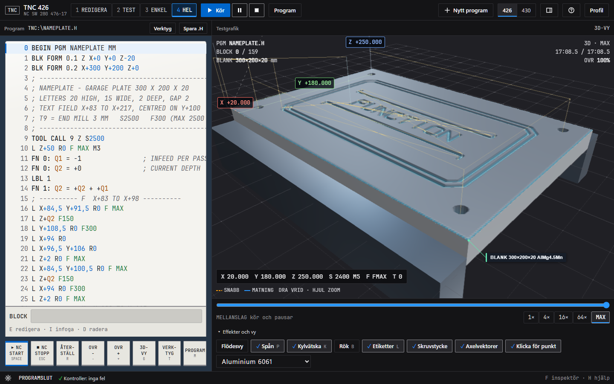

| Dugme | Taster | Šta radi |
|---|---|---|
| Dijagram toka | `V` | prikazuje program kao dijagram toka umesto kao listu |
| Strugotina | `P` | strugotina i varnice kod alata |
| Emulzija | `K` | mlaz emulzije, koji se vidi kada program uključi `M8` |
| Dim | `B` | dim i vatra pri sudaru; isključeno na početku |
| Oznake | `L` | oznake za alat, držač i pripremak |
| Stega | | crta stegu i proverava alat prema njoj |
| Vektori osa | | linije u X, Y i Z od nulte tačke programa do vrha alata, sa vrednostima; na TNC 430 i A i B |
| Klik za tačku | | klik na sliku (ne prevlačenje) postavlja zelenu oznaku i prikazuje koordinate te tačke; ESC je uklanja |

**Izbor materijala** na kraju reda menja materijal pripremka: Aluminium 6061, Titanium Ti-6Al-4V, Mild steel, Stainless 304, Brass i Cast iron, i četiri izgleda (Turbine, Aerospace, Ground finish i Cast). Materijal menja izgled pripremka, strugotine i varnica. Ne menja pomak, broj obrtaja ni bilo koju proveru. Izbor se čuva u pregledaču.

### Vođeni unos bloka

U režimu PRG IZMENA blok gradite odgovarajući na jedno po jedno pitanje, kao na upravljanju. Ne morate da znate kako se blok piše.

1. Pritisnite `1` za PRG IZMENA.
2. Postavite kursor na blok posle koga treba da dođe novi.
3. Pritisnite funkcijski taster za vrstu bloka, na primer `L` za pravu liniju. Red iznad funkcijskih tastera pokazuje na kom ste pitanju.
4. Upišite odgovor i pritisnite ENTER. ENTER bez vrednosti preskače pitanje koje može da se preskoči.
5. Posle poslednjeg pitanja blok se čuva i simulator ponovo proverava program.

| Taster | Šta radi u pitanju |
|---|---|
| ENTER | prihvata odgovor i prelazi na sledeće pitanje (ENT) |
| SHIFT+ENTER | ostavlja pitanje bez vrednosti (NO ENT) |
| END | završava dijalog i čuva blok sa onim što ste odgovorili |
| ESC | prekida dijalog bez čuvanja (DEL) |
| DELETE | briše ono što ste upisali (CE) |
| `X` `Y` `Z` | bira osu u pitanju o koordinatama; na TNC 430 i `B` i `A` |
| `I` | čini vrednost inkrementalnom |
| `P` | prelazi na polarne koordinate |
| `Q` | odgovara Q parametrom |
| `+` `-` | menja znak |
| `#` | uzima trenutnu poziciju |

Funkcijski tasteri u režimu PRG IZMENA raspoređeni su u tri reda. Prvi red ima funkcije putanje `L`, `CC`, `C`, `CR`, `CT`, `CP`, `RND` i `CHF`. Drugi red ima `APPR/DEP`, `TOOL DEF`, `TOOL CALL`, `CYCL DEF`, `CYCL CALL`, `LBL SET`, `LBL CALL` i `Q`. Treći red ima uređivanje, umetanje, brisanje, poništavanje, ponavljanje, alate, sirovi tekst i proveru.

### Polarni blokovi: LP sa PR i PA

Polarni blok zadaje cilj radijusom `PR` i uglom `PA` od pola. Pol mora da postoji pre toga, u bloku `CC`.

1. Upišite pol, na primer `CC X+0 Y+0`.
2. Pritisnite funkcijski taster `L`. Pitanje se najpre odnosi na obične koordinate.
3. Pritisnite `P`. Dijalog prelazi na polarnu liniju i dobija oznaku **Polarne koordinate**.
4. Odgovorite na radijus, na primer `57`, i pritisnite ENTER.
5. Odgovorite na ugao, na primer `157,5`, i pritisnite ENTER.
6. Izaberite korekciju radijusa funkcijskim tasterom `R0`, `RL` ili `RR`.
7. Odgovorite na pomak, na primer `MAX`, a zatim na M funkciju, ili pritisnite ENTER ako je nema.

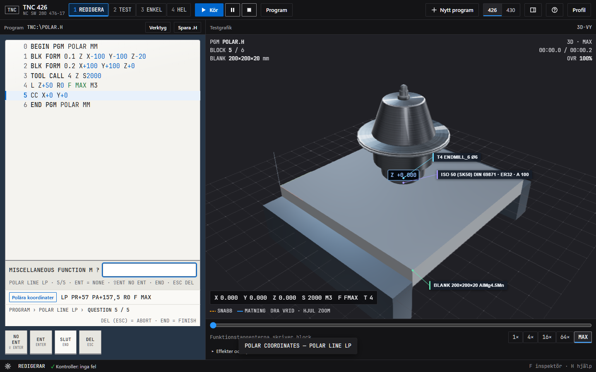

Ispod pitanja prikazuje se blok dokle ste stigli sa odgovorima. Kada završite, u programu stoji:

```
LP PR+57 PA+157,5 R0 F MAX
```

Kako se to čita:

- **Decimalni znak na ekranu je podešavanje.** Pod Podešavanja, Opšte, **Decimalni znak (MP 7280)** birate **Prati jezik**, **Zarez** ili **Tačka**. Prati jezik je podrazumevano i daje zarez na srpskom i švedskom, a tačku na engleskom: `LP PR+57 PA+157.5 R0 F MAX`. Na upravljanju je decimalni znak poseban mašinski parametar (MP 7280), odvojen od jezika dijaloga, i tako je i ovde. U pitanju smete da upišete zarez ili tačku; oba znače isto.
- **Tačka u datoteci, uvek.** Podešavanje važi samo za ekran. U sačuvanoj datoteci blok ima tačku i nema razmak u pomaku, onako kako ga upravljanje piše: `LP PR+57 PA+157.5 R0 FMAX`. Tekst programa i komentari se nikada ne prepravljaju.
- **Neke reči uvek zadržavaju tačku**, i kada ekran prikazuje zarez: `BLK FORM 0.1`, `CYCL DEF 7.1`, `TCH PROBE 0.0` i `FN 0:`.
- **Neispravan broj se ne prihvata.** Ako, na primer, kao ugao upišete `1,2,3`, pitanje ostaje.

`P` radi na isti način za `C` (postaje `CP`), `CT` (postaje `CTP`) i za prilaz i odlazak sa `APPR` i `DEP`. `CC` je uvek u Dekartovim koordinatama.

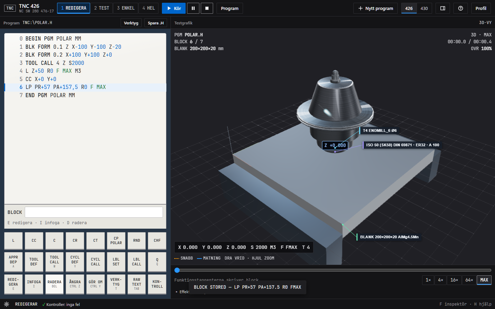

### Izmena bloka

Postavite kursor na blok i pritisnite `E`.

- Polarni blok (`LP`, `CP`, `CTP`) otvara se u svom dijalogu sa popunjenim trenutnim vrednostima. ENTER zadržava vrednost. Kada završite, blok se zamenjuje.
- Svaki drugi blok otvara se u redu bloka kao tekst. Izmenite tekst i pritisnite ENTER da sačuvate ili ESC da odustanete.
- `F2` prebacuje između dijaloga i teksta dok uređujete. Blokovi `L`, `CC`, `C`, `CR`, `CT`, `RND` i `CHF` mogu se tako otvoriti u dijalogu. Za blok koji nema dijalog simulator odgovara `OVAJ BLOK NEMA DIJALOG — IZMENITE GA KAO TEKST`.

`I` umeće novi blok posle kursora, `D` ili DELETE briše blok, a `C` ga kopira. `Ctrl+Z` poništava, a `Ctrl+Shift+Z` ili `Ctrl+Y` ponavlja.

### Uređivanje sirovog teksta

Pritisnite TAB dok nijedno dugme ni klizač nema fokus. Ceo program se tada prikazuje kao polje za tekst u kome slobodno kucate, lepite i pomerate redove. Pritisnite TAB ponovo da se vratite; program se tada ponovo proverava. Ako neko dugme ima fokus, TAB umesto toga pomera fokus na sledeće dugme, kao u drugim programima.

### Pomoć i lekcije

Pritisnite `H`. Fioka ima pet kartica: Lekcije (svaka lekcija učitava sopstveni program i pokreće mašinu umesto vas), Sudar (poznati načini da se mašina slupa, ovde bez rizika), Priručnik, Prečice i AI podešavanje. Lekcije ne diraju vaše programe.


### Na telefonu

Na ekranu užem od 900 piksela radni prostor mašine deli se na tri radne površine: Program, Grafika i Status. Menjajte ih karticama ili prevlačenjem u stranu. Funkcijski tasteri ostaju na dnu, po osam odjednom. Novi program, prekidač mašine, Pomoć, Profil i podešavanja nalaze se pod Meni.

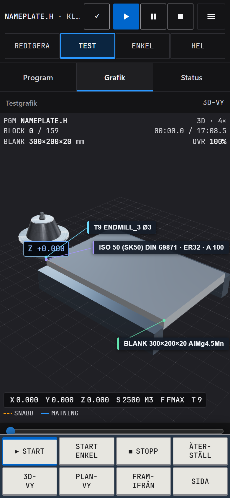

## Programi: čuvanje, učitavanje i biblioteka

### Novi program

Pritisnite `N` ili Novi program. Dijalog ima dve kartice.

- **Ručno**: upišite ime programa sa A–Z, 0–9 i donjom crtom i pritisnite Napravi. Simulator pravi `BEGIN PGM` i `END PGM` u milimetrima, a ostatak pišete blok po blok.
- **AI**: vidite [AI programi i AI ključ](#ai-programi-i-ai-ključ).


### Lista programa

Pritisnite `M` ili dugme Programi. Lista prikazuje sve programe u simulatoru sa veličinom, statusom i projektom. Birajte strelicama.

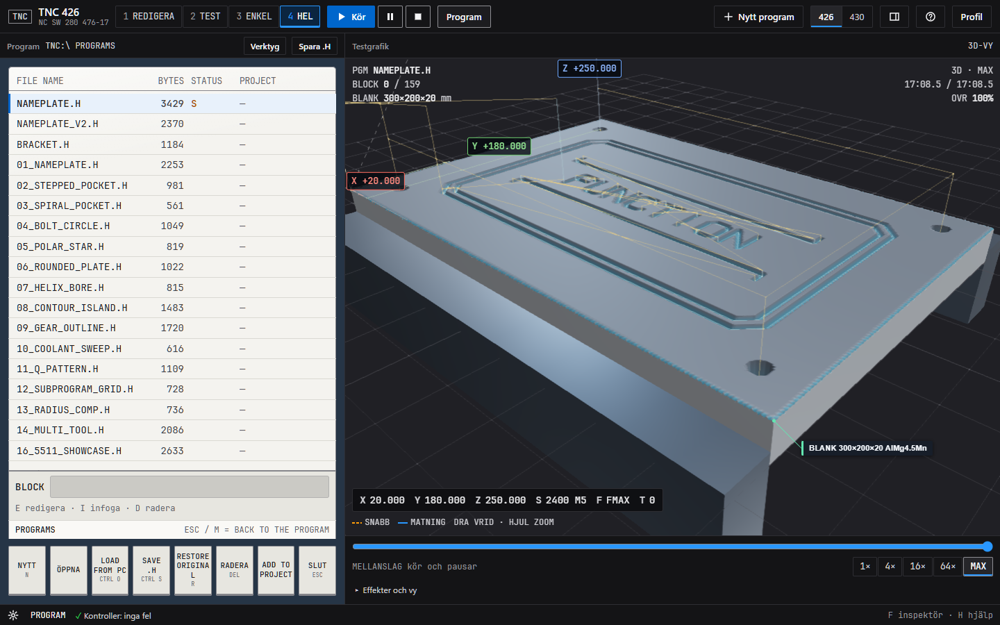

| Funkcijski taster | Taster | Šta radi |
|---|---|---|
| NOVI | `N` | otvara dijalog Novi program |
| OTVORI | ENTER | otvara označeni program |
| LOAD FROM PC | `Ctrl+O` | učitava datoteku sa računara |
| SAVE .H | `Ctrl+S` | čuva program kao datoteku |
| RESTORE ORIGINAL | `R` | vraća ugrađeni program u izvorno stanje |
| OBRIŠI | DELETE | briše vaš program |
| ADD TO PROJECT | | dodaje program u aktivni projekat |
| KRAJ | ESC | vraća na program |

Ugrađeni program ne može da se obriše; simulator odgovara `UGRAĐEN PROGRAM — KORISTITE VRAĆANJE ORIGINALA`.

### Čuvanje i učitavanje datoteka

- **Čuvanje**: `Ctrl+S` čuva otvoreni program kao datoteku `.H` sa brojevima blokova, u formatu listinga upravljanja.
- **Učitavanje**: `Ctrl+O`, ili prevucite datoteku u prozor. Simulator čita `.H` i `.I` (u UTF-8 ili Windows-1252) i `.zip` arhive sa više programa.
- **Alati koji nedostaju**: ako program poziva alat koga nema u tabeli alata, alat se pravi kada se program učita, kao pri uvozu na upravljanju. Pogrešno upisan broj alata se zato ne otkriva pri učitavanju.

### Profil

Vaši programi i vaša tabela alata sami se čuvaju u pregledaču. Pod Profil možete profilu da date ime, da izvezete sve kao `.zip` i da ga uvezete u drugom pregledaču. Pri uvozu birate **Spoji sa mojim** (dodaj) ili **Zameni moj** (zameni). Brisanjem podataka pregledača za stranu profil nestaje, zato ga prethodno izvezite.

**Projekat** je imenovana fascikla sa programima. Pravite ga u Inspektoru na kartici Moji programi. Novi programi ulaze u aktivni projekat, a ZIP preuzima fasciklu kao datoteke `.H`.

### Šesnaest pokaznih programa

Uz simulator dolazi šesnaest programa, od kojih svaki pokazuje jednu tehniku. Nalaze se u listi programa i u fascikli `examples/showcase`. Uvodna kartica vam nudi da jedan od njih izaberete kao prvi program. To su primeri za vežbu i nisu izvršavani na pravom upravljanju.

| Program | Šta pokazuje |
|---|---|
| `01_NAMEPLATE.H` | Gravira KLARTEXT pravim potezima u dva prolaza i gloda okvir sa zaobljenim uglovima. |
| `02_STEPPED_POCKET.H` | Tri pravougaona džepa jedan u drugom sa ciklusom 4, svaki stepenik 6 mm dublji. |
| `03_SPIRAL_POCKET.H` | Okrugli džep Ø70 glodan iz sredine ka spolja po spirali od inkrementalnih polarnih blokova. |
| `04_BOLT_CIRCLE.H` | Osam rupa na podeonom krugu (ciklusi 200 i 220) i glodani središnji otvor (ciklus 208). |
| `05_POLAR_STAR.H` | Petokraka zvezda napisana u potpunosti polarnim blokovima (`CC`, `LP PR/PA`) unutar prstena. |
| `06_ROUNDED_PLATE.H` | Čeono glodana ploča sa radijusom na uglovima, konturno glodana sa korekcijom radijusa, i četiri rupe. |
| `07_HELIX_BORE.H` | Otvor glodan zavojnicom (`CP` sa `IZ`) na dva radijusa, i upuštanje. |
| `08_CONTOUR_ISLAND.H` | SL ciklusi: džep sa zaobljenim uglovima i dva ostrva, grubo glodan, zatim fino obrađeni dno i strana. |
| `09_GEAR_OUTLINE.H` | Kontura nalik zupčaniku sa 12 zubaca pravih bokova u polarnim blokovima. Vizuelna demonstracija, ne sertifikovan evolventni zupčanik. |
| `10_COOLANT_SWEEP.H` | Čeono glodanje ciklusom 230 i vijugavi žleb loptastim glodalom, sve sa rashladnom tečnošću (`M8`). |
| `11_Q_PATTERN.H` | Tri rozete izračunate Q parametrima, sa skokovima i potprogramom. |
| `12_SUBPROGRAM_GRID.H` | Jedan potprogram poziva se 15 puta u mreži sa pomeranjem nulte tačke (ciklus 7). |
| `13_RADIUS_COMP.H` | Isti kvadrat izvršava se tri puta sa `RR`, `R0` i `RL`, pa se pomak putanje vidi kao stepenice. |
| `14_MULTI_TOOL.H` | Sedam alata u jednom izvršavanju: čeono glodalo, grubi džep, fini džep, zabušivač, burgija, ureznik i glodalo za obaranje ivica. |
| `15_430_SWIVEL.H` | Samo TNC 430: ciklus 19 naginje zakretnu glavu za 30 stepeni, gloda se kosa površina i buše se dve rupe upravno na nju. |
| `16_5511_SHOWCASE.H` | Razigrana radionička značka sa velikim ciframa, okvirom, dve polarne zvezde i četiri oznake zakivaka. |

### Biblioteka na serveru

Kada server radi i prijavljeni ste, program sa ekrana možete da stavite u biblioteku servera: otvorite meni (☰) i izaberite **Sačuvaj u biblioteku**. Meni odgovara jednim od ovih redova:

```
NAMEPLATE.H je dodat u biblioteku.
NAMEPLATE.H sačuvan kao v2.
NAMEPLATE.H je nepromenjen (v2).
```

Strana Programi na serveru prikazuje sve programe sa verzijama. Tu možete da otvorite stariju verziju, da je vratite i da podelite program linkom.

## AI programi i AI ključ

Kartica **AI** u dijalogu Novi program (taster `N`) piše Klartext program na osnovu opisa, ili menja program koji je otvoren. AI radi preko servisa OpenRouter i nijednog drugog.

Za AI je potreban server: lokalni, onaj koji neko drži za vas, ili desktop aplikacija, koja ima ugrađen server. Datoteka simulatora `index.html` i izdanje bez servera na kartici prikazuju samo jedan red, i ništa se nikuda ne šalje:

```
AI zahteva lokalni ili hostovani server. Ručno pravljenje radi kao i obično.
```

Sa ovom verzijom nije isproban nijedan pravi provajder. Svi testovi rade sa lažnim provajderom, pa rezultat koji dobijete zavisi od modela koji izaberete.

### Ključ

OpenRouter ključ se nalazi na serveru, a u desktop aplikaciji u fascikli sa podacima aplikacije. Nikada nije u pregledaču.

**Unos ključa.** Dok server nema ključ, kartica AI na vrhu prikazuje polje.

1. Otvorite Novi program tasterom `N` i izaberite karticu **AI**.
2. Upišite ključ u polje **OpenRouter ključ**. Ispod polja piše `Ključ se šalje serveru i tamo se čuva. Nikada se ne čuva u pregledaču.`
3. Pritisnite **Sačuvaj ključ** ili ENTER.
4. Polje se prazni i nestaje, a kartica odgovara `Ključ je sačuvan na serveru.` Kursor je u opisu.

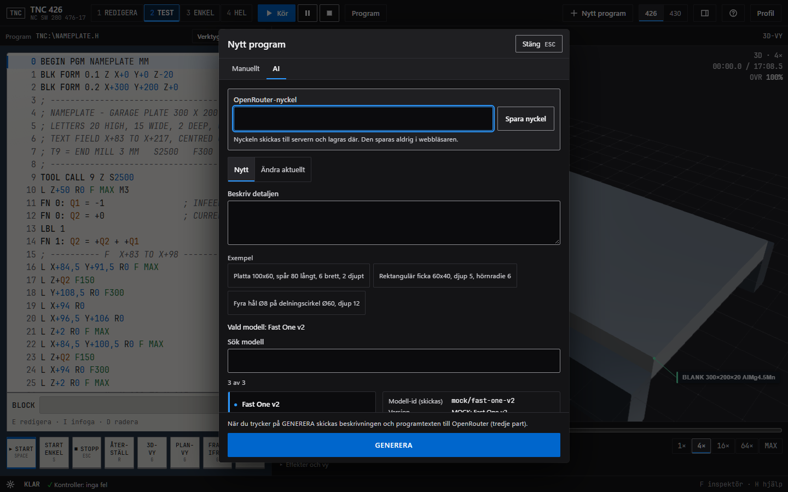

**Uklanjanje ključa.** Kada je ključ sačuvan, na dnu kartice je link **Ukloni ključ sa servera**. Pritisnite ga, a zatim **Potvrdi: ukloni ključ**. Kartica odgovara `Ključ je uklonjen sa servera.` Ako server ima i ključ u sopstvenom podešavanju, piše `Sačuvani ključ je uklonjen. Server i dalje ima ključ iz sopstvenog podešavanja.`

Za ključ važi sledeće:

- Samo administrator može da ga sačuva ili ukloni. Ostali dobijaju `Samo administrator može da menja ključ.` U desktop aplikaciji jedini lokalni korisnik je administrator.
- Ključ se ne proverava kada se čuva. Pogrešan ključ se pokaže pri prvom generisanju: `OpenRouter je odbio ključ. Uklonite ga i unesite ispravan ključ.`
- Čuva se u datoteci `openrouter.key` u fascikli sa podacima servera. Datoteku može da čita samo nalog koji pokreće server. Nije šifrovana, pa fasciklu sa podacima čuvajte kao i druge tajne.
- Nikada se ne upisuje u bazu podataka, u odgovor pregledaču ni u red dnevnika.
- Ko održava server može umesto toga da zada ključ u promenljivoj okruženja `OPENROUTER_API_KEY`. Ključ sačuvan preko kartice ima prednost.
- Ako je starija verzija sačuvala ključ u ovom pregledaču, on se briše kada se strana učita, a kartica kaže `Ključ koji je bio sačuvan u ovom pregledaču obrisan je odavde. Ključ se sada čuva na serveru.`

### Novo ili Izmeni trenutni

Na vrhu kartice birate šta AI treba da uradi.

| Režim | Vi pišete | Šta radi Učitaj |
|---|---|---|
| **Novo** | **Opišite deo**: mere, oblici, dubine | otvara rezultat kao novi program pod slobodnim imenom; program koji ste imali otvoren ostaje nepromenjen |
| **Izmeni trenutni** | **Šta da se izmeni u NAMEPLATE.H?** (ime je ime otvorenog programa) | zamenjuje tekst otvorenog programa rezultatom, kao jedan korak poništavanja; `Ctrl+Z` vraća original |

Ispod opisa su tri primera, pod **Primeri**. Pritisak na primer popunjava opis. Ime novog programa uzima se iz reda `BEGIN PGM` u programu; ako je ime zauzeto, dobija `_2`, `_3` i tako dalje. Ako nijedan program nije otvoren, Izmeni trenutni odgovara `Nema otvorenog programa za izmenu.` Režim ne može da se promeni dok posao traje.

### Model

Red **Izabrani model** pokazuje model koji se koristi. Kucajte u polje **Pretraži modele** da skratite listu, a birajte klikom ili strelicama. Kada pokažete na model, date mu fokus ili ga dodirnete, vide se ID modela, verzija, kontekst, efektivno ograničenje izlaza, cena na milion tokena i šta model podržava. Lista i cene dolaze od servisa OpenRouter preko servera. Izbor se čuva u pregledaču.

Nema kontrola za rezonovanje, tokene, merenje ni broj krugova. Oni su utvrđeni na serveru: srednje rezonovanje tamo gde ga model podržava, i ograničenje izlaza koje nikada nije veće od ograničenja samog modela.

### Šta se šalje i kada

Ništa od onoga što napišete ne napušta vaš računar dok ne pritisnete **GENERIŠI**. Red iznad dugmeta kaže šta se tada šalje:

```
Pritiskom na GENERIŠI opis i tekst programa šalju se servisu OpenRouter (treća strana).
```

U režimu Izmeni trenutni umesto toga piše:

```
Pritiskom na GENERIŠI opis i ceo program NAMEPLATE.H šalju se servisu OpenRouter (treća strana).
```

Uz opis idu vaša tabela alata i izabrana mašina. OpenRouter i onaj ko pokreće model obrađuju tekst prema sopstvenim uslovima, zato u opis ne unosite ništa poverljivo.

### Faze i krugovi

1. Pritisnite **GENERIŠI**. Dugme zamenjuje **Otkaži**.
2. Pod **Tok** se faze pojavljuju redom kojim ih server izvodi: Generisanje, Provera, Merenje, Dorada i Završetak. Završena faza ima kvačicu, tekuća strelicu. Dorada prikazuje svoj krug, na primer `Dorada, krug 2 od 5`. Procenti se ne prikazuju.
3. Tekst programa raste pod **Tekst programa** dok model piše.
4. Kada je posao gotov, piše `Program je prošao proveru. Pritisnite Učitaj da ga otvorite.`, a zatim broj blokova, krug i broj zahteva. Dugme se sada zove **Učitaj**. Pored njega je **Generiši ponovo**. Ispod je tih red sa vremenom i cenom posla, na primer `Vreme 42 s · cena $0.012`; prikazuje se i posle neuspelog ili otkazanog posla, a cena se izostavlja kada je server ne pošalje.
5. Pritisnite **Učitaj**. Red iznad dugmeta unapred kaže šta će se desiti, na primer `Učitavanje ga otvara kao novi program, SLOT.H. NAMEPLATE.H ostaje nepromenjen u listi programa.`

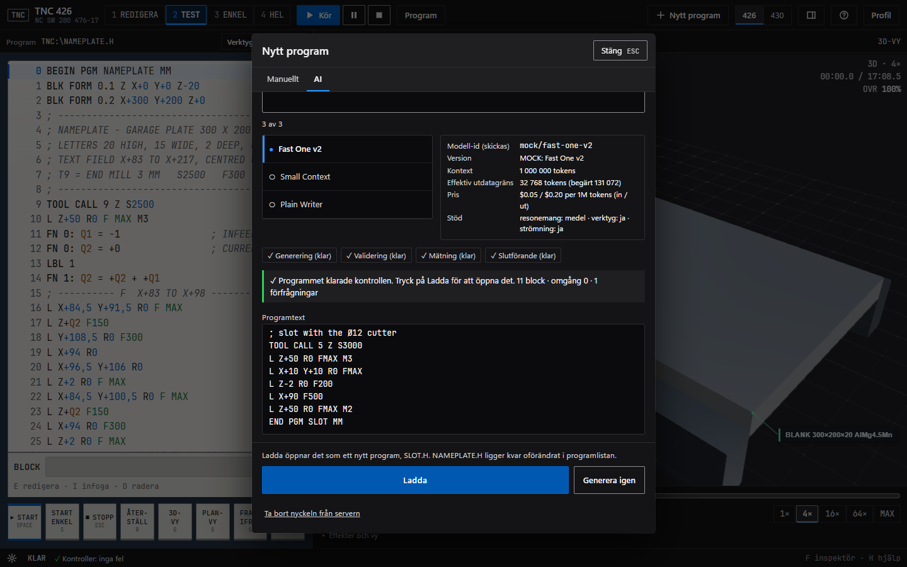

Ovako posao teče:

- Server proverava svaki odgovor istim interpreterom koji koristi simulator, a simulator meri izglodani deo prema onome što ste tražili.
- Posao je prvi program i najviše pet krugova dorade. Završava se kod prvog programa koji prođe.
- Završava se i kada krug ne donese poboljšanje. Tada se isporučuje najbolji provereni program ako se dovoljno dobro poklapa, a red kaže koliko: `Program je prošao proveru i poklapa se sa planiranim delom 88.7 procenata (cilj 95). Dalji krugovi ga nisu poboljšali, pa je dorada zaustavljena.`
- Posao nikada ne dira otvoreni program. Rezultat unosi samo **Učitaj**.
- Ako nijedan program ne prođe, najbolji pokušaj ostaje pod **Nacrt (nije učitan)**. **Kopiraj nacrt** ga stavlja u ostavu. Nacrt se nikada ne učitava sam.
- **Otkaži** zaustavlja posao. Kartica odgovara `Otkazano. Ništa nije učitano.` i nijedan novi zahtev se ne šalje.
- Po nalogu može da radi jedan posao odjednom.
- Server ima ograničenje po korisniku i mesecu, 5 američkih dolara ako nije drugačije podešeno (`TNC_AI_MONTHLY_BUDGET_USD`). Modeli koji smeju da se biraju mogu se ograničiti sa `TNC_AI_MODELS`. Podrazumevani model je `deepseek/deepseek-v4.1-flash` (`TNC_AI_DEFAULT_MODEL`).

### Poruke o greškama na kartici AI

| Poruka | Uradite ovo |
|---|---|
| `Nijedan OpenRouter ključ nije sačuvan. Unesite ključ na vrhu.` | sačuvajte ključ, vidite [Ključ](#ključ) |
| `Niste prijavljeni na server. Prijavite se i ponovo otvorite dijalog.` | prijavite se na server |
| `Za ovaj nalog već radi jedan posao. Sačekajte da se završi.` | sačekajte, ili otkažite drugi posao |
| `Mesečni AI budžet je potrošen. Sačekajte prvi u mesecu ili pitajte administratora.` | sačekajte, ili zamolite onoga ko održava server da podigne ograničenje |
| `OpenRouter nalog nema dovoljno kredita. Dopunite ga ili promenite ključ.` | dopunite nalog kod servisa OpenRouter |
| `Ovaj model nije dozvoljen na ovom serveru. Izaberite drugi.` | izaberite drugi model sa liste |
| `Lista modela nije mogla da se učita.` | pritisnite **Pokušaj ponovo**; server ne može da dosegne OpenRouter |
| `Program nije prošao proveru. Nacrt je sačuvan ispod i nije učitan. Izmenite opis ili izaberite drugi model.` | opišite deo jasnije, ili promenite model |
| `Odgovor je odsečen na ograničenju izlaza. Opišite jednostavniji deo ili izaberite model sa većim ograničenjem izlaza.` | podelite deo, ili promenite model |
| `Server se nije javio 50 sekundi. Posao je zaustavljen. Pokušajte ponovo.` | proverite da li server radi i pokušajte ponovo |
| `Server nije dostupan. Proverite da li radi i pokušajte ponovo.` | pokrenite server |

Posle poruke može da stoji `Server:` i red na engleskom sa objašnjenjem samog servera.

## Alati i tabela alata

Pritisnite `T` ili dugme Alat. Tabela alata odgovara datoteci `TOOL.T` na upravljanju: jedan alat po redu sa brojem (T), imenom, dužinom (L) i radijusom (R). Svaka mašina ima svoju tabelu.

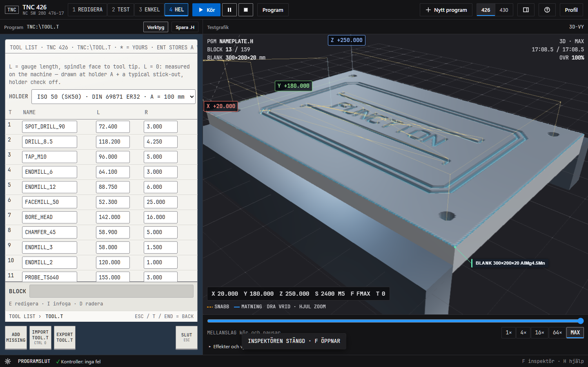

- **L** je dužina alata od čela vretena do vrha. Sa L = 0 alat se smatra izmerenim na mašini, a provera držača je isključena za taj alat.
- **R** je radijus. Koristi ga korekcija radijusa (`RL`, `RR`) i on određuje koliko materijala alat skida.
- **HOLDER** bira držač alata koji se crta i proverava prema obratku i stegi.
- Vrednost menjate kucanjem u njeno polje. Broj alata mora biti 0–32767, a radijus ne sme biti negativan.

| Funkcijski taster | Šta radi |
|---|---|
| ADD MISSING | dodaje alate koje program poziva, a kojih nema u tabeli |
| IMPORT TOOL.T | učitava tabelu alata iz datoteke |
| EXPORT TOOL.T | čuva tabelu kao datoteku, na primer `TOOL_TNC426.T` |
| KRAJ | zatvara tabelu (takođe ESC ili `T`) |

Program bira alat sa `TOOL CALL`, na primer `TOOL CALL 4 Z S2000`. U režimu PRG IZMENA taster `W` otvara dijalog za `TOOL CALL`. Slika prikazuje alat u držaču, sa oznakama za alat, držač i pripremak; oznake se uključuju i isključuju tasterom `L`.

Stega je uključena od početka i može se isključiti pod **Efekti i prikaz**. Simulator javlja alarm ako alat ili držač uđe u stegu.

Sa serverom svaka mašina ima i tabelu alata na strani Tabele alata. U izdanju Play zamena alata upisuje novi alat u tabelu, vidite [Zamena alata](#zamena-alata).

## Play: radionica

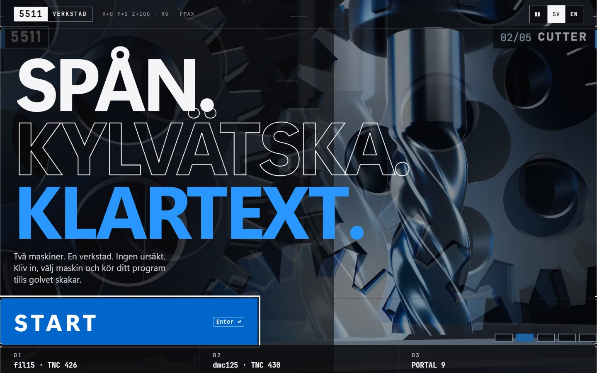

### Od početne strane do mašine

1. Početna strana prikazuje dugme START. Pritisnite ENTER ili kliknite. Gore desno pauzirate pozadinski film i menjate jezik dugmadima Svenska, English i Srpski.
2. Prvi put se prikazuje uvod u tri koraka. Pritisnite Dalje ili Preskoči.
3. Stojite u radionici. Priđite jednoj od dve označene mašine, `fil15` sa TNC 426 ili `dmc125` sa TNC 430.
4. Pritisnite `E` kada se pojavi okvir **Otvori upravljanje**. Kamera prilazi upravljanju i simulator se otvara, podešen na upravljanje te mašine.
5. Radite kao u poglavlju [Upravljanje i uređivanje](#upravljanje-i-uređivanje).
6. Pritisnite **U radionicu** u gornjoj traci da se vratite. Program ostaje tu dok se ne vratite.

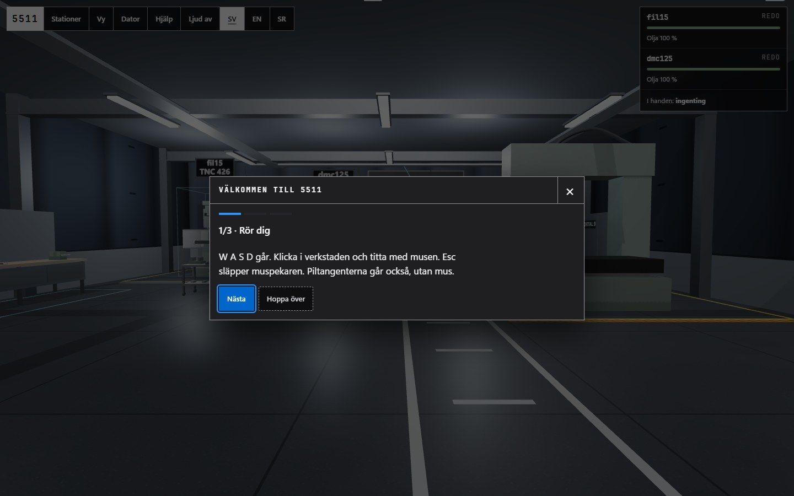

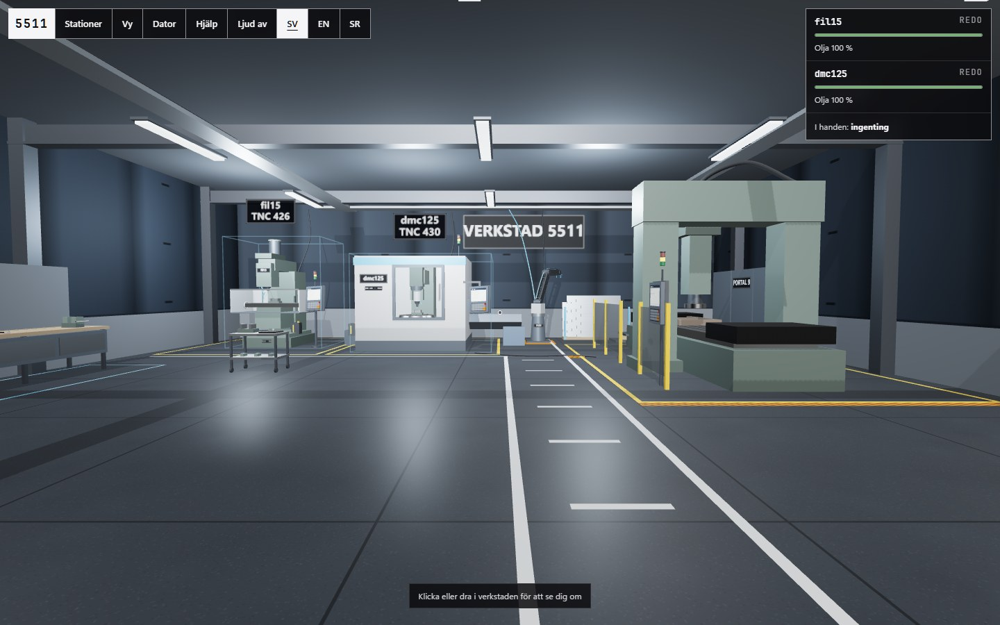

U radionici postoji samo jedan simulator. On izvršava jedan program odjednom, pa ako program radi na jednoj mašini, ne možete da otvorite upravljanje na drugoj. Tada vidite `Druga mašina radi. Jedan simulator, jedan program u isto vreme.` Treća mašina, PORTAL 9, isključena je i može samo da se gleda.

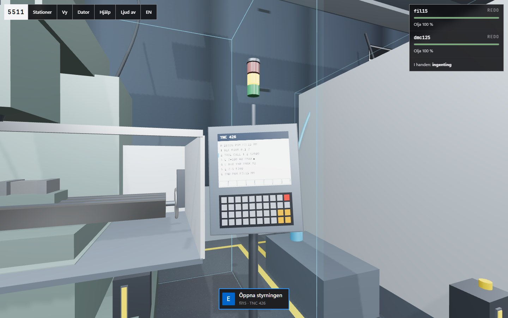

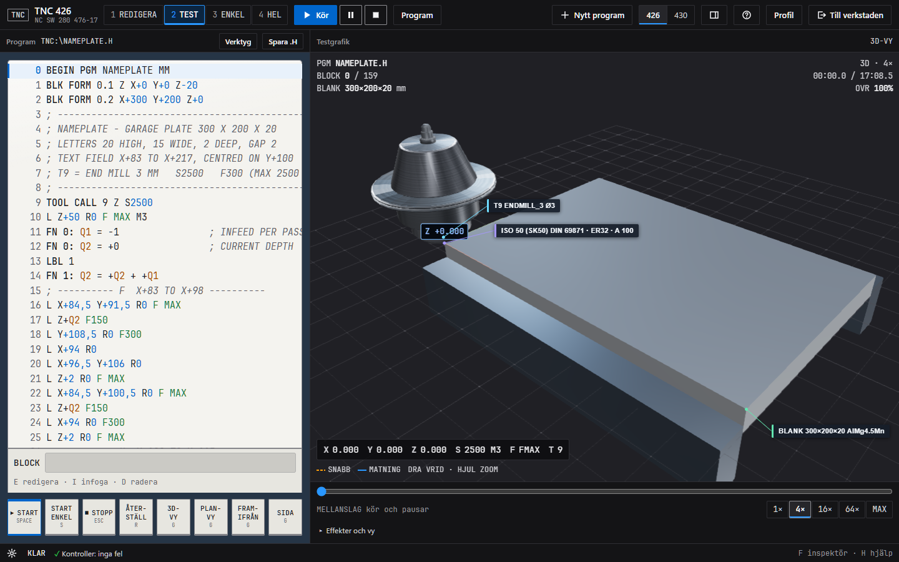

### Kretanje

| Taster ili pokret | Šta se dešava |
|---|---|
| `W` `S` ili `↑` `↓` | hodate napred i nazad |
| `A` `D` | koračate u stranu |
| `←` `→` | okrećete se levo i desno |
| SHIFT | hodate brže dok ga držite |
| klik u radionici | pokazivač se hvata, a vi gledate okolo pomeranjem miša |
| ESC | oslobađa pokazivač |
| prevlačenje mišem ili prstom | gledate okolo bez hvatanja pokazivača |
| `E` | radi ono što okvir na dnu predlaže za stvar koju gledate |

Strelice su dovoljne da se krećete bez miša. Na okvir na dnu može i da se klikne.

**Na telefonu i tabletu.** Na ekranu osetljivom na dodir, dok hodate sami, dole levo se vidi okrugla ploča za hodanje. Gurnite dugme u smeru u kome želite da idete; što dalje, to brže. Osvrćete se prevlačenjem drugim prstom bilo gde po podu. Ploča nestaje dok je otvorena neka tabla. Sve što ona radi može i iz liste Stanice.

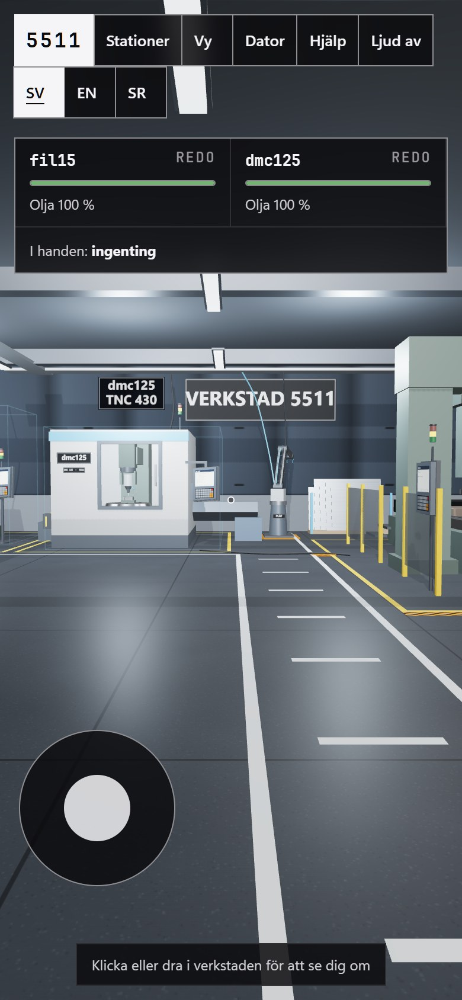

**Samo tastatura.** Ceo put radi bez miša: ENTER na START, TAB do Stanice, ENTER na **Otvori upravljanje**, TAB do **U radionicu**, TAB do Računar i nekog podešavanja tamo, ESC za zatvaranje. Ono što ima fokus ima vidljiv okvir.

### Red gore levo

| Dugme | Šta radi |
|---|---|
| Stanice | otvara listu svega što može da se uradi |
| Pogled | menja kameru: Hodaj sam, Cela radionica, Oko mašine, POV rezanja, Alat izbliza, Gotov komad |
| Računar | otvara radionički računar |
| Pomoć | ponovo prikazuje uvod |
| Ugasi zvuk / Upali zvuk | isključuje i uključuje zvuk |
| SV, EN, SR | odmah menjaju jezik: švedski, engleski ili srpski |

Poslednja tri pogleda su kamere samog simulatora, pa otvaraju upravljanje na mašini.

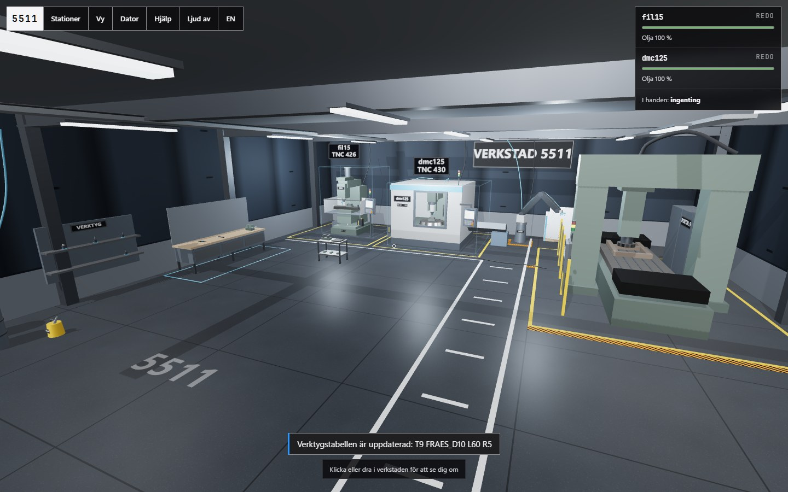

### Stanice

Sve što može da se uradi u 3D prostoru može da se uradi i iz liste Stanice, bez hodanja. Svaka stanica ima svoju dugmad i dugme **Idi tamo** koje vas postavlja ispred nje. Za mašine lista prikazuje i stanje, nivo ulja i alat u vretenu.

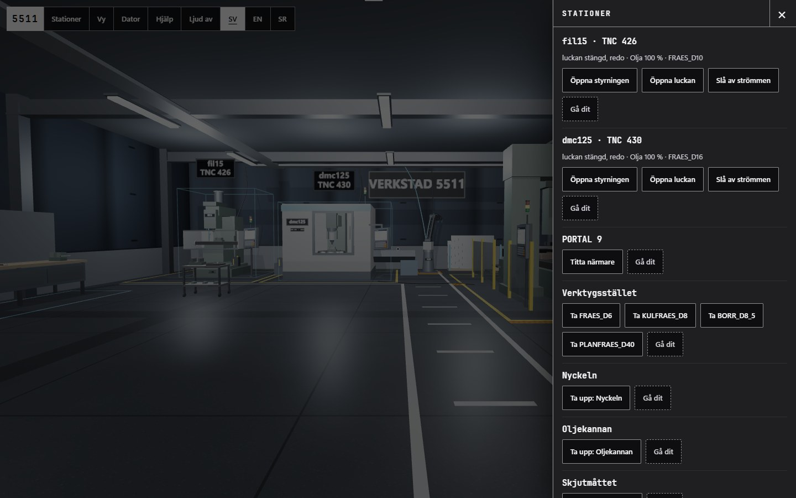

Stanice su dve mašine, PORTAL 9, stalak za alat, ključ, kantica za ulje, šubler, radionički računar, ormar i limena ruka.

U ruci možete da nosite jednu stvar (ključ, kanticu za ulje ili šubler) i uz to jedan alat sa stalka. Okvir gore desno pokazuje šta držite, pod **U ruci**.

### Okvir gore desno

Za svaku mašinu prikazuje stanje i merač ulja.

| Stanje | Znači |
|---|---|
| SPREMNA | mašina može da se pokrene |
| RADI | na mašini radi program |
| BLOKIRANA | vrata su otvorena, mašina je zaključana, zamena alata je u toku ili je ulje potrošeno |
| BEZ STRUJE | napajanje je isključeno |

### Zamena alata

Zamena alata se radi utvrđenim redom. Ako neki korak uradite prerano, radionica odgovara `Ne još. Idi redom, korak po korak.` Ako program radi, odgovara `Ne. Mašina radi. Prvo zaustavi program.`

1. Uzmite **Ključ** (dugme **Uzmi**). Nalazi se na tezgi.
2. Kod mašine: **Otvori vrata**.
3. **Zaustavi i zaključaj mašinu**. Program koji radi se zaustavlja.
4. **Otpusti alat**. Za ovo vam treba ključ u ruci.
5. **Izvadi alat**. Sada ga nosite.
6. Kod stalka za alat: **Vrati alat na stalak** i uzmite drugi, na primer **Uzmi FRAES_D6**.
7. Kod mašine: **Stavi alat**.
8. **Stegni alat**. Za ovo vam ponovo treba ključ.
9. **Otključaj mašinu** i **Zatvori vrata**.

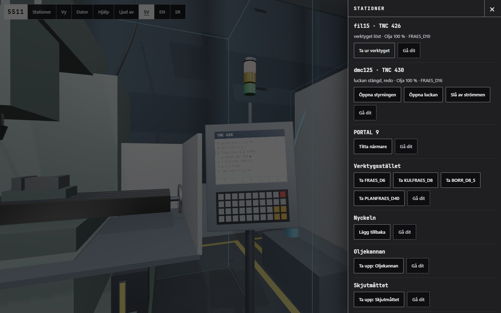

Kada stegnete alat, njegovo ime, dužina i radijus upisuju se u tabelu alata simulatora, na mesto alata koji je trenutno aktivan u simulatoru. Radionica potvrđuje, na primer:

```
Tabela alata je ažurirana: T9 FRAES_D10 L60 R5
```

Dok su vrata otvorena, mašina zaključana ili vreteno prazno, program ne može da se pokrene. Simulator tada prikazuje **ZAKLJUČANO** i razlog, na primer `Vrata su otvorena` ili `Izmena alata je u toku`.

Stalak za alat ima šest alata. Vrednosti su izmišljene za radionicu i ne potiču ni iz jednog kataloga.

| Alat | L (mm) | R (mm) |
|---|---|---|
| `FRAES_D6` | 50 | 3 |
| `FRAES_D10` | 60 | 5 |
| `FRAES_D16` | 75 | 8 |
| `KULFRAES_D8` | 60 | 4 |
| `BORR_D8_5` | 90 | 4,25 |
| `PLANFRAES_D40` | 45 | 20 |

Na početku je `FRAES_D10` u mašini `fil15`, a `FRAES_D16` u mašini `dmc125`. Alat koji je u vretenu ne može da se uzme sa stalka.

### Napajanje

**Isključi struju** i **Uključi struju** nalaze se kod svake mašine. Napajanje ne može da se isključi dok program radi. Kada je napajanje isključeno, program ne može da se pokrene, a simulator prikazuje `Mašina je bez struje`.

### Ulje i servisni merač

Svaka mašina ima merač ulja koji ide od 100 % do 0 %.

- Ulje opada samo dok mašina zaista reže, i to 2 procentna poena u minuti. Pun rezervoar zato traje 50 minuta rezanja. Vreme dok stojite, uređujete ili je kartica pregledača skrivena ne računa se.
- Na 20 % merač prikazuje **MALO**, a radionica kaže `Ulje je pri kraju. Donesi kanticu.`
- Na 0 % merač prikazuje **PRAZNO**. Program koji radi se zaustavlja, a mašina se ne pokreće dok ne dolijete ulje.
- Dolivanje: uzmite **Kanticu za ulje**, idite do mašine i izaberite **Dolij ulje**. Merač se vraća na 100 %.

### Merenje obratka

Uzmite **Šubler** i izaberite **Izmeri komad** kod mašine sa zatvorenim vratima. Upravljanje se otvara sa kamerom simulatora na komadu i sa Inspektorom otvorenim na tabli **Poređenje**. Tu su mere iz rada (vreme ciklusa, put u pomaku, put u brzom hodu, kretanja, najniži Z i skinuta zapremina), a sa **Sačuvaj rad kao referencu A** poredite dva rada, vidite [Pokretanje programa](#pokretanje-programa).

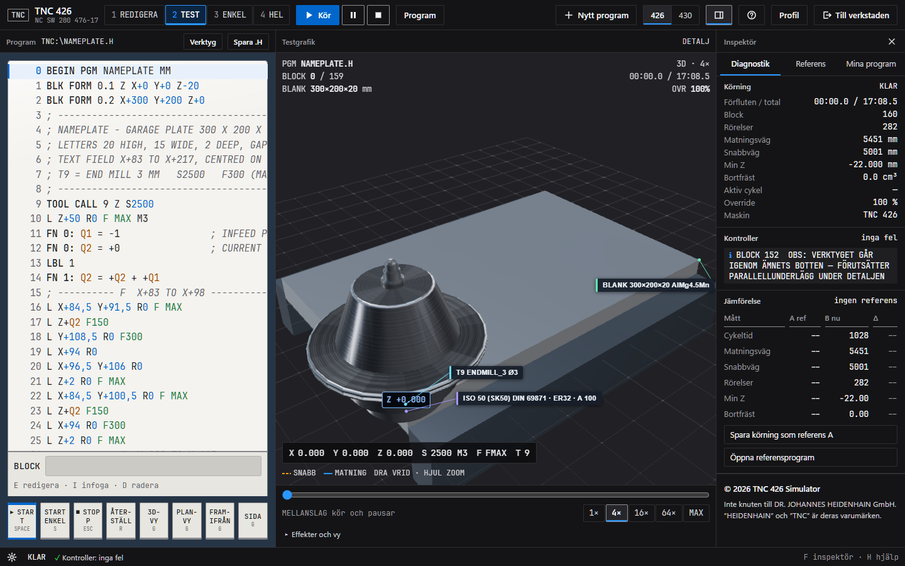

### Radionički računar

Otvorite ga dugmetom Računar, ili mu priđite i pritisnite `E`.

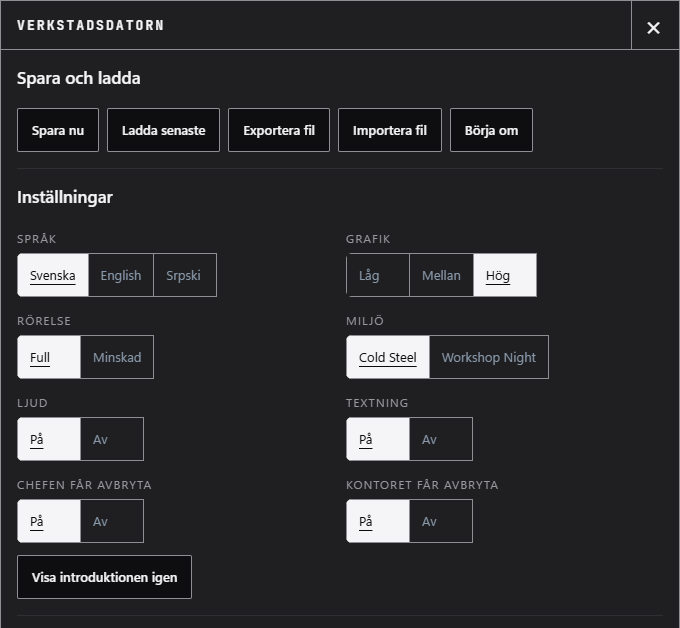

**Čuvanje i učitavanje.** Igra se sama čuva u pregledaču svaki put kada se nešto promeni.

| Dugme | Šta radi |
|---|---|
| Sačuvaj sad | odmah čuva stanje |
| Učitaj poslednje | vraća na poslednje sačuvano stanje |
| Izvezi fajl | preuzima stanje kao datoteku `tnc-5511-save.json` |
| Uvezi fajl | učitava takvu datoteku; neispravna datoteka daje `Ovaj fajl nije ispravna sačuvana igra.` |
| Kreni ispočetka | vraća radionicu na početak: puno ulje, uključeno napajanje, prvobitni alati |

Čuva se nivo ulja, napajanje i alat u vretenu svake mašine, ono što držite u ruci i skrivena iznenađenja koja ste pronašli. Mesto na kome stojite se ne čuva. Mašina koja je sačuvana sa praznim vretenom vraća se otvorena i zaključana, u čekanju na alat. Vaši programi pripadaju profilu simulatora i čuvaju se tamo.

**Podešavanja.** Jezik (Svenska, English, Srpski), Grafika (Niska, Srednja, Visoka), Kretanje (Puno, Smanjeno), Okruženje (Cold Steel, Workshop Night), Zvuk, Titlovi i dva lika. Jezik, grafika, kretanje, okruženje i zvuk dele se sa simulatorom. Decimalni znak se podešava u podešavanjima samog simulatora. **Prikaži uvod ponovo** ponovo otvara tri koraka uvoda.

**Tajne.** Računar vodi listu skrivenih iznenađenja. Ono što ste pronašli možete da otvorite odatle. Ostalo tražite sami.

### Likovi

Dok ste u radionici mogu da naiđu dva lika: **Šef** i **Kancelarija**. Kažu nekoliko rečenica i odu.

- Dolaze najviše jednom u pet minuta aktivnog vremena i smenjuju se.
- Nikada ne dolaze tokom uvoda, dok je otvorena neka tabla, dok ste kod upravljanja ili dok simulator prikazuje grešku.
- **Dalje** (ili ENTER) prelazi na sledeću rečenicu. **Preskoči** (ili ESC) završava posetu.

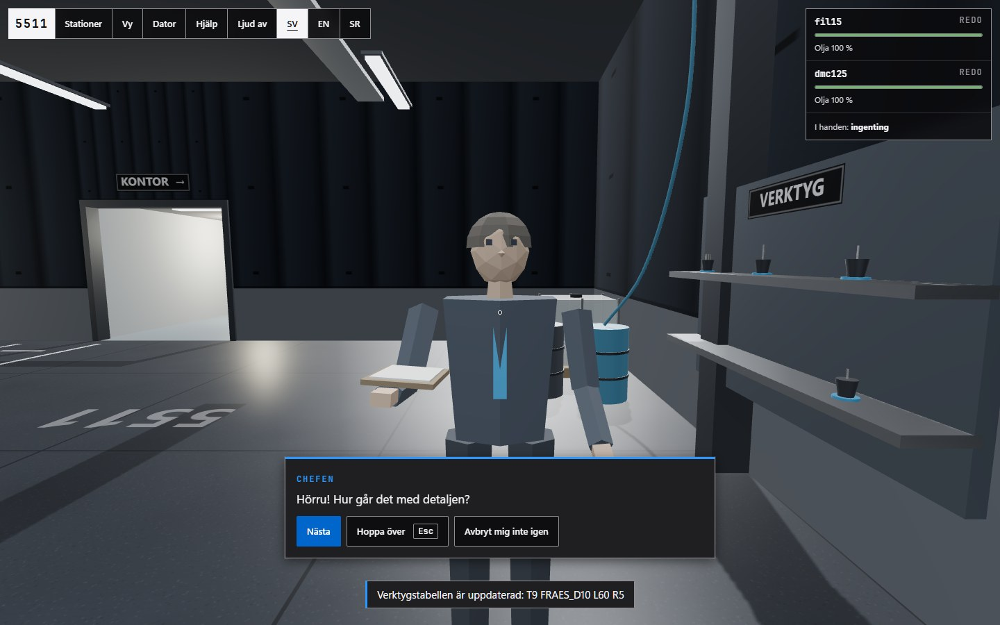

Kako da ih isključite:

| Želite | Uradite ovo |
|---|---|
| da isključite lik koji upravo govori | pritisnite **Ne prekidaj me više** u njegovom okviru |
| da isključite šefa | Računar, Podešavanja, **Šef sme da prekida**: Ne |
| da isključite kancelariju | Računar, Podešavanja, **Kancelarija sme da prekida**: Ne |
| da ih ponovo uključite | isti prekidač: Da |

### Titlovi i zvuk

- **Titlovi** određuje da li se rečenice likova prikazuju kao tekst. Kada je Titlovi na Ne, umesto rečenice se prikazuje `(titlovi isključeni)`. Uključeno je od početka.
- **Ugasi zvuk** u redu gore levo, ili Zvuk u računaru, isključuje zvučne signale simulatora za sudare i upozorenja. Pozadinski film na početnoj strani nema zvuk.

### Skrivena iznenađenja

U radionici ima skrivenih iznenađenja (Easter eggs). Razgledajte. Radionički računar pamti koja ste pronašli.

### Sopstveni sadržaj

Ko postavlja sopstveno izdanje Play može da doda kratku scenu sa dva lika u datoteci sa podacima, bez ponovne izgradnje. Format je opisan u [web/src/play/pack/README.md](../web/src/play/pack/README.md).

## Izgled

Izgled nikada ne menja način na koji se program izvršava. Sastoji se od dva nezavisna izbora koja pravite pod zupčanikom, na kartici Izgled.


### Upravljanje

| Izbor | Kako izgleda |
|---|---|
| **Prati mašinu** (podrazumevano) | 426 Classic kada je izabran TNC 426, 430 Steel kada je izabran TNC 430 |
| **426 Classic** | program levo, debeo okvir, red bloka ispod ekrana, osam četvrtastih svetlih funkcijskih tastera |
| **430 Steel** | 3D prikaz levo, tanak čelični okvir, red bloka iznad belog ekrana, ravni tasteri u dve grupe po četiri |

Oba izgleda su sopstveni crteži, a ne kopije panela pravih upravljanja.

### Okruženje

| Izbor | Kako izgleda |
|---|---|
| **Cold Steel** (podrazumevano) | hladna, plavosiva 3D pozadina |
| **Workshop Night** | mračna radionica sa toplijim svetlom |

Okruženje se odnosi na 3D scenu i okvir oko nje. U izdanju Play isti izbor važi i za radionicu.


## Podešavanja

Podešavanja otvarate zupčanikom dole levo ili tasterom `,`. Na telefonu su pod Meni. Podešavanja se čuvaju u pregledaču i važe odmah. Dele ih datoteka simulatora, Business i Play kada su na istoj adresi. Ako nedostaju, ili je neka vrednost oštećena, koristi se podrazumevana vrednost.

### Jezik

Interfejs postoji na tri jezika: **Svenska** (podrazumevano), **English** i **Srpski** (srpski, latinica). Prikazuje se jedan jezik odjednom. CNC reči kao što je `TOOL CALL`, tekst programa i poruke o greškama interpretera nikada se ne prevode.

| Gde | Kako se menja |
|---|---|
| Simulator, Business | zupčanik ili `,`, kartica Opšte, **Jezik** |
| Uvodna kartica pri prvoj poseti | korak 1 od 4 |
| Play, početna strana | dugmad Svenska, English, Srpski gore desno |
| Play, radionica | dugmad SV, EN, SR u redu gore levo |
| Play, radionički računar | Podešavanja, **Jezik** |

Izbor se čuva u pregledaču i dele ga datoteka simulatora, Business i Play kada su na istoj adresi. Kada promenite jezik u radionici, upravljanje menja jezik u isto vreme.


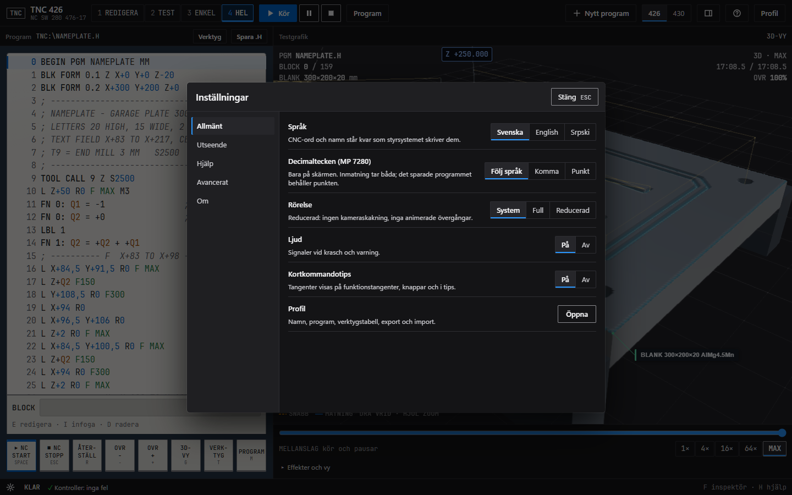

### Opšte

| Podešavanje | Podrazumevano | Značenje |
|---|---|---|
| Jezik | Svenska | Svenska, English ili Srpski, vidite [Jezik](#jezik). |
| Decimalni znak (MP 7280) | Prati jezik | Prati jezik, Zarez ili Tačka. Važi samo za ekran: unos prima i zarez i tačku, a sačuvani program uvek zadržava tačku. Vidite [Polarni blokovi](#polarni-blokovi-lp-sa-pr-i-pa). |
| Pokret | Sistem | Sistem prati podešavanje računara za smanjeno kretanje. Smanjen uklanja trešenje kamere i animirane prelaze. |
| Zvuk | Uklj. | Zvučni signali pri sudaru i upozorenju. |
| Prečice | Uklj. | Prikazuje taster na funkcijskim tasterima, dugmadima i u opisima. |
| Profil | | Otvara profil: ime, programi, tabela alata, izvoz i uvoz. |

### Izgled

| Podešavanje | Podrazumevano | Značenje |
|---|---|---|
| Upravljanje | Prati mašinu | Vidite [Izgled](#izgled). |
| Okruženje | Cold Steel | Vidite [Izgled](#izgled). |
| Grafika | Visoka | Niska, Srednja ili Visoka. Niža vrednost radi brže na slabim grafičkim karticama. |

### Pomoć, Napredno i O programu

| Podešavanje | Značenje |
|---|---|
| Pomoć i lekcije | Otvara fioku pomoći. |
| Prečice | Prikazuje sve tastere. |
| Uvod | Ponovo prikazuje uvodnu karticu: jezik, upravljanje, pokret i grafika, prvi program. |
| Vrati pomoć | Ponovo prikazuje uvod i briše evidenciju završenih lekcija. |
| Razvojni dnevnik | Dnevnik funkcija i istorija verzija, za one koji razvijaju simulator. |
| Dijagnostika | Podaci o izdanju, mašini i pregledaču koje možete da kopirate u prijavu greške. |
| O programu | Licenca i napomena da simulator nije povezan sa kompanijom HEIDENHAIN. |

Play ima iste izbore za jezik, grafiku, kretanje, okruženje i zvuk u radioničkom računaru, a uz to Titlovi i dva lika, vidite [Radionički računar](#radionički-računar).

## Prečice na tastaturi

Prečice važe u radnom prostoru mašine dok nijedno polje za tekst nema fokus. U izdanju Play važe dok je upravljanje otvoreno.

### Izvršavanje i prikaz

| Taster | Šta radi |
|---|---|
| RAZMAK | NC START, ili pauza ako program radi |
| ENTER | izvršava jedan blok; u režimu PRG IZMENA uređuje blok |
| `S` | izvršava jedan blok |
| `R` | zaustavlja i vraća na početak |
| ESC | pauzira; zatvara alarm, dijalog ili tablu |
| `←` `→` | kreće se nazad i napred kroz izvršavanje; sa SHIFT pet puta dalje |
| `5` do `9` | brzina 1×, 4×, 16×, 64×, MAX |
| `+` `-` | korekcija pomaka naviše i naniže u koracima od 10 % |
| `G` | menja prikaz: 3D, odozgo, spreda, sa strane |
| `V` | prikazuje program kao dijagram toka |
| `P` `K` `B` | strugotina, emulzija, dim |
| `L` | oznake u 3D prikazu |

### Režimi i table

| Taster | Šta radi |
|---|---|
| `1` do `4`, ili `F1` do `F4` | režim rada: PRG IZMENA, TEST, BLOK PO BLOK, CEO PROGRAM |
| `F` | otvara i zatvara Inspektor |
| `T` | tabela alata |
| `M` | lista programa |
| `N` | novi program |
| `H` | pomoć i lekcije |
| `,` | podešavanja |

### Uređivanje

| Taster | Šta radi |
|---|---|
| `↑` `↓` | pomera kursor bloka |
| HOME, END | prvi i poslednji blok |
| PGUP, PGDN | dvanaest blokova gore i dole |
| `E` | uređuje blok |
| `I` | umeće blok |
| `D` ili DELETE | briše blok |
| `C` | kopira blok |
| TAB | sirovi tekst, dok nijedno dugme nema fokus |
| `F2` | prebacuje između dijaloga i teksta dok uređujete blok |
| `Ctrl+Z` | poništava |
| `Ctrl+Shift+Z` ili `Ctrl+Y` | ponavlja |
| `Ctrl+S` | čuva kao `.H` |
| `Ctrl+O` | učitava datoteku |

### Samo u režimu PRG IZMENA

| Taster | Šta radi |
|---|---|
| `Y` | `CYCL DEF` |
| `W` | `TOOL CALL` |
| `A` | `APPR` i `DEP` |
| `Q` | Q parametar |

Tasteri unutar pitanja navedeni su pod [Vođeni unos bloka](#vođeni-unos-bloka). Tasteri u radionici navedeni su pod [Kretanje](#kretanje).

### Samo tastatura

Do svega u radnom prostoru mašine može da se dođe bez miša.

- TAB i SHIFT+TAB pomeraju fokus između dugmadi, kartica i polja. Ono što ima fokus ima vidljiv okvir.
- Prvi TAB na strani daje link **Na program**, koji preskače gornju traku.
- ENTER ili RAZMAK pritiska dugme koje ima fokus. Prečice nikada ne uzimaju te tastere dugmetu sa fokusom, niti slova koja kucate u polje.
- U redu sa karticama (režimi rada, Inspektor, Pomoć, Podešavanja) strelice menjaju karticu.
- Dijalog zadržava fokus dok ga ne zatvorite. ESC ga zatvara, a fokus se vraća na dugme koje ga je otvorilo.
- Na kartici AI strelice biraju model, a fokus prelazi na **Otkaži** kada posao krene i na **Učitaj** kada se završi.

## Bez servera i bez ključa

Simulator je napravljen da radi samostalno. Tabela pokazuje šta zahteva više.

| Funkcija | Datoteka simulatora ili izdanje, bez servera | Zahteva server | Zahteva AI ključ |
|---|---|---|---|
| Pisanje, izvršavanje i provera programa | da | | |
| Obe mašine, svi ciklusi koji se simuliraju | da | | |
| Vođeni unos, sirovi tekst, poništavanje | da | | |
| Čuvanje i učitavanje `.H`, `.zip`, `TOOL.T` | da | | |
| Profil, projekti, izvoz i uvoz | da | | |
| Pokazni programi i lekcije | da | | |
| Upravljanje, okruženje, jezik, podešavanja | da | | |
| Play: radionica, zamena alata, ulje, likovi, sačuvana igra | da | | |
| Biblioteka programa sa verzijama | | da | |
| Tabele alata na serveru | | da | |
| Nalozi i korisnici | | da | |
| Deljenje programa linkom | | da | |
| Pisanje programa pomoću AI | | da | da, na serveru |

Kada nemate server, važi sledeće:

- Sve što sačuvate nalazi se u pregledaču koji koristite. Drugi pregledač ili računar to ne vidi dok ne izvezete profil i ne uvezete ga tamo.
- Meni (☰) sa bibliotekom i nalogom ne prikazuje se u izdanju Business.
- Kartica AI u dijalogu Novi program prikazuje jedan red o tome da AI zahteva server. Kartica Ručno radi kao i obično.
- Datoteci simulatora internet uopšte nije potreban. Izdanja treba samo da dosegnu mesto na kome se sama nalaze.
- Film na početnoj strani izdanja Play postoji samo ako su datoteke filma deo izgradnje. Bez njih se prikazuje nacrtana mreža.

## Rešavanje problema

### `REŽIM PROGRAMIRANJA — NC START RADI U 2 TEST, 3 BLOK PO BLOK, 4 CEO PROGRAM`

Pritisnuli ste Pokreni u režimu PRG IZMENA, u kome se ništa ne izvršava. Pritisnite `2`, `3` ili `4`, a zatim RAZMAK.

### `NEMA KRETANJA ZA IZVRŠENJE`

Program nema kretanja, na primer zato što ima samo `BEGIN PGM` i `END PGM`, ili zato što ga greška zaustavlja pre prvog kretanja. Otvorite Inspektor tasterom `F` i pročitajte provere.

### ZAKLJUČANO, a program se ne pokreće (Play)

Radionica blokira pokretanje. Razlog stoji posle reči ZAKLJUČANO.

| Razlog | Uradite ovo |
|---|---|
| `Mašina je bez struje` | idite do mašine i izaberite Uključi struju |
| `Nema ulja: dolij ga u radionici` | uzmite kanticu za ulje i izaberite Dolij ulje kod mašine |
| `Vrata su otvorena` | izaberite Zatvori vrata |
| `Mašina je zaustavljena i zaključana u radionici` | izaberite Otključaj mašinu, a zatim Zatvori vrata |
| `Izmena alata je u toku` | završite zamenu alata, vidite [Zamena alata](#zamena-alata) |

### `Ne još. Idi redom, korak po korak.` (Play)

Korak ne odgovara stanju u kome je mašina. Otvorite Stanice: tamo su prikazani samo koraci koji su trenutno mogući.

### `Treba ti ključ. Na tezgi je.` (Play)

Za otpuštanje i stezanje alata potreban je ključ u ruci. Uzmite ga u listi Stanice ili na tezgi.

### `Simulator još ne odgovara na poruke iz radionice` (Play)

Radionica i simulator nisu uspostavili vezu, pa izbor mašine, blokada i zamena alata ne stižu do simulatora. Ponovo učitajte stranu. Ako se ponovi, datoteka simulatora u izgradnji je starija od radionice: ponovo izgradite izdanje sa `npm run build:play`.

### Radni prostor mašine je prazan, ili `index.html missing: run python build.py in the repo root`

Izdanje ne nalazi datoteku simulatora. Pokrenite `python build.py` u korenu projekta i ponovo pokrenite izdanje.

### `The TNC server does not answer at /api/v1. The library, tool tables and accounts need it.`

Otvorili ste biblioteku, tabele alata ili nalog, a server ne radi. Pokrenite server, ili izaberite **Open the machine** da se vratite u radni prostor mašine, koji radi bez servera. Ova strana postoji samo na engleskom.

### `AI zahteva lokalni ili hostovani server. Ručno pravljenje radi kao i obično.`

Strana nema server iza sebe, pa kartica AI nema kome da šalje. To važi za datoteku simulatora `index.html` i za izdanje na običnom veb-sajtu. Pokrenite server ili koristite desktop aplikaciju, vidite [AI programi i AI ključ](#ai-programi-i-ai-ključ).

### `Nijedan OpenRouter ključ nije sačuvan. Unesite ključ na vrhu.`

Server nema OpenRouter ključ. Administrator ga upisuje u polje na vrhu kartice AI, vidite [Ključ](#ključ). Ostale poruke kartice navedene su pod [Poruke o greškama na kartici AI](#poruke-o-greškama-na-kartici-ai).

### `CYCLE n NOT IMPLEMENTED IN SIMULATOR` ili `TCH PROBE n NOT IMPLEMENTED IN SIMULATOR`

Program poziva ciklus ili merni ciklus koji simulator ne izvršava, vidite [listu](#šta-se-simulira-a-šta-ne). Upravljanje bi ga izvršilo; simulator tu staje. Zamenite ciklus izričitim kretanjima da biste testirali ostatak programa.

### `CYCLE n NEEDS A ROTARY TABLE`

Ciklusi 27 i 28 rade na omotaču cilindra i zahtevaju obrtni sto. Nijedna od dve mašine u simulatoru ga nema.

### `CYCLE n NOT ON TNC 426/430`

Broj ciklusa pripada novijem upravljanju i ne postoji na TNC 426 ni na TNC 430.

### `FK NOT SIMULATED`

Blok koristi slobodno programiranje konture FK (`FPOL`, `FL`, `FLT`, `FC`, `FCT`, `FSELECT`), koje simulator ne računa. Napišite konturu sa `L`, `C`, `CC`, `CR` i `CT`.

### `OVAJ BLOK NEMA DIJALOG — IZMENITE GA KAO TEKST`

Pritisnuli ste `F2` na bloku koji nema dijalog. Izmenite ga kao tekst u redu bloka.

### Vreme ciklusa je kraće nego na mašini

Simulator ne računa zadrške, zamene alata ni ubrzanje. Koristite vreme za poređenje dve verzije programa, a ne kao procenu za mašinu.

### Pogrešno upisan broj alata se ne prijavljuje

Kada se program učita, prave se alati kojih nema u tabeli alata. Otvorite tabelu tasterom `T` i pregledajte listu posle učitavanja.

### Moji programi su nestali

Programi se čuvaju u pregledaču, za adresu koju strana ima. Ne vide se u drugom pregledaču, u privatnom prozoru ili ako je strana dobila drugu adresu ili port. Otvorite stranu na istoj adresi kao ranije. Ako su podaci pregledača obrisani, programi se mogu vratiti samo iz izvezenog profila.

### Grafika je spora

Izaberite Grafika: Niska i Pokret: Smanjen u podešavanjima. U izdanju Play isti izbori su u radioničkom računaru.

### Windows ili macOS upozorava pri instalaciji desktop aplikacije

Instalacioni programi nisu potpisani. Na Windows sistemu izaberite **More info**, a zatim **Run anyway**; na macOS sistemu kliknite desnim tasterom na aplikaciju i izaberite **Open**.

## Šta se simulira, a šta ne

### Simulira se

- Prave linije, kružni lukovi, polarna kretanja i zavojnice.
- Korekcija radijusa (`RL`, `RR`), zaobljavanje uglova (`RND`) i obaranje ivica (`CHF`), prilaz i odlazak (`APPR`, `DEP`).
- Q parametri sa formulama i skokovima, potprogrami i ponavljanja delova programa.
- Tabela alata i pozivi alata.
- Dve mašine: TNC 426 sa X, Y i Z, i TNC 430 koja uz to ima zakretnu glavu u A i B i ciklus 19.
- Stega u koju alat i držač mogu da udare.
- Materijal skinut sa pripremka i skinuta zapremina.
- Sopstvene bezbednosne provere simulatora: brzi hod u materijal, rezanje sa zaustavljenim vretenom, alat ispod dna pripremka, veliko opterećenje po zubu.

Ciklusi sa sopstvenim kretanjem: 1, 2, 3, 4, 5, 17, 18, 21–25 (SL ciklusi), 200–215, 230, 231 i 262–265, 267 (glodanje navoja), kao i šabloni 220 i 221. Ciklus 12 poziva program.

Ciklusi koji nešto podešavaju bez sopstvenog kretanja: 7, 8, 9, 10, 11, 14, 19, 20, 26, 32 i 247.

Merni ciklusi: 400, 403, 408–413, 415, 417 i 419 se kreću. Ciklusi za merenje alata 30–33, 480–483 i 562 prihvataju se bez kretanja.

### Ne simulira se

- Ciklus 13 daje `CYCLE 13 NOT IMPLEMENTED IN SIMULATOR`. Ciklusi 27 i 28 daju `CYCLE n NEEDS A ROTARY TABLE`. Drugi merni ciklusi daju `TCH PROBE n NOT IMPLEMENTED IN SIMULATOR`.
- Slobodno programiranje konture FK: blokovi `FPOL`, `FL`, `FLT`, `FC`, `FCT` i `FSELECT` daju `FK NOT SIMULATED`.
- Podrezivanja. Materijal se čuva kao jedna visina po tački, pa alat skida samo ono preko čega prelazi duž svoje ose.
- `F AUTO` koristi pomak iz `TOOL CALL`. Programi u `INCH` se ne preračunavaju; pišite u milimetrima.
- `M128` i `M114`.
- Korekcija radijusa u nagnutoj radnoj ravni na TNC 430 je približna.
- Vreme ciklusa ne računa zadrške, zamene alata ni ubrzanje, pa je kraće nego na pravoj mašini.
- Rashladna tečnost je slika. `M8` i `M9` uključuju i isključuju mlaz, ali model tečnosti ne postoji.
- Radionica u izdanju Play je igra. Ulje, napajanje, vrata i zamena alata utiču samo na to da li program sme da se pokrene i šta piše u tabeli alata. Mašine `fil15`, `dmc125` i PORTAL 9 su izmišljene.

### Sopstveni izbori simulatora

- Tamo gde priručnik upravljanja ne prikazuje putanju alata (delovi SL ciklusa 21–24, glodanje navoja i merenje), putanja je sopstveni izbor simulatora. Otvorene tačke navedene su u [CONTINUE.md](../CONTINUE.md) pod "Open placeholders".
- Oblik bloka na ekranu, sa `F MAX` i decimalnim zarezom, nije upoređen sa pravim upravljanjem.
- Švedski i srpski tekstovi interfejsa su sopstveni tekstovi simulatora i nisu zvanični dijaloški tekstovi upravljanja.
- Mere stege su uobičajena standardna veličina, a ne izmerena stega.
- Nijedno pravo upravljanje i nijedna programerska stanica nisu proverili simulator.

## Referenca

### Gde se šta čuva

Sve navedeno nalazi se u pregledaču, za adresu koju strana ima.

| Šta | Gde |
|---|---|
| Programi, projekti i tabela alata (profil) | baza podataka pregledača za stranu |
| Jezik, decimalni znak, upravljanje, okruženje, grafika, pokret, zvuk | `tnc.settings.v1` |
| Izabrani AI model | `tnc.aigen.model` |
| Materijal pripremka; vektori osa i klik za tačku | `tnc426.material`, `tnc.viz` |
| Stanje Inspektora i izabrana mašina, po izdanju | `tnc.edition.business.v1`, `tnc.edition.play.v1` |
| Play: titlovi, likovi, da li je uvod prikazan | `tnc.edition.play.v1` |
| Play: sačuvana igra | `tnc.play.save.v1` |
| Završene lekcije | `tnc.lessons.v1` |

Na serveru se baza podataka `tnc.db` i, ako je ključ sačuvan, datoteka `openrouter.key` nalaze u fascikli sa podacima servera (`TNC_DATA_DIR`; u desktop aplikaciji sistemska fascikla za podatke aplikacija). OpenRouter ključ nikada nije u pregledaču.

### Za programere

```sh
npm ci                     # alati za izgradnju i testiranje
npm --prefix web ci        # zavisnosti veb-dela
python build.py            # gradi index.html iz fascikle sim
python build.py --wasm     # prvo ponovo gradi motor iz Rust koda (zahteva rustup cilj wasm32-unknown-unknown)
npm run test:manual        # primeri i pravila iz priručnika upravljanja
npm run test:ui            # testovi simulatora u pregledaču
npm run test:play          # pravila Play igre
npm run test:e2e           # oba izdanja u pregledaču; prvo ih izgradite
npm run render:hero        # ponovo renderuje film početne strane izdanja Play
```

Svi testovi navedeni su u [CLAUDE.md](../CLAUDE.md#tests). Nijedan test ne zahteva AI ključ.

| Putanja | Šta je |
|---|---|
| `server/crates/tnc-core` | motor: interpreter, ciklusi, provere i model materijala |
| `sim/` | interfejs simulatora; `build.py` ga sklapa u `index.html` |
| `web/` | veb-strane izdanja; `web/src/play/` je radionica |
| `server/` | server |
| `desktop/` | desktop aplikacija |
| `examples/showcase/` | šesnaest pokaznih programa |
| `media/landing-hyperframes/` | izvor filma početne strane, vidite [njegov README](../media/landing-hyperframes/README.md) |
| `tests/` | svi testovi |
| [CONTINUE.md](../CONTINUE.md) | lista zadataka |

## Licenca

MIT, vidite [LICENSE](../LICENSE). Kod trećih strana naveden je u [THIRD_PARTY_NOTICES.md](../THIRD_PARTY_NOTICES.md). "HEIDENHAIN" i "TNC" su zaštićeni znaci kompanije DR. JOHANNES HEIDENHAIN GmbH.
